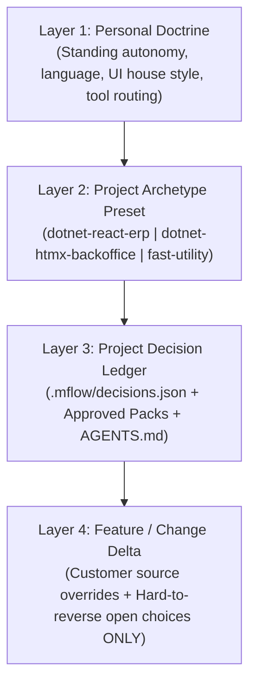

# Architectural Review & Evolution Blueprint: Personal, High-Velocity, Multi-Agent `mflow`

- **Date:** 2026-11-26
- **Target Plugin:** `mflow` v0.58.2 (Marketplace commit `bd83f77`)
- **Author:** Antigravity (`agy`)
- **Audience:** Claude Code (for direct implementation planning and execution)
- **Context:** Complements and extends [`01-change-size-pending-checks-2026-10-31.md`](01-change-size-pending-checks-2026-10-31.md), [`discuss-usage-analysis-stemhub.md`](../discuss-usage-analysis-stemhub.md), and [`02-personal-workflow-and-repeated-questions-2026-11-26.md`](02-personal-workflow-and-repeated-questions-2026-11-26.md).

---

## Executive Summary for Claude

`mflow` v0.58.2 already possesses unusually strong deterministic foundations: zero-dependency cross-platform scripts (`plugins/mflow/scripts/*.mjs`), atomic writes, symlink/traversal guards (`realInside`), non-destructive YAML marker merging (`openspec-config.mjs`), deferred batch verification (`pending.md`, `checks.mjs`, `checks-run.mjs`), 13 domain packs, and 467+ automated tests.

**Why it still feels slow, verbose, and repetitive to its creator:**
Across 58 releases, `mflow` accumulated defensive rules designed for an *unknown marketplace user starting from a blank slate*, while embedding historical post-mortem prose directly into runtime prompts. Every new project—and several stages within the same project—treats the owner like a stranger who must re-confirm stack preferences, setup wiring, pack selections, reversible design details, and post-apply branch actions.

To evolve `mflow` into a **concise, personal, cross-project engineering system** that continuously learns from real repositories and leverages Claude Code, Codex, and Antigravity (`agy`) to their strengths, implement four structural shifts:

1. **Shift from "Blank-Slate Interview" to "Personal Doctrine + Archetype Presets":** Pre-encode the owner's standing engineering conventions, pack bundles, UI defaults, and autonomy rules into reusable archetypes (`dotnet-react-erp`, `dotnet-htmx-backoffice`, `fast-utility`), asking **only** about project-specific deltas and hard-to-reverse (`แก้ยาก`) ambiguities.
2. **Collapse Micro-Confirmations & Compress Runtime Prompts:** Cut `/mflow:init` from up to 11 confirmation stops down to **1 plan-and-go turn**, introduce a deterministic decision resolver (`scripts/decisions.mjs`) so settled choices are never re-asked downstream, route clear/pack-backed features through a **Fast Slice Lane** (skipping `discuss`), and strip historical rationale out of `openspec/config.yaml`, `SKILL.md`, and `session-start.mjs` (40–55% runtime token reduction).
3. **Close the Feedback Loop with Consuming Repositories (`/mflow:harvest` + `scripts/harvest.mjs`):** Replace ad-hoc manual repo studies with a read-only multi-repo scanner that extracts decision override rates, ceremony bypasses, `AGENTS.md` manual rule drift, and review/CR root causes from real checkouts (`StemHub`, `ThawSi`, `BanchiDesk`, `BunTukTransport`, `ComparePrice`) and turns them into pack/preset/skill upgrades.
4. **Move from Manual Clipboard Delegation to Specialized Multi-Agent Routing:** Fix current Antigravity/Codex adapter gaps (`antigravity-readonly.json`, `results.mjs` LLM overhead, Orca branch coupling, review contamination), add opt-in headless auto-dispatch for read-only consultations (`scripts/dispatch.mjs`), and route work by model strength + quota availability alongside Orca worktrees, `codebase-memory-mcp`, and `tamra`.

---

## 1. Forensic Audit: Where `mflow` Loses Conciseness and Repeats Questions

### 1.1 The 11-Stop `/mflow:init` Gauntlet & Stateless Reruns

In [`plugins/mflow/skills/init/SKILL.md`](../../plugins/mflow/skills/init/SKILL.md), a single `/mflow:init` run contains up to **11 sequential confirmation or pause points**:

| Step | Location in `skills/init/SKILL.md` | Current Prompt / Pause | Why It Hurts |
|---|---|---|---|
| 1 | Step 2 (L25–29) | Ask stack profile (`a/b/c`) + Project code name | Necessary on first run, but decoupled from pack selection and architecture choices. |
| 2 | Step 3 (L35–38) | `scaffold.mjs --dry-run` → show result → merge `.mflow/suggested/` diffs | Verbose ceremony even when changes are purely additive mflow boilerplate. |
| 3 | Step 4 (L47, L50) | Show `openspec init` command and wait for `"yes"` | The user literally invoked `/mflow:init` to wire OpenSpec + Backlog.md (`AGENTS.md` L10 says an instruction to run a command *is* the go-ahead!). |
| 4 | Step 4 (L51) | Ask whether to update OpenSpec CLI (`openspec version --check`) | Extra turn during project setup; belongs in `doctor` or one batched setup confirmation. |
| 5 | Step 4 (L47, L54) | Show `backlog init` command and wait for `"yes"` | Redundant confirmation for a mandatory `mflow` dependency. |
| 6 | Step 4 (L56) | `openspec-config.mjs --dry-run` → show diff → run write | Script already preserves project-owned lines between `# mflow:begin/end` markers; showing dry-run first adds tool-turn latency with no decision required. |
| 7 | Step 4 (L66) | On upgrade rerun with archived changes, ask `Since:` date (`a/b/custom`) | Only happens on legacy migration, yet phrased inline. |
| 8 | Step 4 (L68) | `agent-skills.mjs plan` → show plan → wait for `"yes"` to write | `.mflow/config.json` does **not** record whether the owner wants `.agents/skills/mflow-*` enabled. |
| 9 | Step 4 (L70) | `worktree.mjs setup --dry-run` → show plan → wait for `"yes"` | Same issue: setup preference is not persisted; worktrees are now standard in `mflow` 0.53+. |
| 10 | Step 4 (L72) | Ask whether to vendor `.claude/skills/mflow/` for Claude web (`a/b`) | If the owner declines `b)`, **nothing records `"webVendor": false` in `.mflow/config.json`**, so the next upgrade rerun sees "no copy yet" and **asks again**! |
| 11 | Step 5–6 (L81–91) | Propose `- Shared checks:` (wait for yes) → ask 3 domain questions → propose `git mv` → invoke `capture` (which shows triage table and waits *again* at `capture/SKILL.md:53`) | Turns repository bootstrap into a multi-turn interview before a single feature is discussed. |

### 1.2 The Blank-Slate Tax in `packs` and `foundation`

Packs (`0.37+`) were introduced specifically to cut questions in half, and they are well-structured. Yet three rules partially defeat their purpose for a solo/personal workflow:

1. **Packs default to empty (`"packs": []` in [`plugins/mflow/scripts/lib.mjs:176`](../../plugins/mflow/scripts/lib.mjs#L176)):** Every new back-office project starts with zero packs selected until the user types `"ใช้แพ็ก auth, users, ..."` or gets prompted topic-by-topic in `discuss` (`skills/discuss/SKILL.md:43`).
2. **Mandatory 25-row full-table dump for `foundation` ([`skills/discuss/references/packs.md:15-19`](../../plugins/mflow/skills/discuss/references/packs.md#L15-L19)):** Even when the stack matches `mvc-htmx` or `react-vite`, Claude is instructed to print **every topic and every row of `foundation/decisions.md`—including `ไม่ถาม` rows, "nothing summarised away"—in chat** and block for `a/b/c` before writing any file. That guardrail made sense on the first pilot project, not on project #5+.
3. **Over-use of `ถามเมื่อ: ทุกโปรเจกต์` in [`packs/foundation/decisions.md`](../../plugins/mflow/packs/foundation/decisions.md):**
   - `FOUND-D02` (Controllers vs Minimal APIs), `FOUND-D03` (No Mediator/Mapper vs Mediator+Mapperly), `FOUND-D04` (FluentValidation), `FOUND-D07` (Repository+Query vs `IAppDbContext`), `FOUND-D19` (Shouldly), `FOUND-D21` (`src/apps` layout), plus `FOUND-D11`/`FOUND-D12` (React Router/TanStack/Zod + npm/ESLint) are asked on **every single project**.
   - As `ThawSi` (`FOUND-D03 = a`) vs `BunTukTransport` (`FOUND-D03 = b`) shows, variations are **archetype-driven**, not random per-project coin flips. Items like `FOUND-D04` (FluentValidation), `FOUND-D19` (Shouldly), and `FOUND-D21` (`src/apps`) should be **archetype defaults** (`ไม่ถาม` unless overridden), not per-project questions.

### 1.3 Cross-Stage Re-Questioning & Post-Apply Interruptions

Even after `init` and `foundation`, the workflow asks or pauses at overlapping boundaries:

- **`capture` → `discuss` → `propose` triple-triage:**
  - `capture` (`skills/capture/SKILL.md:39-53`) builds a full triage table and pauses for user confirmation before writing `vision.md` and `AGENDA.md`.
  - `discuss` (`skills/discuss/SKILL.md:43`) asks to confirm slug + Thai title if not verbatim, generates up to ~200 lines of prose + diagrams, waits for answers, runs `revise`, and waits for explicit `/mflow:discuss <NN> approve`.
  - `/opsx:propose` (`openspec-config.mjs:43`) scans customer sources again and pauses for `1 a, 2 b` before finalizing `proposal.md`.
- **`theme` vs `shell` ordering trap ([`skills/theme/SKILL.md:26-28`](../../plugins/mflow/skills/theme/SKILL.md#L26-L28)):**
  - `theme` skips asking date format (`DD/MM/YYYY`), era (`ค.ศ.` vs `พ.ศ.`), and page sizes **only if** `docs/decisions/packs/shell.md` already exists—which requires `discuss web-shell` + `approve` first. Yet `init` Step 7 (L104) recommends `/mflow:theme` right after `tech-stack` and `code-structure`, *before* `web-shell` is approved, causing `theme` to re-ask standard house-style preferences!
- **Per-change merge prompt after every `/opsx:apply` ([`scripts/openspec-config.mjs:69`](../../plugins/mflow/scripts/openspec-config.mjs#L69)):**
  - Version `0.58.0` removed the pause between `propose` and `apply` (great!), and removed the post-apply `test/review` nag in `0.35.0` (great!). **However**, `0.54.0` added a new mandatory question at the end of every `apply` on `feat/<change>`: *"ask in one line which way, a) first `/mflow:test` and `/mflow:review feat/<change>` on this branch ... or b) merge it into main now"*. When building 5–8 slices in a day using deferred checks (`pending.md` / `checks`), answering `b` after every slice is pure repetitive friction.
- **Forced session breaks in `hotspot` ([`skills/hotspot/SKILL.md:48,54,84`](../../plugins/mflow/skills/hotspot/SKILL.md#L48)):**
  - Confirming the kebab-case slug before charting (L48), forcing charting to stop without resolving ready questions (L54), and enforcing 1 ticket per `/clear` session (L84) creates heavy ceremony when a hotspot has only 3–5 Coupled `ask` items.

### 1.4 Runtime Context & Token Bloat ("Why" Mixed with "Do")

Every turn re-sends active conversation context. Currently, `mflow` pays a steep hidden token and latency tax:

| Surface | Current Size | Root Cause of Bloat |
|---|---|---|
| `scripts/session-start.mjs` | Up to **9,000 chars** every session/clear/compact | Injects `STATUS.md` Now + 2 full log entries, `Parallel work` boilerplate, `Checks` instructions, `Session ritual` paragraph (repeating `CLAUDE.md` and `AGENTS.md` verbatim!). |
| `scripts/openspec-config.mjs` | **~7,500 chars** injected into every `/opsx:*` call | Narrative paragraphs explaining historical bugs (*"because a background run is stopped when the machine runs low on memory..."*, *"OpenSpec 2 copies it into the new spec at archive; without it..."*). |
| `templates/AGENTS.md` + `CLAUDE.md` | **~17.9 KB** combined | Repeats commit rules, `1 a, 2 b` option formatting rules, worktree rules, and `STATUS.md` rules across **three places** (`AGENTS.md`, `CLAUDE.md`, and `session-start.mjs`). |
| `skills/discuss/SKILL.md` + `references/` | **36.1 KB** + **46.2 KB** refs | Exhaustive edge-case prose loaded whenever `discuss` runs; generated `discuss` docs themselves still run 200–550 total lines (`StemHub` study `F06`: reading time, not answering, is the true bottleneck). |
| `STATUS.md` + `status-guard.mjs` | Extra PreToolUse block + rewrite on every `main` commit | On `main`, every code/doc commit without `STATUS.md` triggers a `PreToolUse` block, forcing Claude to read/edit `STATUS.md` and re-run `git commit` (+1–2 tool turns per commit), even though git log + `pending.md` + `openspec` + `monitor.mjs` already track project state deterministically! |

> **Core Principle for Claude:** Separate **Human Rationale** (keep in `docs/requirement.md` and `docs/analysis/`) from **Runtime Agent Instructions** (`openspec/config.yaml`, `AGENTS.md`, `SKILL.md`, `session-start.mjs`). Runtime instructions should be terse, non-overlapping imperative rules.

### 1.5 Bugs & Friction in Current Multi-Agent Plumbing (`0.54`–`0.58.2`)

1. **`antigravity-readonly.json` is incomplete ([`plugins/mflow/scripts/tools/antigravity-readonly.json`](../../plugins/mflow/scripts/tools/antigravity-readonly.json)):**
   ```json
   {
     "permissions": {
       "allow": ["command(*)", "read_file(*)"],
       "deny": ["write_file(*)"]
     }
   }
   ```
   - Antigravity's native file mutation tools include **`edit_file`** (and artifact/file creation tools), not just `write_file`. Denying only `write_file(*)` leaves `edit_file(*)` unblocked by settings (relying solely on `--mode plan`).
   - Worse, `"allow": ["command(*)"]` grants blanket shell execution, which—as `lib.mjs:87` itself warns—lets `agy` bypass read-only intent via shell redirection or PowerShell `Set-Content`.
2. **`results.mjs` wastes an LLM spawn just to write a 1-line commit message ([`docs/handoff/2026-11-25-mflow-0.53-0.54.md:59-63`](../../docs/handoff/2026-11-25-mflow-0.53-0.54.md#L59-L63)):**
   - When Codex or Antigravity finishes `$mflow-test` or `$mflow-review`, `.git` is read-only inside their sandbox. `results.mjs command` builds a `claude -p --model sonnet` command outside the sandbox *solely* to read 15 header lines of the record and word a commit message!
   - `results.mjs` ALREADY parses `By:`, `Scope:`, `Result:`, `Change:`, and `Verdict:`! It can construct a deterministic, secret-free commit message (`test(mflow): whole suite passed at a1b2c3d (by codex)` or `review(mflow): approve feat/x (by antigravity)`) in **5ms of pure Node.js** with zero Sonnet tokens, zero API latency, and zero prompt-injection surface!
3. **Orca worktree branch friction ([`.remember/now.md:3`](../../.remember/now.md#L3), [`openspec-config.mjs:69`](../../plugins/mflow/scripts/openspec-config.mjs#L69)):**
   - The owner uses **Orca** worktrees, which create their own branch names rather than `feat/<change>`.
   - `openspec-config.mjs:61` stays on an existing non-`main` branch (good), **but** `openspec-config.mjs:69` triggers auto-push and merge options *only* `"On a feat/<change> branch"`, leaving Orca branches with inconsistent post-apply behavior.
4. **Review contamination across agents:**
   - `/mflow:analyze unit:<name>` strictly forbids reading `STATUS.md`, `docs/decisions/`, and `docs/ai/inbox/` so external reviewers stay independent.
   - However, `/mflow:delegate --mode review` and `$mflow-review` do **not** forbid reading `STATUS.md` or earlier files in `docs/reviews/code/`—which caused Codex in StemHub (`2026-10-01-codex-email-templates.assessment.md`) to echo findings from `STATUS.md` rather than discovering them independently.

---

## 2. Personal `mflow` Architecture: Encoding Your Reusable Way of Working

To make `mflow` feel tailored to **one owner across many projects**, replace the "ask everything per repo" model with a **Four-Layer Precedence Hierarchy**:



### 2.1 Why Personal Doctrine Must Live in Portable Repo/Plugin Artifacts (Not `~/.claude/MEMORY.md`)

As [`docs/handoff/2026-11-25-mflow-0.53-0.54.md`](../../docs/handoff/2026-11-25-mflow-0.53-0.54.md) and [`docs/new-machine.md`](../new-machine.md) prove:
- You work across **multiple machines**, **multiple worktrees (Orca / `.claude/worktrees`)**, and **multiple agents (Claude Code, Codex, Antigravity)**.
- Machine-local Claude auto-memory (`~/.claude/.../MEMORY.md`) does **not** travel across machines and is **invisible to Codex and Antigravity**.

**Recommended Storage Pattern (Public Plugin Safe + Private Personal Power):**
- Keep `mflow-marketplace` public-safe (`packs.mjs check` continues guarding against customer names/IPs/secrets).
- Add **`plugins/mflow/presets/`** inside `mflow` for neutral reusable **Archetype Presets** (stack + default packs + pack decision overrides + workflow policies).
- Allow an optional machine/user overlay at **`~/.mflow/defaults.json`** (or synced from a **Tamra** space `dev-patterns` / `mflow-doctrine`), which `/mflow:init` snapshots into the repo's committed **`.mflow/config.json`** at initialization time. Once committed in `.mflow/config.json`, **Claude, Codex, Antigravity, Orca worktrees, and CI on any machine all see the exact same rules!**

### 2.2 Archetype Presets: Turn 40+ Repeated Questions into One Choice

Create `plugins/mflow/presets/<preset>.json` for the recurring project shapes you actually build:

| Preset | Stack & Layout | Auto-Enabled Packs | Pre-Settled `FOUND-*` & Workflow Defaults |
|---|---|---|---|
| `dotnet-react-erp` | ASP.NET Core Web API + React/Vite/Tailwind 4 + PostgreSQL/EF Core + `src/apps` `.slnx` + Docker Compose (`deploy/`) | `foundation, audit, settings, mail, auth, permission, users, api, shell, upload` (add `jobs, import-export, integration` when sources mention them) | `FOUND-D02=a` (Controllers), `FOUND-D03=a` (or `b` in a `dotnet-react-mediator` variant), `FOUND-D04=a` (FluentValidation), `FOUND-D07=a`, `FOUND-D11=a`, `FOUND-D12=a` (or `pnpm`), `FOUND-D19=a` (Shouldly), `FOUND-D21=a`; Date `DD/MM/YYYY` + `ค.ศ.`; `agentSkills=true`, `worktree=true`, `webVendor=false` |
| `dotnet-htmx-backoffice` | ASP.NET Core MVC + Razor + Bootstrap 5 + HTMX + PostgreSQL/EF Core + `src/apps` `.slnx` | `foundation, audit, settings, mail, auth, permission, users, api, shell, upload` | Same backend defaults + `mvc-htmx` seam paths + house-style tokens + `DD/MM/YYYY` + `ค.ศ.` |
| `fast-utility` | Detected stack (`dotnet`, `node`, `python`) | `[]` (none unless named) | Fast-lane OpenSpec only (`propose` → `apply` → `test`); no `AGENDA.md` nag, no `theme`/`screen` ceremony, `postApply: "merge-on-green"` |

**How this transforms `/mflow:init`:**
1. Run `/mflow:init BanchiNext` (or `/mflow:init BanchiNext --preset dotnet-react-erp`).
2. `init` inventories the repo silently, detects or proposes the matching preset + code name, and shows **one 8-line summary table** of everything it will wire (`AGENTS.md`, `CLAUDE.md`, `OpenSpec`, `Backlog.md`, `.agents/skills`, `worktree`, selected `packs`, `Shared checks`).
3. On **one `a` (or Enter)**—or **zero questions on an upgrade rerun** where `.mflow/config.json` already holds `preset` and `setup` flags (`agentSkills`, `worktree`, `webVendor`)—a single composite script (`node scripts/init-run.mjs`) executes all deterministic steps in seconds.
4. `foundation` no longer dumps 25 rows into chat on matching presets: `init` writes `docs/decisions/packs/foundation.md` and `shell.md` baseline defaults immediately (marked `status: baseline`, editable anytime via `/mflow:discuss` or `> ความเห็น:`), surfacing **only** genuine project questions (e.g., `FOUND-D08` single-org vs multi-tenant, `FOUND-D25` multiple web portals).

### 2.3 Three Execution Lanes: Match Ceremony to the Cost of Being Wrong

Empirical evidence from StemHub ([`docs/discuss-usage-analysis-stemhub.md`](../discuss-usage-analysis-stemhub.md)) proved two critical facts:
1. **87% of `discuss` decisions** used Claude's recommendation (`75%` verbatim, `12%` with minor project context).
2. **83% of overrides (10/12)** clustered in **four irreversible/high-cost (`แก้ยาก`) categories**:
   - Database schema, keys, or portal/tenant table boundaries
   - Role permissions and row/column data-visibility scopes
   - External system writes/side-effects (DMS/ERP state transitions, outbound customer emails/accounts)
   - Explicit owner overrides of customer SRS/TOR text

Meanwhile, UI layout details, standard CRUD validations, pack-settled flows, and reversible defaults had near-zero override rates—yet paid the full cost of reading 200–550 line `discuss` documents.

Formalize **Three Explicit Lanes** in `mflow`:

| Lane | Trigger | Exact Flow | Questions Asked |
|---|---|---|---|
| **Lane 0: Direct Fix** | Bug returning code to spec, copy/label/CSS tweak, docs, refactor with no spec change | Edit code → run unit test → commit (`AGENTS.md` L121) | **0** |
| **Lane 1: Fast Slice (New Default for Clear / Pack-Backed Features)** | Feature is covered by approved packs + existing data model, OR user says `"ทำ X เลย"` / `/opsx:propose <change>` directly | Skip `/mflow:discuss` → `/opsx:propose` reads `decisions.json` + `packs/*.md` → writes compact **Assumed from Doctrine** table in `proposal.md` → asks **only** if an unsettled `แก้ยาก` item exists → chains straight into `/opsx:apply` + `archive` + `pending.md` | **0** (if no `แก้ยาก` gap) or **1–3 numbered `a/b/c` lines** |
| **Lane 2: Deep Design (`discuss` / `hotspot`)** | Cross-screen permissions, new core aggregate schema, external integration semantics, or multi-rule state/pricing logic | `/mflow:discuss` (compact 120-line cap) or `/mflow:hotspot` (batch-capable) → approve → Lane 1 / `/mflow:apply-all` | Focused strictly on `แก้ยาก` choices |

#### Making Lane 2 (`discuss` & `hotspot`) Concise When You Do Use It:
- **Top-of-Doc Decision Matrix in `skills/discuss/assets/discussion.md`:** Open every `discuss` doc with a 1-screen summary table (`| ID | คำถาม | ถ้าผิด | แนะนำ | เลือก |`) sorted with **`แก้ยาก` items at the top**.
- **Pre-fill Reversible (`แก้ทีหลังได้`) Choices:** Instead of leaving `**เลือก:**` blank on reversible items—forcing you to read 10 blocks or type `ที่เหลือตามแนะนำ`—auto-fill `แก้ทีหลังได้` items as `a (ค่าเริ่มต้น — แก้ด้วย > ความเห็น: ได้)` when `discussMode: "concise"` is active in `.mflow/config.json`. Only **`แก้ยาก`** decisions block `readyToApprove`!
- **Lower `PROSE_LIMIT` in `scripts/discuss.mjs:60` from `200` to `120` lines:** Keep tables and Mermaid state/ER diagrams; cut narrative repetition.
- **Batch-Ready `hotspot` (`skills/hotspot/SKILL.md`):** Drop the slug confirmation turn (derive kebab-case slug automatically), resolve obvious `research` tickets immediately during charting, and present **all independent frontier `ask` tickets in one numbered `1 a, 2 b, 3 c` batch** instead of forcing one `/clear` session per trivial ticket. Keep `/clear` only when context exceeds ~60% or a ticket requires iterative golden-table grilling.
- **Configurable Post-Apply Action (`postApply` in `.mflow/config.json`):** Replace the hardcoded end-of-apply prompt in `openspec-config.mjs:69` with a config-driven policy:
  - `"defer"` (recommended personal default with `pending.md` / `checks`): push branch (if remote exists), record in `pending.md`, print 2-line summary, **do not ask** `a/b` after every change.
  - `"merge-local"`: merge `--no-ff` to `main` automatically when build + unit + shared checks pass (except when `reviewLevel === "full"` touches migrations/auth, where it asks in 1 line).
  - `"ask"`: current `0.58.2` behavior.

### 2.4 Deterministic Pre-Question Resolver (`scripts/decisions.mjs`)

Build on the insight from [`02-personal-workflow-and-repeated-questions-2026-11-26.md`](02-personal-workflow-and-repeated-questions-2026-11-26.md) by making decision lookup **script-enforced rather than prompt-hoped**:

- Add `plugins/mflow/scripts/decisions.mjs`:
  - `decisions.mjs index [--root .]`: scans approved `discuss` docs (`### D<n>` + pack tables), `docs/decisions/packs/*.md` (`## Decisions` + `## Values`), `AGENTS.md` (`## Stack`, `## Conventions`), and `backlog/decisions/`, writing `.mflow/decisions.json` (each entry keyed by canonical Pack ID such as `FOUND-D03`, `AUTH-D10`, or topic-scoped `access-control:D4`, along with `value`, `status: approved|draft|baseline`, `sourceDoc`, and `sourceHashes` from `source-index.mjs`).
  - `decisions.mjs check-topic <slug>`: outputs JSON listing `(a)` items already settled in this project, `(b)` items settled by selected preset/pack, `(c)` draft answers carried forward, and `(d)` items whose underlying customer source file changed since approval (`source-index.mjs` hash mismatch).
- Wire `decisions.mjs check-topic` into Step 2 of `skills/discuss/SKILL.md` and into `openspec-config.mjs` (`rules.proposal`): **an agent is forbidden from asking a question that `decisions.mjs` reports as `approved` or `baseline` unless `sourceChanged: true` or a customer document explicitly contradicts it.**

---

## 3. Closed-Loop Evolution: Surveying Consuming Repositories (`/mflow:harvest`)

You already proved the power of empirical repo analysis by hand (`StemHub` in `01-...md` and `discuss-usage-analysis-stemhub.md`, `BunTukTransport` in `mflow-factory-proposal.md` §11, and `BanchiDesk`/`ThawSi` in `02-...md`). Turning this into a repeatable command inside `mflow-marketplace` lets every finished project sharpen `mflow` automatically.

### 3.1 `plugins/mflow/scripts/harvest.mjs` (Read-Only Telemetry Collector)

Create a deterministic Node script that accepts explicit repo paths (`--repos D:\GitHub\StemHub,D:\GitHub\ThawSi,...` or `~/.mflow/repos.json`, defaulting to read-only inspection with `GIT_OPTIONAL_LOCKS=0` and never writing a byte inside target repos):

1. **Config-Aware Discovery:** Reads each target checkout's `.mflow/config.json` (falling back gracefully for older repos like `BunTukTransport` that use `docs/discuss` and `docs/ai-inbox`), recording `HEAD` SHA, plugin version in `.mflow/templates.json`, `openspec/config.yaml` marker version, and `.agents/skills/` version.
2. **Six Structured Signals Extracted to JSON:**
   - **Signal A — Decision & Pack Telemetry:** Every `### D<n>` and `PACK-D<nn>` across `discuss` docs: `cost` (`แก้ยาก` vs `แก้ทีหลังได้`), `recommended` option, `chosen` option, whether `(ตามคำแนะนำ)` was used, revision count to `approved`, and prose line count. Groups answers across all repos by Pack ID (`FOUND-D03`, `AUTH-D14`, etc.) and semantic topic slug!
   - **Signal B — Ceremony Bypass & Stall Telemetry:**
     - Archived OpenSpec changes in `openspec/changes/archive/` with no citing `discuss` doc (measures natural Fast-Lane usage).
     - `pending.md` wait durations and batch sizes before `/mflow:test` / `/mflow:review`.
     - Stale `ทดสอบใช้งาน:` Backlog tasks still `To Do` >14 days after their change archived.
     - Unmerged `feat/*`, `change/*`, `chore/*` branches older than 14 days.
   - **Signal C — Rework & Escape Telemetry:**
     - `docs/reviews/code/*.md` verdicts (`approve` vs `changes-requested`) and blocker/major section headings.
     - `docs/reviews/change-requests/CR-*.md` counts and commit volume vs initial feature commits, categorizing whether the CR cited an approved `discuss` doc (external surprise / requirement shift) or an un-discussed area.
   - **Signal D — `AGENTS.md` & `CLAUDE.md` Rule Drift:**
     - Diffs each repo's `## Conventions`, `## Boundaries`, `## Commands` (`- Shared checks:`, `- Test parts:`), and custom lines outside `# mflow:begin/end` in `openspec/config.yaml` against `plugins/mflow/templates/`. Any custom rule written in $\ge 2$ repos is an **owner habit waiting to be upstreamed**.
   - **Signal E — Upgrade Friction:**
     - Commits touching `.mflow/`, `AGENTS.md`, `CLAUDE.md`, or `openspec/config.yaml` right after an `mflow` version bump (e.g., `BanchiDesk` `d0602f7`), revealing manual fixups `init` forced the owner to make.
   - **Signal F — Multi-Agent Yield:**
     - Counts and verdicts by `By:` / `Reviewer:` (`claude`, `codex`, `antigravity`, `opencode`) in `docs/reviews/tests/`, `docs/reviews/code/`, and `docs/ai/inbox/*.assessment.md` (accepted vs set-aside findings per tool).

### 3.2 `/mflow:harvest` Workflow & Promotion Rules

Add a marketplace-level (or `mflow` dev) skill `/mflow:harvest [--repos ...] [--focus questions|conventions|defects|agents]` that runs `harvest.mjs`, dispatches parallel read-only subagents (or `agy`!) to read **only** the outlier diffs/CRs flagged by the JSON, and writes `docs/analysis/NN-harvest-<date>.md` with concrete patch proposals under four strict promotion rules:

| Observed Cross-Repo Pattern | Automated Recommendation | Destination |
|---|---|---|
| A `ถามเมื่อ: ทุกโปรเจกต์` decision gets the **exact same option** in $\ge 3$ repos (or 100% of one preset) | Demote from `ทุกโปรเจกต์` to `ไม่ถาม` (or preset default) | `packs/<name>/decisions.md` or `presets/<preset>.json` |
| A `ถามเมื่อ: ทุกโปรเจกต์` decision splits cleanly by project type (e.g., `ThawSi` vs `BunTukTransport` on `FOUND-D03`) | Keep option in pack, bind each answer to its **Archetype Preset** | `presets/*.json` |
| A `ไม่ถาม` pack default is overridden via `> ความเห็น:` or customer source in $\ge 2$ repos | Revise pack default in `params.md` / `decisions.md` and bump pack version | `packs/<name>/` |
| A convention line appears manually in `AGENTS.md` across $\ge 2$ repos | Upstream to `templates/AGENTS.md` or `openspec-config.mjs` (if workflow-wide) or **Tamra** `dev-patterns` (if stack-specific recipe) | `templates/AGENTS.md` / `/tamra:save dev-patterns` |
| A recurring `changes-requested` blocker or `CR-*` class appears across $\ge 2$ repos | Add deterministic check to `review/SKILL.md` or `rules.specs` in `openspec-config.mjs` | `skills/review/SKILL.md` / `openspec-config.mjs` |

---

## 4. Multi-Agent Strategy: Claude Code + Codex + Antigravity (`agy`)

### 4.1 Stop Treating Agents as Identical Clones — Route by Cognitive & Operational Strength

Each tool in your stack has distinct strengths, context economics, and Windows sandbox constraints:

| Dimension | Claude Code (Opus / Sonnet) | Codex (`codex` CLI / Orca worker) | Antigravity (`agy` CLI / IDE) |
|---|---|---|---|
| **Primary Superpower** | Nuanced Thai/English product & UX judgment, interactive `discuss`, UI kit & `frontend-design`, hook-driven orchestration | High-precision code verification, bug/concurrency/SQL edge cases, strict OS `read-only` sandbox, surgical backend/test slices | Massive context window, fast parallel subagent/workflow fan-out (`research`, `run_workflow`), multimodal UI/visual/diagram & cross-repo synthesis |
| **Best `mflow` Jobs** | **Foreman & Lead Architect:** `init`, `discuss` (high-cost items), `theme`/`screen`, `/opsx:propose`, complex domain `apply`, conflict resolution & final merge | **Adversarial Verifier & Slice Builder:** Blind code `review` (`R*`), `challenge` (breaking specs before build), backend/test implementation in isolated worktrees (`feat/*` / `checks`) | **Harvester, Deep Analyzer & Visual/Overflow Worker:** `/mflow:harvest` across 4–10 repos, `/mflow:analyze` on legacy/as-built units, `mclip`/UI screenshot critique, secondary `test`/`fix`/`review` runner when Claude/Codex hit usage limits |
| **Windows Sandbox Reality** | Runs native hooks (`SessionStart`, `PreToolUse`); commits directly | `read-only` is rock-solid; `workspace-write` blocks `.git` (`index.lock`) and may block Docker/Testcontainers/NuGet | `--mode plan` blocks edits only if settings also deny `edit_file`; headless `--dangerously-skip-permissions` works in isolated worktrees guarded by `checks-run.mjs` |

### 4.2 Eliminate the "Clipboard Shuttle" (`scripts/dispatch.mjs` for Read-Only Delegation)

In StemHub (`F08`), `/mflow:discuss consult` was used **0 times across 16 docs** because `FR-101` forced a 5-step human copy-paste loop: Claude writes brief → prints PowerShell command → stops → human opens terminal, runs tool, waits → human resumes Claude and runs `/mflow:assess` or `/mflow:discuss <NN>`.

Meanwhile, `checks-run.mjs` (`0.56+`) *already* proved how Node can safely spawn `codex`, `agy`, `opencode`, and `claude` headlessly with UTF-8 pipes, timeouts, process-tree cleanup, rate-limit detection (`LIMIT`), and `guardState` / `restoreGuard` protection!

**Actionable Design — Opt-in Auto-Dispatch for Read-Only Modes:**
1. Extract the process-spawning, UTF-8 encoding, timeout, `LIMIT` detection, and `guardState` verification from `checks-run.mjs` into a shared `plugins/mflow/scripts/dispatch.mjs`.
2. Add an opt-in machine/project setting in `.mflow/local.json` or `.mflow/config.json`:
   ```json
   {
     "dispatch": {
       "autoRunReadOnly": true,
       "readOnlyTools": ["codex", "antigravity"],
       "timeoutMinutes": 15
     }
   }
   ```
3. When `autoRunReadOnly` is `true`, `/mflow:discuss <NN> consult`, `/mflow:challenge`, `/mflow:analyze`, and `/mflow:delegate --mode analyze|review` **execute `dispatch.mjs` directly in parallel** (e.g., Codex + Antigravity simultaneously!), normalize the resulting `docs/ai/inbox/*.md` files via `inbox-normalize.mjs`, verify citations against code/sources, and present the synthesized table to the user **in the same turn**! Keep printing the manual commands when `autoRunReadOnly` is `false` (preserving backwards compatibility).

### 4.3 Concrete Multi-Agent Fixes & Integrations for Claude to Implement

1. **Harden `plugins/mflow/scripts/tools/antigravity-readonly.json`:**
   - Add `"edit_file(*)"` (and any file-deletion/write variants) to `"deny"`, and replace `"allow": ["command(*)"]` with either **no blanket command allow** in read-only mode (since `agy` already has native `read_file` tool access to read the brief and every repo file listed in Scope!) or a tight read-only command allowlist (`git diff*`, `git log*`, `git show*`).
   - Verify with a smoke test (`tests/smoke/agy-readonly.mjs`) that `agy` in read-only mode produces a non-empty report (`> 0` bytes, catching the silent exit-0 `"no output produced"` edge case documented in `lib.mjs:87`) and modifies zero files.
2. **Enforce Blind Cross-Agent Reviews (`Author ≠ Reviewer` + Zero Prior-Verdict Contamination):**
   - Update `plugins/mflow/skills/delegate/references/brief-template.md` (mode `review`) and `agent-skills.mjs` (`mflow-review`) to **explicitly forbid opening `STATUS.md`, `docs/reviews/code/*` (except the immediately preceding report on a `--short` fix round), and `docs/ai/inbox/*`**.
   - Make `Author ≠ Reviewer` the default routing rule in `.mflow/config.json` (`checks.route.review: ["codex"]` when Claude builds; `["claude"]` when Codex builds; `["codex", "antigravity"]` for high-risk `full` reviews touching auth, permissions, or migrations).
3. **Replace `claude -p --model sonnet` in `scripts/results.mjs` with Deterministic Commit Formatting:**
   - Keep `results.mjs uncommitted` and `results.mjs commit` (which already safely whitelist paths, check `By:`, and reject secrets), **and** generate the commit message deterministically in `results.mjs` from the parsed record/report metadata (`test(mflow): <scope> <result> at <sha> [by <tool>]` / `review(mflow): <verdict> <target> [by <tool>]`). Remove the extra Sonnet round-trip.
4. **Unified Quota-Failover Runner (`checks-run.mjs --as auto`):**
   - Today, `checks-run.mjs --as codex` stops or releases a job when Codex hits a 429/usage limit, requiring a second terminal running `--as antigravity` or `--as claude`.
   - Allow `--as auto` with a fallback chain per job kind in `.mflow/config.json`:
     - `test`: `["codex", "antigravity", "claude"]`
     - `review`: `["codex", "antigravity", "claude"]` (automatically filtering out whichever tool matches `Author:` of the change!)
     - `fix`: `["claude", "codex", "antigravity"]`
     - `e2e`: `["claude", "codex"]` (the two tools with `e2e-guard.mjs`)
   - One overnight terminal (`node checks-run.mjs --as auto --until 06:00`) then drains the entire batch resiliently across quotas.
5. **First-Class Synergy with Orca, `codebase-memory-mcp`, and `tamra`:**
   - **Orca Worktrees:** In `openspec-config.mjs:69` and `pending.mjs`, treat **any linked worktree branch** (`worktreeInfo(root).linked === true`, e.g., Orca branches) the same as `feat/<change>` for `pending.md` tracking and `postApply` behavior—never assuming the branch name must start with `feat/`.
   - **`codebase-memory-mcp` Acceleration:** Add one concise line to `openspec-config.mjs` (`context`) and `agents/dev.md`: *"When `codebase-memory-mcp` tools (`search_graph`, `trace_path`, `get_code_snippet`) are available, use them before broad grep/file reads to trace callers, writers, and architecture boundaries."* On 50k+ LOC `.NET` + React repos, this cuts exploration tool calls and context tokens substantially.
   - **Tamra Knowledge Loop:** In `skills/discuss/SKILL.md` (`tech-stack`, `code-structure`, `integration`) and `/mflow:harvest`, check whether MCP server `kb` (`tamra`) is connected; if so, query `space:dev-patterns` automatically during evidence gathering before proposing bespoke patterns.

---

## 5. Prioritized Implementation Roadmap for Claude

Follow `mflow`'s own engineering discipline: deterministic logic in `scripts/*.mjs`, tests in `tests/*.test.mjs` (`node --test`), `claude plugin validate`, and measurable verification against real repo fixtures before expanding scope.

### Phase 1: Kill Repeated Questions & Multi-Stop Setup (Highest ROI, Immediate Daily Impact)

1. **Persist Setup Choices & Add One-Shot `/mflow:init` (`scripts/init-plan.mjs` + `skills/init/SKILL.md`):**
   - Store `preset`, `setup: { agentSkills, worktree, webVendor, openspecTools }`, and `workflow: { postApply, discussMode }` in `.mflow/config.json` (validated in `scripts/lib.mjs`).
   - Collapse `init` Steps 2–5 into **one consolidated plan message + one confirmation** on first run, and **zero questions + zero diff** on an up-to-date upgrade rerun (test against the `BanchiDesk` upgrade scenario).
2. **Add Archetype Presets (`plugins/mflow/presets/*.json`) & Baseline Pack Materialization:**
   - Ship `dotnet-react-erp.json`, `dotnet-htmx-backoffice.json`, and `fast-utility.json`.
   - Demote `FOUND-D04`, `FOUND-D19`, `FOUND-D21` (and preset-bound `FOUND-D02`, `FOUND-D03`, `FOUND-D07`, `FOUND-D11`, `FOUND-D12`) from per-project prompts to preset defaults; replace the 25-row `foundation` chat dump in `skills/discuss/references/packs.md` with a **diff-only confirmation** (showing only departures from preset + open `แก้ยาก` items).
   - Auto-materialize baseline `shell` defaults (`DD/MM/YYYY`, `ค.ศ.`) so `/mflow:theme` never re-asks date/era/house-style questions regardless of command order.
3. **Build `scripts/decisions.mjs` (Pre-Question Resolver):**
   - Index settled Pack IDs and project `D<n>` answers into `.mflow/decisions.json` (or compute live in <50ms) and gate `discuss` + `propose` so settled project answers are cited, never re-asked, unless `source-index.mjs` detects a source hash change or contradiction.

### Phase 2: Concise Runtime Prompts & Fast-Lane Execution

1. **Compress Runtime Prompt Surfaces by 40–50%:**
   - Deduplicate `Session ritual`, `1 a, 2 b` formatting rules, and worktree prose across `templates/AGENTS.md`, `templates/CLAUDE.md`, `scripts/session-start.mjs`, and `scripts/openspec-config.mjs` (one canonical home per rule; cut historical post-mortem stories from `openspec-config.mjs`).
   - Relax `status-guard.mjs` on `main` (optional setting `"statusGuard": { "mode": "handoff-only" }` so routine commits do not suffer a `PreToolUse` block-and-retry turn; `/mflow:handoff` and merge commits still update `STATUS.md`).
2. **Formalize Fast Slice Lane & Configurable `postApply`:**
   - Add `workflow.postApply` (`"defer" | "merge-local" | "ask"`) to `openspec-config.mjs` so `apply` stops asking `a) test on branch vs b) merge` after every slice when `"defer"` is active.
   - Update `discuss` template (`assets/discussion.md`) with a top-of-file Decision Summary Table, pre-filled `แก้ทีหลังได้` defaults in concise mode, and a `120`-line prose warning in `discuss.mjs`.
   - Allow `hotspot` to batch-present ready independent `ask` tickets in one turn without mandatory `/clear` per ticket.

### Phase 3: Multi-Agent Hardening & Auto-Dispatch (`Claude` + `Codex` + `Antigravity`)

1. **Fix Immediate Multi-Agent Bugs:**
   - Fix `scripts/tools/antigravity-readonly.json` (`deny` both `write_file(*)` and `edit_file(*)`; remove unrestricted `command(*)` in read-only mode).
   - Make `scripts/results.mjs` format commit messages deterministically without spawning `claude -p --model sonnet`.
   - Generalize `feat/<change>` checks in `openspec-config.mjs` and `pending.mjs` to support Orca worktree branch names cleanly.
   - Add blind-review exclusions (`STATUS.md`, prior `docs/reviews/code/`, `docs/ai/inbox/`) to `delegate` review briefs and `agent-skills.mjs` (`mflow-review`).
2. **Add `scripts/dispatch.mjs` & `checks-run.mjs --as auto`:**
   - Enable parallel headless execution of Codex + Antigravity for read-only consultations (`discuss consult`, `challenge`, `analyze`) when `dispatch.autoRunReadOnly` is enabled.
   - Add quota-failover (`--as auto`) in `checks-run.mjs` respecting `Author ≠ Reviewer`.
   - Add `codebase-memory-mcp` and `tamra` hints to `openspec-config.mjs` and `agents/dev.md`.

### Phase 4: Closed-Loop Repo Harvesting (`/mflow:harvest`)

1. **Implement `scripts/harvest.mjs` + `tests/harvest.test.mjs`:**
   - Read-only multi-repo scanner supporting custom `.mflow/config.json` paths (`docs/discuss`, `docs/ai-inbox`) and outputting structured JSON across Signals A–F.
2. **Implement `/mflow:harvest` Skill:**
   - Run the first live harvest across `StemHub`, `ThawSi`, `BanchiDesk`, `BunTukTransport`, and `ComparePrice` to calibrate preset defaults in `presets/*.json` and upstream recurring `AGENTS.md` conventions.

---

## 6. Acceptance Metrics for Measuring Success

| Metric | Baseline (`mflow` 0.58.2) | Target After Phases 1–3 |
|---|---|---|
| User confirmations in `/mflow:init` (new project with preset) | 8–11 turns | **1 turn** |
| User confirmations in `/mflow:init` (plugin upgrade rerun) | 3–5 turns | **0 turns** (unless a template conflict needs judgment) |
| Questions asked for `foundation` + `shell` + `theme` on standard stack | ~12–15 choices + 25-row full dump | **0–2 choices** (project-specific `แก้ยาก` items only) |
| Post-apply interruption per slice on `feat/*` / Orca branch | 1 prompt per slice | **0 prompts** under `postApply: "defer"` |
| Runtime prompt overhead (`session-start` + `openspec/config.yaml` + `CLAUDE.md`) | ~21 KB | **≤ 11 KB** |
| Human terminal copy-pastes for 2-agent `discuss consult` / `challenge` | 3 manual terminal steps | **0** (parallel auto-dispatch in 1 turn) |
| LLM calls needed by `results.mjs` to commit external test/review records | 1 Sonnet CLI spawn per commit | **0** (deterministic Node commit) |
