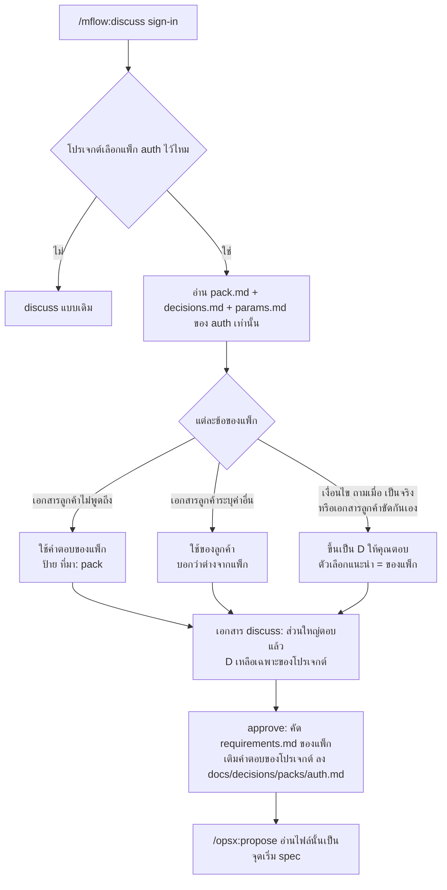

# ข้อเสนอ: แพ็ก business logic ที่ใช้ซ้ำได้ (mflow packs)

วันที่: 2026-11-02 · Revision: 0.2 · สถานะ: คุณตอบ `1 a, 2 b, 3 b, 4 b, 5 a` แล้ว · เฟส 1 สร้างใน mflow 0.37.0 (ยังไม่ commit) · รอคุณตรวจรายการข้อ 3 b ในหัวข้อ 10

> วิธีตอบ: รายการที่ต้องตรวจอยู่ในหัวข้อ 10 ตอบในแชตบรรทัดเดียวได้ เช่น `R1 a, R2 b` หรือ `ที่เหลือตามแนะนำ` อยากแก้ส่วนไหนเขียน `> ความเห็น:` ใต้ส่วนนั้น

> คำตอบ 4 b: แยกบัญชีผู้ใช้ออกจาก `auth` เป็นแพ็ก `users` ชุดแรกจึงมี 5 แพ็ก: `audit`, `mail`, `auth`, `permission`, `users` (ตารางในหัวข้อ 4 ยังเป็นแบบ 4 แพ็กของ rev 0.1 ส่วนที่สร้างจริงอยู่ใน README ของ plugin หัวข้อแพ็ก)

## 1. สรุป

- **ทำได้** ในรูป "แพ็ก" (pack): ชุดข้อตัดสินใจที่ตอบไว้แล้ว + requirement แบบ OpenSpec + พจนานุกรมข้อมูล + จุดทดสอบ ของเรื่องที่ทุกระบบมีเหมือนกัน (sign-in, รหัสผ่าน, สิทธิ์, อีเมล, audit) แพ็กเป็นเอกสาร ไม่ใช่โค้ด จึงใช้ได้กับทุก stack
- **ใช้ผ่านคำสั่งเดิม** เช่น `/mflow:discuss sign-in` เจอแพ็ก `auth` ที่โปรเจกต์เลือกไว้ แล้วตอบข้อที่แพ็กตอบไว้แล้วเอง ถามเฉพาะข้อที่เป็นของโปรเจกต์นั้นจริงๆ (เฟส 1 ไม่เพิ่มคำสั่งใหม่ ดูข้อ 5 ของหัวข้อ 9)
- **ลดคำถามได้ราวครึ่งหนึ่ง:** ใน StemHub เอกสาร discuss 8 ฉบับของเรื่อง sign-in, OTP, บัญชี, สิทธิ์, อีเมล, data conventions และ settings มีข้อตัดสินใจ 68 ข้อ ประมาณ 38 ข้อเป็นมาตรฐานที่ใช้ซ้ำได้ (หัวข้อ 2)
- **ชุดแรก 4 แพ็ก (core business):** `audit`, `auth`, `permission`, `mail` ทำจาก spec และ discuss ที่อนุมัติแล้วของ StemHub โดยอ่านอย่างเดียว (หัวข้อ 4)
- **ข้อจำกัดที่ต้องตัดสินก่อน:** repo `mounchons/mflow-marketplace` เป็น public เนื้อหาที่มาจากเอกสารลูกค้าของ StemHub เข้า plugin ตรงๆ ไม่ได้ (หัวข้อ 6)

## 2. วิเคราะห์จาก StemHub: คำถามไหนไม่ต้องถามอีก

แยกข้อตัดสินใจ (`### D<n>`) ของเอกสาร discuss ที่เกี่ยวข้องเป็นสามแบบ [อนุมาน: จากหัวข้อของทุกข้อ และคำตอบจริงของเอกสาร 06, 17, 18]

- **A มาตรฐานของทีม:** ตอบแบบเดียวกันได้ทุกโปรเจกต์ → เข้าแพ็ก ไม่ถามอีก
- **B ของลูกค้ารายนั้น:** โครงองค์กร คำในเอกสารลูกค้า ระบบที่เชื่อม → ยังถาม
- **C สถานะของโปรเจกต์:** ลำดับ change, "จนกว่าจะมีหน้าจอ X" → ยังถาม

| เอกสาร | ข้อ | A | B | C | ตัวอย่าง A | ตัวอย่าง B / C |
|---|---|---|---|---|---|---|
| 01 access-control (rev 11) | 8 | 4 | 4 | 0 | เก็บขอบเขตข้อมูลต่อเมนู, กลไกบังคับในโค้ด, นอกขอบเขตตอบ not found, แยกปุ่มออกจาก Manage แล้วสิทธิ์เดิมคงอยู่ | ขอบเขตเมนู Order กับ Buyer ID, PO |
| 04 data-conventions | 7 | 6 | 1 | 0 | ชื่อคอลัมน์ผู้สร้าง/แก้, soft delete, ชนิดคีย์, ตารางชั่วคราวลบจริง, ผู้ทำที่เป็นระบบ | คีย์ของตาราง supplier |
| 06 user-auth-data | 7 | 2 | 5 | 0 | บัญชี Invited กดลืมรหัสได้ไหม, คอลัมน์ผู้ทำชี้บัญชีหลายตาราง | บัญชีสองพอร์ทัลแยกตาราง, role ของ supplier |
| 09 email-templates | 6 | 2 | 4 | 0 | สร้าง/ลบเทมเพลตได้แค่ฉบับสำเนา, ช่องเลือกเทมเพลต | ขั้นตอนการส่งของลูกค้า, จำนวนเทมเพลต |
| 17 buyer-sign-in | 10 | 7 | 0 | 3 | เข้าด้วยอีเมล, บัญชี seed เฉพาะ dev, ตัวสลับผู้ใช้ prototype, cookie Secure บน HTTP, log การเข้าไม่สำเร็จ, ผู้ใช้ใหม่ได้ลิงก์ตั้งรหัส | change แรกเลื่อนอะไร, เซสชันยาวจนกว่ามีหน้าต่างเตือน |
| 18 email-otp | 9 | 7 | 0 | 2 | สวิตช์ OTP ต่อพอร์ทัล ค่าเริ่มปิด, จำ browser, ผิด 5 ครั้งเริ่มใหม่, mailbox ของ prototype | สร้างเมื่อไร, ตัวส่งอยู่ change ไหน |
| 19 supplier-sign-in | 10 | 5 | 2 | 3 | seed, ตัวสลับ, แก้อีเมลใน Profile, กันเว็บอื่นพาเข้าระบบ | อีเมลของบัญชีตัวอย่าง, อีเมลเดียวสองบริษัท |
| 21 system-settings | 11 | 5 | 6 | 0 | นับอายุรหัสเป็นวันปฏิทิน, เปลี่ยนค่าแล้วคำนวณบัญชีเดิมใหม่, ค่าใดปรับบนจอได้ | Owning Site, About us, นามสกุลไฟล์ |
| **รวม** | **68** | **38** | **22** | **8** | | |

ข้อสังเกต
- กลุ่ม A ส่วนใหญ่เป็นเรื่องความปลอดภัยและรูปแบบข้อมูล ที่ถ้าตอบไม่เหมือนกันในแต่ละโปรเจกต์ทีมก็ต้องดูแลหลายแบบ
- คำตอบของคุณไม่ได้ตามคำแนะนำของ Claude เสมอ เช่น 06 D1 Claude แนะนำตารางเดียว คุณเลือกแยกตาราง แพ็กต้องเก็บ **คำตอบสุดท้ายของคุณ** (spec ปัจจุบัน) ไม่ใช่คำแนะนำ [ที่มา: StemHub 06 D1]
- ค่าบางค่าเปลี่ยนระหว่างทาง เช่น อายุรหัสผ่านเริ่มจาก "90 วันทำการ" ตามเอกสารลูกค้า แล้วเปลี่ยนเป็น 30 วันปฏิทินและปรับบนจอได้ แพ็กจึงต้องอ่านจาก spec ปัจจุบัน ไม่ใช่จากเอกสาร discuss ฉบับแรก [ที่มา: StemHub spec sign-in "Password policy and expiry"]
- เอกสาร 01 แก้ถึง rev 11 เพราะเรื่องสิทธิ์ผูกกับโครงองค์กรของลูกค้า แพ็ก `permission` จะตัดส่วนกลไก (A) ออกมา ส่วนมิติของขอบเขตข้อมูล (ซัพพลายเออร์ สาขา บริษัท) ยังเป็นคำถามของแต่ละโปรเจกต์

ทำไมไม่ใช้ prompt template อย่างเดียว: prompt ถูกตีความใหม่ทุกครั้ง ไม่มีเลขข้อให้อ้าง และไม่รู้ว่าข้อไหนมาจากแพ็ก ข้อไหนมาจากลูกค้า แพ็กมีเลขข้อ (`AUTH-D01`) และป้ายที่มา จึงตรวจย้อนได้ว่า AI ตัดสินข้อไหนเอง เพราะอะไร

## 3. แพ็กคืออะไร

แพ็กหนึ่งคือโฟลเดอร์เดียว ไม่มีโค้ด ไม่ผูก stack

```text
packs/auth/
├─ pack.md          ← เรื่องนี้คืออะไร, requires (audit, mail), ไม่รวมอะไร, หัวข้อ discuss ที่ใช้แพ็กนี้
├─ decisions.md     ← ข้อที่ตอบไว้แล้ว: เลขข้อ คำตอบ เหตุผล ถ้าผิด และ "ถามเมื่อ"
├─ params.md        ← ค่าตัวเลขเริ่มต้นและช่วงที่ยอมรับ (เอกสารลูกค้าระบุค่าอื่น → ใช้ของลูกค้า)
├─ requirements.md  ← requirement แบบ OpenSpec (### Requirement + #### Scenario) มีช่อง {portal} {scope}
├─ data.md          ← พจนานุกรมข้อมูล: ตาราง คอลัมน์ ความหมาย
├─ screens.md       ← หน้าจอที่แพ็กนี้ต้องมี ให้ /mflow:screen inventory เพิ่มเอง
└─ checks.md        ← จุดทดสอบ (ข้อความผิดต้องเหมือนกันทุกตัวอักษร, ผิดครั้งที่ 6 ด้วยรหัสถูกยังล็อก …)
```

ตัวอย่างหนึ่งข้อใน `decisions.md` [เสนอ]

```markdown
### AUTH-D01: ใช้อะไรเป็นชื่อเข้าระบบ
- **คำตอบ:** อีเมล ส่วนชื่อผู้ใช้เก็บไว้เป็นชื่อที่แสดง ไม่ใช้เข้าระบบ
- **เหตุผล:** อีเมลใช้ส่ง OTP ลิงก์ตั้งรหัส และแจ้งเตือนได้ในตัว
- **ถ้าผิด:** แก้ยาก — คีย์ค้นบัญชี หน้า sign-in และอีเมลเชิญเปลี่ยนทั้งหมด
- **ถามเมื่อ:** เอกสารลูกค้าระบุชื่อผู้ใช้ หรือมีผู้ใช้กลุ่มที่ไม่มีอีเมล
```

ตัวอย่าง `params.md` ของ `auth` จากค่าปัจจุบันของ StemHub [ที่มา: StemHub spec sign-in]

| ค่า | เริ่มต้น | หมายเหตุ |
|---|---|---|
| ล็อกเมื่อผิด | 5 ครั้งใน 5 นาที ล็อก 15 นาที | นับต่อพอร์ทัลและชื่อที่พิมพ์ รวมชื่อที่ไม่มีจริง ปรับบนจอได้ |
| รหัสผ่าน | 8–16 ตัว มีพิมพ์ใหญ่ เล็ก ตัวเลข ห้ามซ้ำ 4 ครั้งล่าสุด | อักขระพิเศษเป็นสวิตช์ |
| อายุรหัสผ่าน | 30 วันปฏิทิน | ดูข้อ 3 ของหัวข้อ 9 |
| ลิงก์ตั้งรหัส | 24 ชม. ใช้ครั้งเดียว | ลิงก์ใหม่ยกเลิกลิงก์เก่า |
| OTP | 6 หลัก อายุ 5 นาที สวิตช์ต่อพอร์ทัล ค่าเริ่มปิด | จำ browser 24 ชม. (0–720) |
| ลบตารางชั่วคราว | เซสชันและ attempt 1 วัน ลิงก์ 30 วัน | |

ป้ายใหม่ในเอกสาร discuss: `[ที่มา: pack auth §AUTH-D01]` ทำงานแบบเดียวกับ `[ที่มา: brain <note>]` ที่มีอยู่แล้ว

## 4. ชุดแรก: core business 4 แพ็ก

| แพ็ก | ครอบคลุม | ที่มาใน StemHub (อ่านอย่างเดียว) | ต้องมีก่อน |
|---|---|---|---|
| `audit` | ผู้ทำและเวลาทุกแถว, ทะเบียนผู้ทำรวมผู้ทำที่เป็นระบบ, soft delete ด้วย filter เดียว, ตารางชั่วคราวลบจริง, Activity Log แบบ append-only ค่าเก่า/ใหม่ใน transaction เดียว, หนึ่งการบันทึกเป็นหนึ่งรายการ, จอดู log | spec `data-conventions`, `activity-log` · discuss 04 | — |
| `auth` | เข้าด้วยอีเมล, ข้อความผิดแบบเดียว, ล็อก, เซสชันฝั่ง server (โทเค็นสุ่มใน cookie เก็บ hash), CSRF, ออกจากระบบ, นโยบายและอายุรหัส, ลืมรหัส/ลิงก์, เข้าครั้งแรก (ตั้งรหัส + ยอมรับข้อกำหนด), OTP ทางอีเมล + จำ browser, บัญชีผู้ใช้ (สถานะ Active/Inactive/Invited/Disabled, สร้าง เชิญ รีเซ็ต ลบ, Profile เปลี่ยนรหัส, ไม่มีใครเห็นรหัส), seed และตัวสลับผู้ใช้ของ prototype | spec `sign-in`, `buyer-accounts`, `supplier-accounts`, ส่วนรหัสผ่านของ `system-settings` · discuss 06, 17, 18, 19, 21 (D4–D6) | `audit`, `mail` |
| `permission` | catalog หน้าจอ × สิทธิ์ (View/Manage) ที่กำหนดในโค้ด, กลุ่มถือสิทธิ์, คีย์ของผู้ใช้คำนวณตอนเข้าระบบ และมีผลรอบเข้าถัดไป, ตรวจฝั่ง server ทุก endpoint, เมนูและปุ่มตามคีย์, ขอบเขตข้อมูลต่อกลุ่มต่อเมนู, นอกขอบเขตตอบ not found, กลุ่ม seed เห็นทั้งหมด, จัดการกลุ่มเฉพาะ SuperAdmin, แยก checkbox แล้วสิทธิ์เดิมคงอยู่ | spec `access-control`, `group-management` · discuss 01 | `auth`, `audit` |
| `mail` | `mail_outbox` เข้าคิวใน transaction เดียวกับงาน, ตัวส่งตัวเดียว + retry + log ทุกครั้ง, สวิตช์ส่งจริง, allow-list ผู้รับ, จำกัดอัตรา, ผู้ส่งเดียวของระบบ, ค่า SMTP ตอน start, ทะเบียนเทมเพลตระบบ + สำเนา, tag ต่อเหตุการณ์และ tag บังคับของอีเมลบัญชี, preview, สวิตช์เปิดปิด, จอผูกเหตุการณ์กับเทมเพลต, mailbox ของ prototype | spec `mail-delivery`, `mail-config`, `email-templates` · discuss 09 | `audit` |

**ไม่เข้าแพ็ก (เป็นของ StemHub):** สองพอร์ทัล Buyer/Supplier เป็นตัวอย่าง ไม่ใช่ค่าตายตัว, ขอบเขตตามซัพพลายเออร์และ Buyer ID, Owning Site, DMS, เลขจอ DR0xx, เลข NFR/SRS, ชื่อลูกค้า, IP ของ dev server, ข้อความภาษาของลูกค้า

**ยังเป็นคำถามของทุกโปรเจกต์ (แพ็กมีตัวเลือกแนะนำให้):** มีกี่พอร์ทัลหรือกลุ่มผู้ใช้และบัญชีแยกตารางไหม, รายชื่อ role และหน้าจอ, มิติของขอบเขตข้อมูล (สาขา บริษัท ลูกค้า), เปิด OTP ไหม, SMTP และอีเมลผู้ส่ง, รายการเหตุการณ์ที่ส่งอีเมล

**รอบถัดไป (ไม่อยู่ในชุดแรก):** `settings` (system-settings), `upload` (file-upload), `api` (api-conventions), `approval`, `import-export`, และชั้น stack ของแต่ละแพ็ก (หัวข้อ 8)

## 5. AI ตัดสินใจอย่างไร

ลำดับที่มาของคำตอบเดิมใน `skills/discuss/references/topics.md` คือ เอกสารลูกค้าและคำของคุณ → มาตรฐานของทีม (knowledge base) → ข้อเสนอของ Claude แพ็กเข้าไปอยู่ชั้น "มาตรฐานของทีม" และมาก่อน knowledge base เพราะเป็นข้อที่คุณอนุมัติแล้ว



ภาพนี้ตอบ: เมื่อมีแพ็ก ข้อไหน AI ตอบเอง ข้อไหนยังถาม | ทั้งภาพเป็น [เสนอ]

กติกาต่อข้อ [เสนอ]
1. เอกสารลูกค้าไม่พูดถึง → ใช้คำตอบของแพ็ก ไม่ถาม
2. เอกสารลูกค้าระบุค่าอื่น (เช่น ล็อกเมื่อผิด 3 ครั้ง) → ใช้ของลูกค้า ไม่ถาม แต่บอกในเอกสารว่าต่างจากแพ็ก
3. ข้อที่แพ็กเขียน "ถามเมื่อ" ไว้ และเงื่อนไขเป็นจริง หรือเอกสารลูกค้าขัดกันเอง → ขึ้นเป็น D โดยตัวเลือกที่แนะนำคือคำตอบของแพ็ก
4. เรื่องนอกแพ็ก → discuss แบบเดิม
5. ข้อที่ AI ตอบจากแพ็กยังเห็นในเอกสาร discuss เสมอ (หัวข้อ 2 ของเอกสาร พร้อมป้าย) คุณแย้งได้ด้วย `> ความเห็น:` ตามเดิม

เรื่อง context: discuss อ่านเฉพาะ `pack.md`, `decisions.md`, `params.md` ของแพ็กที่ตรงกับหัวข้อ, `requirements.md`, `data.md`, `screens.md` และ `checks.md` ถูกรวมเป็นไฟล์เดียว `docs/decisions/packs/<แพ็ก>.md` ตอน approve (เติมคำตอบของโปรเจกต์แล้ว) แล้ว propose และ apply อ่านไฟล์นั้น ไม่มีการโหลดทุกแพ็กพร้อมกัน แพ็กละไม่เกินราว 300 บรรทัด

แพ็กกับหัวข้อ discuss ที่มีอยู่: `access-control` → `permission`, `audit-history` และส่วน audit ของ `data-model` → `audit`, `notifications` → `mail`, หัวข้อใหม่ `sign-in` → `auth`

## 6. ที่อยู่ของแพ็ก และข้อจำกัด

- repo `mounchons/mflow-marketplace` เป็น **PUBLIC** [ที่มา: `gh repo view`] อะไรที่เข้า plugin คือเผยแพร่แล้ว ลบออกจากประวัติ git และ fork ภายหลังไม่ได้
- mflow ไม่รับ folder ใน `.mflow/config.json` ที่ชี้ออกนอกโปรเจกต์ (absolute path, `..` หรือ link) เพื่อกันไม่ให้ repo ที่ clone มาพา script ไปเขียนไฟล์ที่อื่น [ที่มา: `plugins/mflow/scripts/lib.mjs` ตรวจ `hotspotsDir`, `sourceDir`, `inboxDir`, `discussDir`] โฟลเดอร์แพ็กนอกโปรเจกต์ที่ตั้งผ่าน config จึงเป็นรูปแบบเดียวกับที่ mflow ปฏิเสธไว้
- StemHub อ่านอย่างเดียว ไม่มีไฟล์ใดใน StemHub ถูกแก้ งานคัดแพ็กเกิดใน mflow-marketplace ทั้งหมด
- ในแต่ละโปรเจกต์ แพ็กที่ใช้แล้วถูกคัดไว้ที่ `docs/decisions/packs/<แพ็ก>.md` ตอน approve (เติมคำตอบของโปรเจกต์แล้ว) Codex, OpenCode และ cloud session จึงอ่านได้โดยไม่ต้องมี plugin และ plugin รุ่นใหม่ไม่เปลี่ยนกติกาของโปรเจกต์ที่อนุมัติไปแล้ว

เนื้อหาที่เข้า plugin ต้องผ่านการทำให้เป็นกลาง: ไม่มีชื่อลูกค้า เลขจอ เลขข้อของเอกสารลูกค้า IP อีเมลจริง และชื่อคน มี test ใน `tests/` ตรวจคำต้องห้ามเหล่านี้ทุกครั้งที่รัน `node --test`

## 7. โปรเจกต์เลือกใช้แพ็กอย่างไร

- รายการแพ็กที่โปรเจกต์ใช้อยู่ใน `.mflow/config.json` เช่น `"packs": ["audit", "auth", "permission", "mail"]` ไฟล์นี้ commit ไปกับ repo (ต่างจาก `.mflow/local.json` ที่เป็นของเครื่องเดียวและอยู่ใน `.gitignore`) ทั้งทีม Codex และ cloud จึงเห็นรายการเดียวกัน [เสนอ; ที่มา: `plugins/mflow/scripts/apply-subagent.mjs`]
- เฟส 1 สั่งในแชตได้เลย เช่น "ใช้แพ็ก auth, mail" Claude เขียนลง config ให้ (`/mflow:init` ถามตอนตั้งค่าในเฟส 2)
- แพ็กที่ไม่ได้เลือกไม่ถูกอ่าน และ `requires` ที่ขาดจะถูกบอก เช่น เลือก `auth` แต่ไม่มี `mail`
- `AGENDA.md` ของ discuss แสดงว่าหัวข้อไหนมีแพ็กรองรับ เช่น `sign-in — มีแพ็ก auth: คาดว่าเหลือ 3–5 ข้อ`

## 8. ขั้นตอน

**เฟส 1: แพ็กชุดแรก + discuss อ่านแพ็ก** (mflow 0.37.0)
1. เขียนรูปแบบแพ็ก (`packs/README.md`) และ 4 แพ็กจาก spec ปัจจุบันของ StemHub ด้วยมือ ทำให้เป็นกลางตามหัวข้อ 6 (นี่คือการทำด้วยมือรอบแรกตามกติกา README "เพิ่มคำสั่งหลังจากทำเรื่องเดิมด้วยมือซ้ำ 2 ถึง 3 ครั้ง")
2. เพิ่มกติกาในหัวข้อ 5 ลง `skills/discuss/SKILL.md` และ `references/topics.md` (ลำดับที่มา, ป้าย `[ที่มา: pack …]`, แพ็กต่อหัวข้อ, approve คัด requirement ลง `docs/decisions/packs/`)
3. เพิ่มบรรทัดใน `openspec/config.yaml` ผ่าน `openspec-config.mjs`: propose เริ่ม spec จาก `docs/decisions/packs/` เมื่อมี
4. test: รูปแบบไฟล์แพ็กครบ, ทุกข้อมี ถ้าผิด และ ถามเมื่อ, `requires` ไม่วน, คำต้องห้าม
5. ทดลองกับโปรเจกต์ถัดไปที่คุณเลือก แล้วนับว่าเหลือกี่ D จริง

**เฟส 2: หลังโปรเจกต์ที่สองใช้แพ็กแล้ว**
- คำสั่ง `/mflow:pack list | extract <ชื่อ> --from <โปรเจกต์>` ให้สร้างแพ็กใหม่จากโปรเจกต์ที่เสร็จแล้วได้เอง ตามที่คุณเลือก (ร่าง → คุณตรวจ → รุ่น 1)
- `/mflow:init` ถามว่าใช้แพ็กไหน
- รุ่นของแพ็กและการอัปเดตโปรเจกต์เมื่อแพ็กเปลี่ยน (เป็น change-request ของโปรเจกต์นั้น)
- ถ้าเลือกข้อ 2 a ในเฟส 1: ขยับเป็นแบบ b หลังเห็นผลจริง

**เฟส 3: ชั้น stack และแพ็กเพิ่ม**
- `packs/<ชื่อ>/stack/<profile>.md` แนวทางสร้างจริงต่อ profile (`mvc-htmx`, `react-vite`) เช่น Argon2id, EF Core global query filter, cookie
- แพ็ก `settings`, `upload`, `api`, `approval`, `import-export`

## 9. ข้อตัดสินใจ

### 1. ที่อยู่ของแพ็ก
- **ถ้าผิด:** แก้ยาก — สิ่งที่ push เข้า repo public แล้วเอาคืนไม่ได้
- a) ใน plugin mflow (`plugins/mflow/packs/`) เฉพาะเนื้อหาที่ทำให้เป็นกลางแล้ว มี test ตรวจคำต้องห้าม: ใช้ได้ทุกเครื่อง ทุก tool และบน cloud ทันที, ติดตั้งครั้งเดียว / ทุกคนเห็นกติกาความปลอดภัยของทีม (ไม่มีความลับ แต่เปิดเผย)
- b) plugin แยก (เช่น `mflow-packs`) ใน marketplace ที่เป็น private: เก็บแพ็กของลูกค้าเฉพาะรายได้ในอนาคต / ต้องมี marketplace ที่สอง, mflow ต้องหาแพ็กข้าม plugin (ยังไม่เคยทำ), cloud ต้องเข้าถึง repo private
- c) ไม่มีคลังกลาง คัดจากโปรเจกต์เก่าใส่โปรเจกต์ใหม่ทุกครั้ง: ไม่มีอะไรเผยแพร่ / ไม่มีรุ่น ไม่มี test แต่ละโปรเจกต์เพี้ยนไปคนละทาง
- **แนะนำ:** a เพราะเนื้อหาของ 4 แพ็กแรกเป็นกลไกทั่วไปที่ไม่มีความลับ และใช้ได้ทุก tool โดยไม่ต้องตั้งค่าเพิ่ม ถ้าภายหลังมีแพ็กที่เป็นความลับของลูกค้า ค่อยทำ b แยกไป
- **เลือก:** a (คุณตอบ 2026-11-02)

### 2. AI ตัดสินใจเองแค่ไหน
- **ถ้าผิด:** แก้ทีหลังได้ — เป็นกติกาใน discuss แก้ในรุ่นถัดไป เอกสารที่อนุมัติแล้วไม่เปลี่ยน
- a) ข้อของแพ็กยังขึ้นเป็น D ทุกข้อ โดยมีคำตอบของแพ็กเป็นตัวเลือกแนะนำ คุณตอบ `ที่เหลือตามแนะนำ` บรรทัดเดียว: ระวังที่สุด / เอกสาร discuss ยาวขึ้นมาก (ราว 38 D เพิ่ม) และยังต้องอ่านทุกข้อ
- b) ข้อของแพ็กเขียนเป็นข้อความที่ตอบแล้ว (`[ที่มา: pack …]`) ไม่ขึ้นเป็น D ยกเว้นเงื่อนไข "ถามเมื่อ" เป็นจริงหรือเอกสารลูกค้าขัดกัน (กติกาหัวข้อ 5): ตรงกับเป้า "ให้ AI ตัดสินใจ ลดการถาม" / ค่าของแพ็กมาจากโปรเจกต์เดียว ถ้าไม่เหมาะจะรู้ตอนทดสอบใช้งาน
- c) ไม่ถามเลย แม้เอกสารลูกค้าขัดกับแพ็ก: เร็วที่สุด / ขัดกับหลัก "เอกสารลูกค้าและคำของคุณมาก่อน"
- **แนะนำ:** b เพราะเป็นเป้าของงานนี้โดยตรง และยังเห็นทุกข้อที่ AI ตอบเองในเอกสารพร้อมแย้งได้ ส่วน a เป็นทางที่ระวังกว่าถ้าอยากดูผลกับโปรเจกต์แรกก่อน
- **เลือก:** b (คุณตอบ 2026-11-02)

### 3. ค่าเริ่มต้นในแพ็กมาจากไหน
- **ถ้าผิด:** แก้ทีหลังได้ — แก้ในแพ็กรุ่นถัดไป โปรเจกต์ที่อนุมัติแล้วไม่เปลี่ยนตาม
- a) คำตอบสุดท้ายของคุณใน StemHub (spec ปัจจุบัน) ทุกข้อ ค่าที่เป็นความต้องการของลูกค้ารายนั้น (เช่น อายุรหัส "ทุก 30 วัน" ที่แทน "90 วันทำการ" ของ SRS) เป็นค่าเริ่มต้นที่ปรับได้: ตรงกับสิ่งที่ทีมสร้างและทดสอบมาแล้ว / ค่าบางค่าเป็นความต้องการของลูกค้ารายนั้น
- b) ใช้ a เป็นฐาน แต่ผมเสนอค่ามาตรฐานใหม่ในข้อที่แนวปฏิบัติปัจจุบันต่างออกไป (เช่น NIST SP 800-63B ไม่บังคับเปลี่ยนรหัสตามรอบ และแนะนำรหัสยาวขั้นต่ำ 8 ไม่จำกัดบน 16) ให้คุณตรวจเป็นรายการแยก: แพ็กเป็นมาตรฐานของทีมจริง ไม่ใช่ของลูกค้ารายเดียว / ต้องตรวจเพิ่มหนึ่งรอบ
- **แนะนำ:** b รายการที่ต่างจะสั้น (คาดไม่เกิน 10 ข้อ) และตอบครั้งเดียวแล้วใช้ได้ทุกโปรเจกต์
- **เลือก:** b (คุณตอบ 2026-11-02)

### 4. ชุดแพ็กแรก
- **ถ้าผิด:** แก้ทีหลังได้ — แยกหรือรวมแพ็กในรุ่นถัดไป
- a) 4 แพ็ก: `audit`, `auth` (รวมรหัสผ่าน OTP และบัญชีผู้ใช้), `permission`, `mail`
- b) 5 แพ็ก: แยกบัญชีผู้ใช้ออกจาก `auth` เป็น `users`: แพ็กเล็กลง / `auth` กับ `users` ต้องใช้คู่กันเกือบทุกครั้ง
- c) เริ่ม 2 แพ็ก `auth` + `permission` (รวม `audit` ที่จำเป็นไว้ในตัว) แล้วค่อยทำ `mail`: เร็วกว่า / OTP และลิงก์ตั้งรหัสยังอ้าง `mail` ที่ยังไม่มี
- **แนะนำ:** a ครบตามที่คุณยกตัวอย่าง (mail, password, sign-in, permission) และ `audit` เป็นฐานที่อีกสามแพ็กต้องใช้
- **เลือก:** b (คุณตอบ 2026-11-02)

### 5. เฟส 1 มีคำสั่งใหม่ไหม
- **ถ้าผิด:** แก้ทีหลังได้ — เพิ่มคำสั่งในรุ่นถัดไปได้เสมอ
- a) ไม่มี ใช้ผ่าน `/mflow:discuss <หัวข้อ>` เช่น `/mflow:discuss sign-in` ดึงแพ็ก `auth` ให้เอง และเพิ่ม `/mflow:pack` ในเฟส 2 หลังทำด้วยมือครบ 2 โปรเจกต์ (ตามกติกาใน README)
- b) เพิ่ม `/mflow:pack list | use <ชื่อ>` ตั้งแต่เฟส 1: เห็นชัดว่ามีแพ็กอะไร / ทำคำสั่งก่อนรู้ว่าการใช้งานจริงเป็นแบบไหน
- **แนะนำ:** a
- **เลือก:** a (คุณตอบ 2026-11-02)

**คำถามเพิ่ม (ไม่บังคับ):** โปรเจกต์ไหนจะเป็นตัวแรกที่ทดลองใช้แพ็ก บอกมาพร้อมคำตอบได้เลย

## 10. ข้อ 3 b: ค่าในแพ็กที่แนวปฏิบัติปัจจุบันต่างจาก StemHub

ตอนนี้แพ็กทั้ง 5 ใช้คำตอบสุดท้ายของ StemHub ทุกข้อ รายการนี้คือข้อที่ผมเสนอให้เปลี่ยนเป็นค่ามาตรฐานของทีม รวมจากการตรวจของทั้ง 5 แพ็กได้ 19 ข้อ (มากกว่าที่คาดไว้ว่าไม่เกิน 10) ข้อที่ซ้ำกันข้ามแพ็กรวมเป็นข้อเดียวแล้ว

- ทุกข้อแก้ทีหลังได้ เพราะแพ็กยังไม่ได้ปล่อย เปลี่ยนแล้วยังเป็นรุ่น 1
- ในแต่ละโปรเจกต์ เอกสารลูกค้ายังชนะค่าของแพ็กเสมอ (เช่น ลูกค้ากำหนดให้รหัสหมดอายุ 90 วัน ก็ใช้ 90 วัน) ค่าของแพ็กจึงใช้เมื่อลูกค้าไม่ได้พูดถึง
- ข้อที่แนะนำ a (คงแบบ StemHub) คือข้อที่ทางที่เสนอยังไม่เคยสร้างและทดสอบจริง และแพ็กควรเก็บเฉพาะสิ่งที่ทำแล้ว

- ที่มาในวงเล็บมาจากความรู้ของ AI ยังไม่ได้เปิดเอกสารต้นฉบับตรวจ เลขมาตรา PDPA, RFC และ NIST เชื่อถือได้ แต่เลขหัวข้อย่อยของ ASVS 5.0 (V6.2.2, V6.4, V14, V16) ต้องตรวจก่อนนำไปอ้างในแพ็ก

ตอบบรรทัดเดียว เช่น `R1 b, R3 a, ที่เหลือตามแนะนำ`

### auth

**R1. กฎรหัสผ่าน (AUTH-D13)**
- StemHub: 8–16 ตัว ต้องมีพิมพ์ใหญ่ พิมพ์เล็ก และตัวเลข ห้ามซ้ำ 4 ครั้งล่าสุด
- เสนอ: ขั้นต่ำ 15 ตัวเมื่อใช้รหัสผ่านอย่างเดียว (8 ตัวเมื่อเปิด OTP) รับได้อย่างน้อย 64 ตัว ไม่บังคับชนิดตัวอักษร ตรวจกับรายการรหัสที่ใช้บ่อยหรือรั่ว ส่วนห้ามซ้ำ 4 ครั้งคงไว้ [ที่มา: NIST SP 800-63B-4; OWASP ASVS 5.0 V6]
- a) คงแบบ StemHub · b) ตามที่เสนอ · **แนะนำ:** b — กฎชนิดตัวอักษรทำให้คนตั้งรหัสแบบเดาง่าย ความยาวกับการตรวจรายการรั่วกันได้ดีกว่า

**R2. รหัสผ่านหมดอายุ (AUTH-D14)**
- StemHub: หมดอายุทุก 30 วันปฏิทิน
- เสนอ: ค่าเริ่มต้นไม่หมดอายุ บังคับเปลี่ยนเฉพาะเมื่อมีสัญญาณว่ารหัสรั่ว คงค่าตั้งไว้ให้ลูกค้าที่ต้องการเปิดเอง [ที่มา: NIST SP 800-63B-4 ห้ามบังคับเปลี่ยนตามรอบ]
- a) คง 30 วัน · b) ตามที่เสนอ · **แนะนำ:** b

**R3. OTP ทางอีเมลเป็นปัจจัยที่สอง (AUTH-D23)**
- StemHub: ส่งรหัสทางอีเมล
- เสนอ: เพิ่มแอป authenticator (TOTP) หรือ passkey เป็นปัจจัยที่สองจริง ส่วน OTP ทางอีเมลเป็นตัวเลือกระดับต่ำกว่า [ที่มา: NIST SP 800-63B-4 ไม่รับอีเมลเป็นช่องทาง out-of-band]
- a) คงอีเมล OTP อย่างเดียว แล้วเพิ่ม TOTP ในแพ็กรุ่นใหม่เมื่อมีโปรเจกต์ที่สร้างจริง · b) ใส่ TOTP ลงแพ็กตอนนี้ · **แนะนำ:** a — TOTP ยังไม่เคยสร้างในโปรเจกต์ไหน

**R4. อายุลิงก์ตั้งรหัส (AUTH-D17, USERS-D09)**
- StemHub: 24 ชม. ทั้งลิงก์ลืมรหัส ลิงก์ที่ผู้ดูแลรีเซ็ต และลิงก์ของบัญชีใหม่
- เสนอ: ลิงก์รีเซ็ตราว 1 ชม. ลิงก์ของบัญชีใหม่ 72 ชม. แยกเป็นสองค่า [ที่มา: OWASP Forgot Password Cheat Sheet ให้ token อายุสั้น; ตัวเลข 1 ชม. เป็นแนวปฏิบัติทั่วไป ไม่ใช่ตัวเลขจาก cheat sheet]
- a) คง 24 ชม. ค่าเดียว · b) ตามที่เสนอ · **แนะนำ:** b

**R5. อายุเซสชัน (AUTH-D10 ซึ่งถามทุกโปรเจกต์อยู่แล้ว)**
- StemHub: ไม่ใช้งาน 480 นาทีหลุด สูงสุด 720 นาที เพราะยังไม่มีหน้าต่างเตือนก่อนหมดเวลา
- เสนอ: ไม่ใช้งาน 15–30 นาที พร้อมหน้าต่างเตือน สูงสุด 8–12 ชม. [ที่มา: OWASP Session Management Cheat Sheet]
- a) ตัวเลือกแนะนำของข้อนี้เป็น 480 นาทีต่อไป · b) ตัวเลือกแนะนำเป็น 30 นาที + หน้าต่างเตือน · **แนะนำ:** a — หน้าต่างเตือนยังไม่เคยสร้าง และการหลุดเงียบทุก 30 นาทีเป็นสิ่งที่ลูกค้าของ StemHub ไม่รับ

**R6. ล็อกบัญชี (AUTH-D08)**
- StemHub: ผิด 5 ครั้งใน 5 นาที ล็อกอีเมลนั้น 15 นาที นับอีเมลที่ไม่มีจริงด้วย
- เสนอ: หน่วงเวลาเพิ่มขึ้นทีละรอบ (หรือ CAPTCHA) แทนล็อกตายตัว เพราะคนอื่นตั้งใจล็อกบัญชีของคนที่รู้อีเมลได้ [ที่มา: NIST SP 800-63B-4 rate limiting; OWASP Authentication Cheat Sheet]
- a) คงแบบ StemHub · b) ตามที่เสนอ · **แนะนำ:** a — ล็อก 15 นาทีจำกัดความเสียหายได้ ทดสอบแล้ว และไม่บอกว่าอีเมลไหนมีจริง

### users

**R7. รหัสเริ่มต้นของบัญชีองค์กรภายนอก (USERS-D19)**
- StemHub: ส่งรหัสสุ่ม 12 ตัว อายุ 24 ชม. ทางอีเมล
- เสนอ: ส่งลิงก์ตั้งรหัสครั้งเดียวแบบเดียวกับบัญชีพนักงาน [ที่มา: OWASP Forgot Password Cheat Sheet; ASVS 5.0 V6.4]
- a) คงแบบ StemHub · b) ตามที่เสนอ · **แนะนำ:** b — ไม่มีรหัสค้างในกล่องอีเมลและในคิวอีเมล

**R8. เปลี่ยนอีเมลเข้าระบบใน Profile (USERS-D25)**
- StemHub: เปลี่ยนได้เมื่อใส่รหัสปัจจุบัน ไม่ยืนยันอีเมลใหม่
- เสนอ: ส่งลิงก์ยืนยันไปอีเมลใหม่ และแจ้งอีเมลเดิม [ที่มา: OWASP Authentication Cheat Sheet]
- a) คงแบบ StemHub · b) ตามที่เสนอ · **แนะนำ:** b

**R9. หน้าเปลี่ยนรหัสของพนักงาน (USERS-D24)**
- StemHub: พนักงานเปลี่ยนรหัสได้เฉพาะตอนหมดอายุหรือลืมรหัส
- เสนอ: ทุกพอร์ทัลมีหน้าเปลี่ยนรหัส [ที่มา: ASVS 5.0 V6.2.2]
- a) คงแบบ StemHub · b) ตามที่เสนอ · **แนะนำ:** b — คนที่สงสัยว่ารหัสรั่วเปลี่ยนได้ทันที

### ข้อมูลส่วนบุคคล (audit, mail, users)

**R10. ระยะเก็บและการลบข้อมูลส่วนบุคคล (AUDIT-D04, AUDIT-D14, AUDIT-D16, MAIL-D29, USERS-D10)**
- StemHub: Activity Log เก็บอย่างน้อย 12 เดือนโดยไม่มีวันสิ้นสุด, คิวอีเมลและ log การส่งไม่ลบ, บัญชีที่ soft delete เก็บข้อมูลส่วนบุคคลตลอดไป, log แก้ไม่ได้จึงตอบคำขอลบข้อมูลไม่ได้
- เสนอ: ระยะเก็บเป็นข้อที่ถามทุกโปรเจกต์ (log, คิวอีเมล, บัญชีที่ลบ) แล้วงานตามเวลาทำให้ชื่อ อีเมล และเบอร์โทร ไม่ระบุตัวตนเมื่อพ้นระยะหรือเมื่อมีคำขอ โดยคง `actor.id` ไว้ให้ประวัติยังอ้างได้ [ที่มา: PDPA มาตรา 33, 37(3); OWASP Logging Cheat Sheet]
- a) คงแบบ StemHub · b) ตามที่เสนอ · **แนะนำ:** b — เป็นข้อกฎหมาย และสิ่งที่ถามเพิ่มมีแค่ระยะเวลา

**R11. ปิดค่าข้อมูลอ่อนไหวใน Activity Log (AUDIT-D12)**
- StemHub: ไม่เก็บค่าเฉพาะของลับ (hash รหัส โทเค็น)
- เสนอ: ปิดค่าข้อมูลอ่อนไหวด้วย เช่น เลขบัตรประชาชน เลขบัญชี เก็บแค่ 4 หลักท้าย [ที่มา: OWASP Logging Cheat Sheet; PDPA มาตรา 26]
- a) คงแบบ StemHub · b) ตามที่เสนอ · **แนะนำ:** b

**R12. กัน log ถูกแก้ (AUDIT-D14)**
- StemHub: role ของฐานข้อมูลไม่มีสิทธิ์ UPDATE และ DELETE บน log
- เสนอ: ส่งเหตุการณ์ความปลอดภัย (เข้าระบบ ถูกปฏิเสธสิทธิ์ เปลี่ยนสิทธิ์) ไปที่เก็บแยกที่แอปเขียนต่อท้ายได้อย่างเดียว หรือใช้ hash chain [ที่มา: ASVS 5.0 V16]
- a) คงแบบ StemHub · b) ทำทุกโปรเจกต์ · c) ถามเมื่อโปรเจกต์อยู่ใต้ข้อกำหนดด้านความปลอดภัย (เช่น การเงิน) · **แนะนำ:** c

### permission

**R13. สิทธิ์ที่ถูกถอนมีผลเมื่อไร (PERM-D07)**
- StemHub: มีผลรอบเข้าระบบถัดไป (ยกเว้นย้ายกลุ่มหรือถอนเมนูของ role ซึ่งตัดเซสชันทันที)
- เสนอ: สิทธิ์ที่ถอนหรือขอบเขตที่แคบลงมีผลที่ request ถัดไป ด้วยการตัดเซสชันของสมาชิก หรือตรวจรุ่นของสิทธิ์กลุ่มทุก request ส่วนสิทธิ์ที่เพิ่มยังมีผลรอบเข้าถัดไปได้ [ที่มา: ASVS 5.0; OWASP Session Management Cheat Sheet]
- a) คงแบบ StemHub · b) ตามที่เสนอ · **แนะนำ:** b — สิทธิ์ที่ถอนแล้วไม่ควรใช้ต่อได้จนจบเซสชัน

**R14. ปฏิเสธเป็นค่าเริ่มต้นตอนรัน (PERM-D08)**
- StemHub: ทุก endpoint ต้องประกาศสิทธิ์ ตรวจด้วย architecture test
- เสนอ: เพิ่ม policy ที่ปฏิเสธเป็นค่าเริ่มต้นตอนรัน endpoint ที่ไม่ประกาศสิทธิ์ถูกปฏิเสธแม้ test ไม่ได้รัน [ที่มา: ASVS 5.0; OWASP Authorization Cheat Sheet]
- a) คงแบบ StemHub · b) ตามที่เสนอ · **แนะนำ:** b — งานน้อย (เช่น fallback policy ของ ASP.NET Core)

**R15. ตัวสลับผู้ใช้ของ prototype (PERM-D26)**
- StemHub: ใช้ได้เฉพาะโหมด prototype หลังเข้าระบบ และลง log
- เสนอ: แอปไม่ยอม start ถ้าเปิดโหมด prototype ใน production และให้ใช้ได้เฉพาะกลุ่มผู้ดูแลสูงสุด [ที่มา: ASVS 5.0 ห้ามมีความสามารถสำหรับทดสอบใน production]
- a) คงแบบ StemHub · b) ตามที่เสนอ · **แนะนำ:** b

### mail

**R16. การส่งซ้ำเมื่อส่งไม่ผ่าน (MAIL-D11)**
- StemHub: ลอง 3 ครั้งในราว 6 นาที แล้วเป็น Failed
- เสนอ: error ชั่วคราว (4xx) รอนานขึ้นเรื่อยๆ จนถึง 24 ชม. error ถาวร (5xx) ล้มทันที [ที่มา: RFC 5321 §4.5.4.1]
- a) คงแบบ StemHub · b) ตามที่เสนอ · **แนะนำ:** b — ตอนนี้ SMTP ล่ม 10 นาทีทำให้ลิงก์ตั้งรหัสหายถาวร

**R17. SPF, DKIM และ DMARC ของโดเมนผู้ส่ง (MAIL-D09)**
- StemHub: ไม่มีข้อกำหนด
- เสนอ: เป็นรายการตรวจก่อนขึ้นระบบ ไม่มีโค้ด [ที่มา: RFC 7208, 6376, 7489; ข้อกำหนดผู้ส่งของ Google และ Yahoo ปี 2024]
- a) ไม่ใส่ · b) ใส่เป็นรายการตรวจ · **แนะนำ:** b — ถ้าไม่มี อีเมลเชิญและรหัสจะไปตกที่ spam

**R18. อีเมลตีกลับ (MAIL-D11)**
- StemHub: บันทึกเฉพาะคำตอบของ SMTP ตอนส่ง
- เสนอ: ตั้ง Return-Path เป็นกล่องที่มีคนดู (รายการตรวจ) ส่วนการแจ้งบัญชีที่อีเมลตีกลับถาวรทำในรุ่นถัดไป [ที่มา: RFC 3464]
- a) คงแบบ StemHub · b) ตามที่เสนอ · **แนะนำ:** b

**R19. allow-list ผู้รับนอก production (MAIL-D06)**
- StemHub: list ว่างแปลว่าส่งถึงทุกคนในทุก environment โดยพึ่งสวิตช์ที่ปิดอยู่
- เสนอ: นอก production เปิดสวิตช์ส่งจริงได้เมื่อ allow-list ไม่ว่างเท่านั้น [ที่มา: ASVS 5.0 แยกค่าตั้งของแต่ละ environment]
- a) คงแบบ StemHub · b) ตามที่เสนอ · **แนะนำ:** b — เครื่องทดสอบที่มีสำเนาข้อมูลจริงจะไม่ส่งอีเมลถึงลูกค้าจริง

ข้อที่ตรวจแล้วตรงกับแนวปฏิบัติอยู่แล้ว ไม่ต้องเปลี่ยน: PERM-D17 (ระเบียนนอกขอบเขตตอบ 404 ส่วนไม่มีสิทธิ์หน้าจอตอบ 403)
