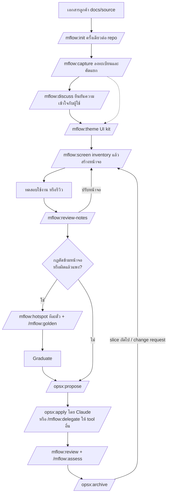

# mflow: Requirement

| รายการ | ค่า |
|---|---|
| เอกสาร | Requirement ของ plugin mflow |
| เวอร์ชันที่อธิบาย | 0.44.1 |
| ผู้ใช้เป้าหมาย | คนที่ต้องการทำระบบ: SA, PM หรือเจ้าของระบบ |
| ผู้ดูแล plugin | Mounchon |
| วันที่ | 2026-10-04 |
| สถานะ | ใช้งานได้ (pilot) |

---

## 1. ที่มาและปัญหา

การพัฒนาซอฟต์แวร์แบบเดิมคือ เก็บ requirement → เขียนเอกสารออกแบบ → dev เมื่อมี AI (Claude Code, Codex และตัวอื่น) ช่วยเขียนโค้ด การ dev เร็วขึ้นมาก ลำดับเดิมจึงไม่คุ้มอีกต่อไป แต่การวน "req → dev บางส่วน → req" เจอปัญหาสามข้อ:

1. **ลูกค้าไม่อ่านเอกสาร** แต่ชี้หน้าจอได้ requirement ที่ได้จากเอกสารจึงไม่ครบ
2. **โลจิกธุรกิจขนาดใหญ่** (คำนวณราคา, state machine, สต็อก, การอนุมัติ) ตัดผ่านหลายหน้าจอ ถ้าสร้างทีละส่วนโดยไม่เห็นกฎทั้งก้อน ต้องรื้อโครงสร้างกลางทาง
3. **AI จำไม่ได้ข้าม session** ไม่รู้ว่าก่อนหน้าทำอะไร จะทำอะไรต่อ และผลลัพธ์ที่ต้องการคืออะไร ยิ่งใช้ AI หลายตัวยิ่งหลุด

## 2. เป้าหมาย

mflow คือ plugin ของ Claude Code ที่ทำให้กระบวนการต่อไปนี้ทำซ้ำได้และตรวจสอบได้:

- **หน้าจอก่อน:** ทำ prototype ที่กดได้จริงให้ลูกค้าดู แทนการให้ลูกค้าอ่านเอกสาร
- **จับโลจิกใหญ่ก่อนสร้าง:** ทำให้กฎธุรกิจชัดในรูปที่ test ตรวจได้ ก่อนเขียนโค้ดจริง
- **ความจำของ AI อยู่ในไฟล์:** ทุก session ทุก tool เริ่มจากสถานะเดียวกัน
- **ใช้ AI หลายตัวอย่างมีการตรวจรับ:** งานจาก tool อื่นกลับมาในรูปที่ Claude ตรวจกับโค้ดจริงได้
- **ขอบเขตงานมีหลักฐาน:** เอกสารลูกค้า การรีวิว และ change request ถูกบันทึกจนใช้ประเมินราคาได้
- **ทำก่อน ทดสอบใช้งาน แล้วปรับเพิ่ม:** คำตอบของผู้ใช้เดินงานต่อได้ทันที ไม่รอลูกค้ายืนยันซ้ำ สิ่งที่ต้องแก้หลังทดสอบเป็นเอกสาร discuss ฉบับใหม่หรือ change ถัดไปของ OpenSpec

## 3. ผู้ใช้และสภาพแวดล้อม

| หัวข้อ | รายละเอียด |
|---|---|
| ผู้ใช้หลัก | คนที่ต้องการทำระบบ เช่น SA, PM หรือเจ้าของระบบ ใช้ AI ช่วยครบทั้งสาย: requirement, domain design, dev, deploy คำตอบและคำสั่งของผู้ใช้ถือเป็นคำสั่งของลูกค้าโดยตรง |
| AI หลัก | Claude Code (มี hook และคำสั่ง mflow) |
| AI เสริม | Codex, OpenCode, Gemini CLI, chat UI (ChatGPT/Gemini web) และ tool ใหม่ในอนาคต |
| เครื่องมือร่วม | OpenSpec (living spec), Backlog.md (บอร์ดงาน), git |
| Stack | เลือกตอน `/mflow:init`: a) ASP.NET Core MVC + Razor + Bootstrap 5 + HTMX, xUnit, Playwright (รองรับเต็ม, แนะนำเมื่อ repo ว่าง) b) React + Vite + ASP.NET Core Web API, xUnit + Vitest, Playwright c) stack อื่นที่ Claude เติมตาราง mapping ให้ยืนยัน (ยังไม่ทดสอบ) |
| ระบบปฏิบัติการ | Windows และ Linux |
| ภาษา | ข้อความถึงลูกค้าและ README เป็นภาษาไทย ไฟล์ที่ AI อ่าน (AGENTS.md, SKILL.md) เป็นภาษาอังกฤษ |

## 4. หลักการออกแบบ

| รหัส | หลักการ | เหตุผล |
|---|---|---|
| P1 | หนึ่งข้อเท็จจริงอยู่ที่เดียว ที่อื่นชี้มา | ข้อมูลซ้ำสองที่จะขัดกันภายในไม่กี่สัปดาห์ แล้ว AI เลือกเชื่อแบบสุ่ม |
| P2 | สถานะงานอยู่ในไฟล์ใน repo | AI ตัวไหน session ไหนก็ทำต่อได้ |
| P3 | งานที่ต้องได้ผลเหมือนกันทุกครั้งใช้ script | ไม่ให้ AI ทำด้วยมือในเรื่องที่ต้องแม่นยำ (สร้างไฟล์, ทะเบียน, สร้างคำสั่ง) |
| P4 | คนตัดสินใจ AI ลงมือ | คำสั่งที่เขียนลง repo หรือมีผลต่อขอบเขตต้องได้ yes ก่อน คำสั่งให้ทำจากผู้ใช้คือ yes ของเรื่องนั้น และครอบคลุมทุกขั้นของเรื่องนั้น: แสดงสิ่งที่กำลังเขียนแล้วทำต่อโดยไม่ถามซ้ำ ถามเฉพาะสิ่งที่เกินเรื่องนั้น (การเปลี่ยนที่กระทบหน้าจออื่นหรือของที่สร้างแล้ว หัวข้ออื่น ข้อเสนอของ AI ตัวอื่น) ถ้าขอแค่วิเคราะห์ให้หยุดที่รายงาน การแสดงสิ่งที่ Claude อ่านจากเอกสารลูกค้า (ตารางคัดแยก การจับคู่คอลัมน์) ให้ผู้ใช้ตรวจไม่นับเป็นการถามซ้ำ |
| P5 | Spec บอกสิ่งที่ "เป็นอยู่" change บอกสิ่งที่ "จะเป็น" | ตามโมเดลของ OpenSpec |
| P6 | Test คือหลักฐานว่าเสร็จ | "เสร็จ" ต้องพิสูจน์ด้วย test ที่ผ่าน ไม่ใช่คำบอกของ AI |
| P7 | ไม่ผูกกับ AI tool ตัวใด | brief และทะเบียน tool ทำให้เปลี่ยนหรือเพิ่ม tool ได้โดยไม่แก้ plugin |
| P8 | ไม่ทับงานของคน | ไฟล์ที่มีอยู่แล้วไม่ถูกเขียนทับ ข้อเสนอไปอยู่ที่ `.mflow/suggested/` |
| P9 | เพิ่มคำสั่งเมื่อทำเรื่องเดิมด้วยมือซ้ำ 2 ถึง 3 ครั้ง | กันการออกแบบเกินความจำเป็น |
| P10 | คำตอบหรือคำสั่งของผู้ใช้คือคำสั่งของลูกค้า: ทำก่อน ทดสอบใช้งาน แล้วปรับเพิ่ม | ผู้ใช้ (SA, PM หรือเจ้าของระบบ) พูดแทนลูกค้า การรอลูกค้ายืนยันซ้ำทำให้งานหยุด สิ่งที่ผิดเห็นเร็วที่สุดตอนใช้งานจริง และแก้เป็น change ถัดไปของ OpenSpec ได้ ความเห็นของ AI ตัวอื่นไม่มีน้ำหนักนี้ |

## 5. Workflow ภาพรวม



ตลอดทุกขั้น hook SessionStart ใส่ briefing ให้ AI และ hook Stop เตือนให้อัปเดต STATUS.md

## 6. Functional requirements

สถานะ: **มีแล้ว** = อยู่ใน v0.3 / **บางส่วน** = มีแต่ยังไม่ครบตาม requirement

### 6.1 ตั้งค่าโปรเจกต์ (`/mflow:init`)

| รหัส | Requirement | สถานะ |
|---|---|---|
| FR-01 | สำรวจ repo ก่อนถามผู้ใช้: solution, test project, Playwright, agent file เดิม, เอกสาร requirement, CLI ที่ติดตั้ง | มีแล้ว |
| FR-02 | สร้าง AGENTS.md, CLAUDE.md (`@AGENTS.md`), STATUS.md, docs/vision.md, docs/decisions/hotspots/INDEX.md, docs/source/README.md, docs/ai/inbox/README.md, docs/decisions/discuss/README.md, .mflow/config.json | มีแล้ว |
| FR-03 | ไม่เขียนทับไฟล์เดิม เขียน template ไว้ที่ `.mflow/suggested/` ให้ merge พร้อมแสดง diff | มีแล้ว |
| FR-04 | ต่อ OpenSpec (`openspec init --tools claude,codex` หรือ `openspec update`) และ Backlog.md (`backlog init … --agent-instructions agents`) หลังผู้ใช้ตอบ yes | มีแล้ว |
| FR-05 | เติม `context` และ `rules` ใน openspec/config.yaml: proposal ต้องลิงก์ hotspot และเอกสาร data model ที่อนุมัติ, requirement ต้องมี scenario, task ต้องจบด้วย test และ change ที่สร้าง aggregate ต้องเปลี่ยนส่วนนั้นของ `PrototypeData/README.md` เป็นบรรทัดชี้ไปที่ entity | มีแล้ว |
| FR-173 | เติม `operations.apply.guidance` ใน openspec/config.yaml: ใน Claude Code เมื่อ briefing ของ session บอกว่า apply subagent เปิดอยู่ (FR-174) `/opsx:apply` ส่งงานเขียนโค้ดของแต่ละ task ให้ subagent `mflow:dev` ตัวใหม่ (`agents/dev.md` มากับ plugin, `model: claude-sonnet-5-5`, `effort: xhigh`) ทีละ task ตามลำดับใน `tasks.md` พร้อมรายงานของ task ก่อนหน้า Claude ตัวหลักถือ `tasks.md` ตรวจ diff กับผล test ก่อนติ๊กและก่อนเริ่ม task ถัดไป และ tool ที่ไม่มี subagent นี้ (Codex) ทำ task เอง ไม่แก้ไฟล์ที่ OpenSpec สร้าง เพราะ `openspec update` เขียนทับ skill และ command แต่ไม่แตะ `config.yaml` | มีแล้ว |
| FR-174 | apply subagent `mflow:dev` **ปิดเป็นค่าเริ่มต้น** จนกว่าจะเปิด `/mflow:subagent on\|off\|status [--shared]` เก็บค่า `applySubagent.enabled` ไว้ใน `.mflow/local.json` (เฉพาะเครื่อง เพิ่มลง `.gitignore` เมื่อสร้างไฟล์) หรือ `.mflow/config.json` (`--shared` ทั้งทีม) ค่า local ทับค่าทีม ไม่มีทั้งสองคือปิด ค่าอยู่ที่ root ของโปรเจกต์จึงได้ผลเดียวกันไม่ว่าเปิด Claude Code ที่โฟลเดอร์ไหน hook PreToolUse (`subagent-guard.mjs`, matcher `Agent\|Task`) ปฏิเสธ `mflow:dev` เมื่อปิด ไม่ใช่โปรเจกต์ mflow หรืออ่านค่าไม่ได้ (fail closed) และปล่อย subagent ตัวอื่นผ่าน briefing มีบรรทัด "is ON" เฉพาะตอนเปิด และ guidance ส่งงานให้ subagent เฉพาะเมื่อ briefing ของ session นั้นบอกว่าเปิด จึงไม่เสียรอบเรียกตอนปิด ตัดสินจาก session ปัจจุบัน ไม่ใช่บันทึกเก่า ปิดมีผลทันที เปิดมีผลหลัง `/clear` หรือ session ใหม่ ไม่แตะไฟล์ใต้ `openspec/` และ `.claude/` ไม่เขียนทับไฟล์ที่ parse ไม่ได้ `status` เตือนเมื่อกฎ deny ของ Claude Code (ของ user หรือโฟลเดอร์ที่เปิด) ปิดไว้ทั้งที่ตั้งเปิด และเมื่อเปิดแต่ `config.yaml` ไม่มี guidance ถ้าไม่ใช้แค่รอบเดียวระหว่างที่เปิด ให้บอกในข้อความ `/opsx:apply` | มีแล้ว |
| FR-06 | เขียนคำสั่ง build/test ลง AGENTS.md เฉพาะที่รันผ่านจริง ที่รันไม่ได้ติด `(unverified)` | มีแล้ว |
| FR-07 | เรียกซ้ำได้อย่างปลอดภัยเพื่อรับ template ใหม่เมื่ออัปเกรด plugin: `.mflow/templates.json` บันทึก hash ของ template ที่เคยเสนอและรุ่น plugin ที่เสนอ รอบถัดไปเสนอเฉพาะ template ที่เปลี่ยน ไฟล์ที่ผู้ใช้ merge หรือเลือกเก็บของตัวเองไว้แล้วไม่ถูกเสนอซ้ำ (`kept`) และ stack ที่เลือกไว้แล้วถูกใช้ต่อโดยไม่ถามใหม่ briefing บอกเมื่อ template ของโปรเจกต์เก่ากว่า plugin | มีแล้ว |
| FR-07a | doctor (`scripts/doctor.mjs`, เรียกผ่าน `/mflow:help check setup` และท้าย `/mflow:init`) ตรวจแบบอ่านอย่างเดียว: รุ่น Node (ขั้นต่ำและวันหมดอายุ), git, รุ่น OpenSpec และ Backlog.md เทียบกับขั้นต่ำและรุ่นที่ทดสอบใน `compat.json`, JSON ที่ briefing อ่านจาก CLI, config (parse ได้ และไม่มีชื่อ setting ที่สะกดผิด), โฟลเดอร์, ทะเบียนเอกสาร, ค่า subagent, AGENTS.md และ STATUS.md, guidance ใน openspec/config.yaml, template ที่เก่ากว่า plugin, `.mflow/suggested/` ที่ค้าง, cache แบบเก่า, session ของ consultation ที่อ่านไม่ได้, golden data ที่ไฟล์ต้นทางเปลี่ยนหรือชี้ออกนอกโปรเจกต์ และโหมด prototype ที่ไม่มีการตรวจตอน start ทุกข้อที่เป็น warn หรือ fail มีวิธีแก้ | มีแล้ว |
| FR-07b | เอกสารทั้งหมดที่ mflow เขียนอยู่ใต้ `docs/` ห้าหมวด (0.20): `source/` (เอกสารลูกค้า), `decisions/` (`discuss/`, `hotspots/`), `ui/`, `reviews/` (สรุปรีวิว, `code/`, `change-requests/`), `ai/` (`inbox/`, `analysis/`, `design/`, `challenge/`) กับ `docs/vision.md` นอก `docs/` มีเฉพาะ AGENTS.md, CLAUDE.md, STATUS.md, `.mflow/`, `openspec/`, `backlog/` ชื่อ folder ของ discuss, hotspots, inbox และ source ตั้งใน `.mflow/config.json` ได้ (scaffold วาง template ลง folder ตามค่าตั้ง จึงไม่มีไฟล์ซ้ำสองที่) | มีแล้ว |
| FR-08 | ถามเลือก stack หลังสำรวจ repo และก่อนเขียนไฟล์ใดๆ ถามทุกครั้งแม้เดาจาก repo ได้ (ตัวเลือก `a)` `b)` `c)` พร้อมคำแนะนำและหลักฐาน) บันทึกที่ `## Stack` ใน AGENTS.md ที่เดียว (profile + ตาราง seam → path/เทคโนโลยี) และ `theme` `screen` `golden` `review` อ่านจากตรงนั้น โปรเจกต์ที่ยังไม่มี section นี้ ให้ถามเมื่อคำสั่งเหล่านั้นต้องใช้ครั้งแรก | มีแล้ว |
| FR-193 | ถามชื่อโปรเจกต์ในโค้ดในข้อความเดียวกับ stack: ชื่อที่ทุก project, folder และ namespace ขึ้นต้นด้วย (ไม่ใช่ชื่อที่แสดงในหัว AGENTS.md) เสนอสามชื่อพร้อมชื่อที่แนะนำ (จากชื่อที่ลูกค้าเรียกระบบ, จากชื่อโปรเจกต์หรือโฟลเดอร์แบบ PascalCase, ชื่อสั้นแบบแบรนด์) ตอบเป็นตัวอักษรหรือพิมพ์เอง ชื่อต้องเป็น PascalCase ASCII ขึ้นต้นด้วยตัวอักษร ไม่มีช่องว่าง ขีด หรือ underscore มีชื่อบริษัทนำหน้าได้แบบ `Company.Product` ไม่เกินราว 20 ตัวอักษร ไม่ชนกับ .NET หรือชื่อ layer/ชนิด (`System`, `Microsoft`, `App`, `Web`, `Api`, `Core`, `Domain`) ชื่อที่พิมพ์ผิดกฎได้รูปที่ถูกที่ใกล้ที่สุดเสนอกลับ บันทึกเป็น `Project name (code)` ใน `## Stack` และใช้แทน `<ProjectName>` ในทุก path ของ `## Stack` init ซ้ำกับโปรเจกต์ที่ยังไม่มีบรรทัดนี้ถามเฉพาะชื่อ (solution ที่มีอยู่แล้วใช้ prefix เดิมเป็นชื่อแนะนำ) เปลี่ยนชื่อหลังสร้าง solution แล้วต้องผ่านเอกสาร `code-structure` ฉบับใหม่และ OpenSpec change ไม่ใช่ผลของการรัน init ซ้ำ | มีแล้ว |

### 6.2 ความจำข้าม session (hooks + ไฟล์)

| รหัส | Requirement | สถานะ |
|---|---|---|
| FR-10 | SessionStart (เริ่ม, resume, clear, compact) ใส่ briefing: ส่วน Now และ log ล่าสุดของ STATUS.md, OpenSpec change ที่ค้าง, Backlog task ที่ In Progress, hotspot ที่ active และจำนวนตั๋วที่หยิบได้ | มีแล้ว |
| FR-11 | Briefing แจ้งเอกสารลูกค้าที่ยังไม่ได้ประมวลผล และรายงานจาก AI อื่นที่ยังไม่ได้ assess | มีแล้ว |
| FR-12 | (ตั้งแต่ 0.39 เป็น hook ตอน `git commit` ตาม FR-242 แทน Stop hook กติกานับไฟล์ข้างล่างใช้เหมือนเดิม) Stop hook ขอให้เขียน STATUS.md เมื่อมีไฟล์เปลี่ยนหลัง STATUS.md ถูกเขียนครั้งล่าสุด นับทั้งไฟล์ที่แก้ เพิ่ม ลบ เปลี่ยนชื่อ และที่ commit ไประหว่าง session: SessionStart จด commit และไฟล์ที่ค้างอยู่ตอนเริ่ม ไฟล์ที่ลบหรือเปลี่ยนชื่อไว้ก่อนเริ่มจึงไม่นับ ส่วน record จาก mflow รุ่นก่อนที่ไม่มีข้อมูลนี้ นับไฟล์ที่ลบทุกไฟล์ (อาจเตือนเกิน แต่ไม่พลาด) ไฟล์ที่ commit แล้วนับเฉพาะที่ commit หลัง STATUS.md ถูกเขียนครั้งล่าสุด: ไล่ย้อนตาม first parent ของ HEAD แล้วเริ่มนับหลัง commit ล่าสุดที่เก่ากว่า STATUS.md หรือที่มี STATUS.md อยู่ด้วย (commit handoff หรือ commit งานพร้อม entry) commit handoff จึงไม่ทำให้ถามซ้ำ และงานที่ลง log แล้วหรือที่ merge เข้ามาก่อนนั้นไม่ถูกนับอีก คำขอของ hook ไม่สั่งย่อ log และบอกให้คง entry เก่าไว้ตามเดิม และไม่นับ `docs/status-log.md` ที่ handoff ย้าย entry เก่าไป (0.34.1) ที่มา: StemHub 2026-10-23 commit STATUS.md อย่างเดียวหลัง merge แล้ว hook นับ 141 ไฟล์ตั้งแต่ต้น session และสั่งย่อ log จน entry 9 รายการถูกรวมเหลือบรรทัดเดียว | มีแล้ว |
| FR-13 | (0.39) ทุก commit ที่มีงานยังไม่ลง STATUS.md ถามหนึ่งครั้ง (`statusGuard.repeatMinutes` ค่าเริ่มต้น 0 ตั้งเป็นนาทีเพื่อเว้นช่วงได้) ไม่มีช่วงงดถามตอนต้น session เพราะงานแก้ด่วน 5 นาทีที่ commit ก็ควรมี entry ชื่อเดิม `stopGuard` ให้แค่ `enabled` ส่วน `graceMinutes` และ `repeatMinutes` ของชื่อเดิมไม่ใช้ เพราะตั้งไว้สำหรับ hook ที่ถามทุกครั้งที่ตอบจบ (ถึง 0.38: ไม่เตือนใน 10 นาทีแรก และซ้ำไม่เกินทุก 30 นาที) | มีแล้ว |
| FR-14 | Hook ทำงานเฉพาะ repo ที่มี `.mflow/config.json` เงียบใน repo อื่น ยกเว้น hook PreToolUse ที่ปฏิเสธ subagent `mflow:dev` ใน repo ที่ไม่ใช่ mflow (FR-174) และไม่แตะ subagent ตัวอื่น | มีแล้ว |
| FR-15 | hook ของ mflow ทำงานเฉพาะใน Claude Code: AI ตัวอื่น (Codex, OpenCode ฯลฯ) ทำตาม "Session ritual" ใน AGENTS.md (Codex รุ่น 0.162 มี hook ของตัวเองแล้ว แต่ mflow ไม่ได้ใช้) | มีแล้ว |
| FR-16 | `/mflow:handoff` เขียน STATUS.md แบบละเอียดจากข้อเท็จจริง (git, openspec, backlog, ผล test) และสร้าง brief ให้ tool อื่นได้ ตัด log ให้เหลือ 10 รายการโดยย้าย entry เก่าไปไว้บนสุดของ `docs/status-log.md` คำต่อคำ ไม่ย่อหรือรวม (0.34.1) | มีแล้ว |

### 6.3 เอกสารลูกค้า (`/mflow:capture`)

ชื่อเดิมคือ `/mflow:source` (ถึง 0.7) เปลี่ยนเฉพาะชื่อคำสั่ง โฟลเดอร์ `docs/source/`, `source-index.mjs` และ `sourceDir` คงเดิม เพื่อไม่ให้โปรเจกต์ที่ใช้อยู่พัง

| รหัส | Requirement | สถานะ |
|---|---|---|
| FR-20 | เก็บต้นฉบับใน `docs/source/` ไม่แก้ไข ฉบับใหม่เป็นไฟล์ใหม่ | มีแล้ว |
| FR-21 | ทะเบียนเอกสารด้วย hash: new / changed / unchanged / missing | มีแล้ว |
| FR-22 | อ่านเฉพาะไฟล์ที่ระบุ หรือไฟล์ที่เป็น new/changed ข้ามไฟล์ที่อ่านแล้ว | มีแล้ว |
| FR-23 | สถานะเอกสาร: active, superseded (พร้อมฉบับที่แทน), reference และบันทึกว่าถูกใช้กับ hotspot/change ไหน | มีแล้ว |
| FR-24 | เทียบฉบับใหม่กับฉบับเก่าทีละหัวข้อเมื่อมีการแทนที่ | มีแล้ว |
| FR-25 | คัดแยกทุกข้อความไปยังปลายทาง: AGENTS.md, vision.md, hotspot INDEX, change request, คำศัพท์ ข้อที่คลุมเครือถามผู้ใช้ในตารางเดียวกัน ข้อที่ยังตอบไม่ได้ไป open questions และให้ผู้ใช้ยืนยันก่อนเขียน | มีแล้ว |
| FR-26 | อ่าน PDF, MD, CSV โดยตรง, แปลง DOCX เป็น Markdown ใน `.mflow/cache/`, อ่าน XLSX ด้วย python ไฟล์แปลงอยู่ที่ `.mflow/cache/<path ในโปรเจกต์>.<hash>.md` ซึ่ง `source-index.mjs cache` บอกให้ ไฟล์ชื่อซ้ำคนละโฟลเดอร์จึงไม่ชนกัน ไฟล์ที่แก้แล้วได้ path ใหม่แทนการใช้ข้อความฉบับเก่า และฉบับเก่าถูกลบ บรรทัดแรกบอกต้นฉบับ เครื่องมือที่ใช้แปลง วันที่ และส่วนที่แปลงไม่ได้ | มีแล้ว |
| FR-27 | `docs/source/INDEX.md` สร้างอัตโนมัติจาก `.mflow/sources.json` ทะเบียนเป็นข้อมูลหลัก INDEX.md เป็นมุมมองที่ `render` สร้างใหม่ได้ `mark` รับ `--status` เฉพาะ active, superseded, reference และไฟล์ภายในโปรเจกต์ ทะเบียนที่อ่านไม่ได้ทำให้หยุด ไม่เขียนทับ (NFR-11) | มีแล้ว |

### 6.4 UI kit (`/mflow:theme`)

| รหัส | Requirement | สถานะ |
|---|---|---|
| FR-30 | สร้าง UI kit ก่อนหน้าจอแรก ให้ทุกหน้าจอใช้สี input และ component ชุดเดียวกัน | มีแล้ว |
| FR-31 | Tokens (`tokens.css`) เป็นที่เดียวของสี ฟอนต์ radius ระยะห่าง พร้อม bridge ไปตัวแปร Bootstrap 5.3 และฟอนต์ไทยเป็นค่าเริ่มต้น | มีแล้ว |
| FR-32 | App shell: sidebar, top bar, page header, toast, prototype banner | มีแล้ว |
| FR-33 | Component ตามสัญญา: DataTable, FilterPanel, FormField, DatePicker, DateRangeField, PageHeader, Button, Card, Dialog, SidePanel, QuickView, Alert, Tabs, Dropdown, Tooltip, Loading, DetailView, StatusBadge, EmptyState, ConfirmDialog (สร้างบน Dialog), Toast, SidebarMenu, PrototypeBanner ทุกตัวมี Input, สถานะ, พฤติกรรม และบรรทัด Narrow และสำหรับ `mvc-htmx` สร้างบน component ของ Bootstrap | มีแล้ว |
| FR-34 | DataTable: แบ่งหน้าที่ server ใน query ของ database (กรอง เรียง แล้ว skip/take และนับด้วยเงื่อนไขเดียวกัน), filter panel แยกอยู่เหนือตาราง, sort, เลือกจำนวนต่อหน้า, สถานะอยู่ใน URL | มีแล้ว |
| FR-35 | หน้า `/_styleguide` แสดงทุก component ทุกสถานะ ให้ผู้ใช้อนุมัติหน้าตาครั้งเดียว | มีแล้ว |
| FR-36 | กฎสำหรับ AI: `docs/ui/design-system.md` และ `.claude/rules/ui.md` (โหลดเฉพาะตอนเปิดไฟล์ UI) ห้าม hex และ inline style | มีแล้ว |
| FR-37 | `update <อะไร>` แก้ kit แล้วทุกหน้าจอเปลี่ยนตาม, `update access` สร้างหรือปรับชั้นสิทธิ์จากเอกสาร access-control ที่อนุมัติแล้ว | มีแล้ว |
| FR-38 | App shell มี `SidebarMenu` ที่สร้างจาก `MenuDefinition` และกรองตามสิทธิ์ของผู้ใช้ปัจจุบัน (`ICurrentUser.Can`) ใช้ permission key ชุดเดียวกับการตรวจที่ endpoint และปุ่ม | มีแล้ว |
| FR-39 | ปุ่มสลับ role ใน PrototypeBanner: เลือกผู้ใช้จำลองจาก `users.json`/`roles.json` (สร้างจากเอกสาร access-control ที่อนุมัติแล้ว) เพื่อให้ลูกค้าเห็นเมนู แถวข้อมูล field และปุ่มของแต่ละ role มีเฉพาะตอน `Prototype:UseFakeData` เป็น true ค่านี้ตัดสินตอน runtime โค้ดจึงยังอยู่ในแอปที่ publish: `appsettings.json` ตั้งเป็น false, แอปไม่ยอม start ถ้าเปิดค่านี้นอก environment Development หรือ Prototype (เซิร์ฟเวอร์ demo ใช้ `ASPNETCORE_ENVIRONMENT=Prototype`) และมี negative test ว่า start ไม่ได้ใน Production, switch-user ใช้ไม่ได้เมื่อปิด และเรียก endpoint ตรงโดยไม่มีสิทธิ์ได้ 403 | มีแล้ว |
| FR-145 | ถามอุปกรณ์ที่ต้องรองรับ (จอคอม / เพิ่มแท็บเล็ต / ทุกขนาดรวมมือถือ) และขนาดจอที่ลูกค้าตรวจรับในรอบเดียวกับแบรนด์ บันทึกใน `docs/ui/design-system.md` ถ้าขัดกับ AGENTS.md, vision หรือเอกสารลูกค้าต้องแจ้ง ห้ามแก้เงียบ | มีแล้ว |
| FR-146 | `AppShell` เต็มหน้าต่าง sidebar กับเนื้อหาเลื่อนแยกกัน top bar ติดด้านบน เมนูสามสถานะตามความกว้างจอ (เต็ม ≥ 1280 / ไอคอน 768–1279 / drawer < 768 ปรับให้ขนาดจอตรวจรับตกในสถานะที่ต้องการ) ปุ่ม ☰ ทุกขนาดจอและจำค่าที่เลือก drawer ปิดด้วย Esc แตะ backdrop หรือเปลี่ยนหน้า โฟกัสเข้าและกลับที่ ☰ ทุกเมนูต้องมีไอคอน | มีแล้ว |
| FR-147 | เนื้อหาจัดตัวเองตามความกว้างของพื้นที่เนื้อหา (container query): ตัวกรอง 4 → 3 → 2 → 1 คอลัมน์ ฟอร์ม 1 คอลัมน์และปุ่มเต็มความกว้างเมื่อแคบ ตารางเลื่อนแนวนอนในกล่องของตัวเอง หน้าจอห้ามมี media query หรือความกว้างตายตัว | มีแล้ว |
| FR-148 | style guide เปิดด้วยส่วนการตัดสินใจของ theme (พร้อมป้ายที่มา) และส่วนโครงหน้าและเมนู (ปุ่มบังคับสถานะเมนู + ตารางความกว้างจอ) theme, screen และ review ตรวจที่ขนาดจอตรวจรับ: ไม่เลื่อนแนวนอน เมนูเปิดได้ ไม่มีอะไรทับหรือถูกตัด ภาพหน้าจอทุก role ที่ขนาดใหญ่สุดและหนึ่ง role ที่ขนาดเล็กสุด `update responsive` เพิ่มส่วนนี้ให้ kit ก่อน 0.11 | มีแล้ว |
| FR-149 | `/mflow:theme preview` สร้าง kit เป็น static preview (HTML/CSS/JS ไม่มี build ไม่ใช้ npm) ใน `docs/ui/theme/` ใช้ CSS base เดียวกับ stack (Bootstrap จาก CDN สำหรับ `mvc-htmx`) มี style guide และหน้าตัวอย่าง เปิดด้วย `python -m http.server` README มีบรรทัดสถานะ `draft` → `approved <วันที่>` → `frozen <วันที่>, kit in <path>` ถ้ายังไม่มีโค้ดแอป `/mflow:theme` ถามก่อนว่าจะทำ preview หรือ scaffold แอปก่อน | มีแล้ว |
| FR-150 | kit มีที่อยู่เดียวในแต่ละช่วง: ก่อน port อยู่ใน preview (`update` แก้ที่ preview), หลัง port อยู่ใน stack และ preview ถูก freeze ห้ามแก้ `design-system.md` บอกที่อยู่ปัจจุบัน เมนูและผู้ใช้จำลองใน `shell.js` เป็นสำเนา ต้นทางคือ `PrototypeData/` และ `MenuDefinition` | มีแล้ว |
| FR-151 | `/mflow:theme port` ต้องมี preview ที่ `approved`, `## Stack` และโปรเจกต์แอปอยู่แล้ว (ไม่ scaffold แอปเอง ให้เสนอ `/opsx:propose` แทน) copy `tokens.css` `app.css` `assets/` ตรงๆ สร้าง shell, component และชั้นสิทธิ์ตามสัญญา (`shell.js` และ `datatable.js` เป็นแค่ตัวอย่างพฤติกรรม) เทียบ style guide กับ preview ทุกขนาดจอตรวจรับ แล้ว freeze preview | มีแล้ว |
| FR-152 | `/mflow:screen` ไม่สร้างหรือปรับหน้าจอขณะ kit อยู่แค่ใน preview (`draft` หรือ `approved`) และเสนอ `port` แต่ `inventory` ทำได้ตั้งแต่ช่วง preview preview ที่ไม่มีบรรทัดสถานะ (ก่อน 0.12) ไม่ถูกขวาง ความเห็นจากการทดสอบเรื่องหน้าตาหรือ layout ของ kit `review-notes` ส่งไปที่ `/mflow:theme update` | มีแล้ว |
| FR-156 | Pager ของ DataTable: ‹ › รอบเลขหน้า ไม่เกิน 7 หน้าแสดงทุกเลข เกินนั้นแสดงหน้าแรก หน้าสุดท้าย หน้าปัจจุบันและข้างละหนึ่ง ช่องว่างเป็น `…` (ช่องว่างหน้าเดียวแสดงเลขแทน) ‹ › ปิดที่หน้าแรก/สุดท้าย หน้าปัจจุบันมี `aria-current="page"` เปลี่ยนตัวกรอง sort หรือจำนวนต่อหน้ากลับไปหน้า 1 จอแคบย่อเป็น `‹ 5 / 20 ›` | มีแล้ว |
| FR-157 | Header search ในตารางไม่บังคับ: เปิดรายคอลัมน์ด้วย `searchable` (ค่าเริ่มต้นปิด) ถ้าไม่มีคอลัมน์ไหนเปิด แถวค้นหาไม่แสดงเลย | มีแล้ว |
| FR-158 | `DatePicker` ของ kit (แบบที่ใช้งานจริงในโปรเจกต์ก่อนหน้า): พิมพ์ตามรูปแบบวันที่ หรือเลือกจากปฏิทินภาษาอังกฤษคู่ไทย (หัวเดือนอังกฤษ + ปี เหนือเดือนไทย, วันในสัปดาห์อังกฤษเหนือไทย เริ่มวันอาทิตย์) สามมุมมอง วัน/เดือน/ปี (หน้าละ 12 ปี), ปุ่ม Today · วันนี้ และ Clear · ล้าง, คีย์บอร์ดครบ, ข้อความผิดพลาดสองภาษา, ส่งค่า ISO `YYYY-MM-DD` ผ่าน hidden input ห้ามใช้ `<input type="date">` และ `Intl` ภาษาไทยกับวันที่ เป็นสัญญา ไม่ใช่โค้ดตายตัว แต่ละ stack สร้างเอง รวมถึง ASP.NET Core MVC ที่ใช้ jQuery unobtrusive validation (bind เฉพาะ hidden ISO, ตรวจที่ช่องที่มองเห็น, ข้อความเดียวต่อช่อง, server ตรวจซ้ำ) | มีแล้ว |
| FR-159 | รูปแบบวันที่ตั้งครั้งเดียว (ถามใน theme ขั้น 1): `DD/MM/YYYY` (แนะนำ), `DD-MM-YYYY`, `DD.MM.YYYY`, `YYYY-MM-DD` และปี ค.ศ. (แนะนำ) หรือ พ.ศ. บันทึกใน design-system.md และ config เดียวใน format module ที่ช่องวันที่ ตาราง และทุกการแสดงวันที่อ่าน ค่าที่เก็บและส่งเป็น ค.ศ. เสมอ ตัวแปลงวันที่มีตารางตัวอย่างในสัญญาซึ่งแต่ละ stack ทำเป็น unit test | มีแล้ว |
| FR-160 | `DateRangeField` (To ก่อน From ไม่ได้ วันเดียวกันได้) และ FilterPanel ไม่ส่งค้นหาเมื่อมีช่องที่ผิดอยู่ โฟกัสไปช่องแรกที่ผิด | มีแล้ว |
| FR-161 | `/mflow:theme update components` เพิ่มสัญญาของ 0.14 ให้ kit เดิม และ `update date-picker` ถามรูปแบบวันที่แล้วสร้างเฉพาะส่วนวันที่ ทั้งสองเทียบก่อนและแสดงเฉพาะส่วนที่ขาด ปรับ `.claude/rules/ui.md` และ `design-system.md` ให้ด้วย และตั้ง `searchable` ให้คอลัมน์ที่มี header search อยู่แล้วก่อนเปลี่ยนค่าเริ่มต้น `/mflow:review` ตรวจว่าไม่มี `<input type="date">` และไม่มีการจัดรูปแบบวันที่ในหน้าจอ | มีแล้ว |
| FR-188 | หน้าตาของ kit (visual direction) ตัดสินในขั้น 1 ของ theme: ค่าเริ่มต้นเป็นแบบ admin หรือ back-office template สมัยใหม่ เริ่มจาก house style (FR-195) แล้วปรับให้ลูกค้าและเรื่องของระบบนั้น ถามหน้าตาที่ต้องการในคำของผู้ใช้ในชุดเดียวกับแบรนด์ ถ้า session มี skill `frontend-design` ให้เรียกพร้อม brief ที่กรอกครบจากคำตอบขั้น 1 (เรื่อง ผู้ใช้ งานหลัก หน้าตา แบรนด์ ฟอนต์ที่มีอักษรไทย และสิ่งที่ห้ามเปลี่ยน: CSS base, ชื่อ token, สัญญา component, AppShell, contrast AA) ถ้าไม่มี (หรือใช้ Codex) ใช้ขั้นตอนเดียวกันจาก `visual-direction.md` คำถามที่เหลือเป็นข้อเลือกของผู้ใช้ ไม่รอถามลูกค้า ผลลงที่ tokens และ stylesheet ของ kit เท่านั้น: ชุดสี ฟอนต์ ความแน่น radius ตามระดับพื้นผิว เงาเฉพาะสิ่งที่ลอย จุดเด่นหนึ่งจุด และ motion เฉพาะตอบการกระทำ ตรวจกับรายการหน้าตาสำเร็จรูปก่อนสร้าง และถ่ายภาพหน้าจอตรวจที่ขนาดจอตรวจรับหลังสร้าง บันทึกเป็นบรรทัด `Look:` ใน design-system.md ถ้าไม่มี CI เสนอสามแนวทางแทนสามชุดสี | มีแล้ว |
| FR-195 | หน้าตามาตรฐานของ mflow (house style จาก UI kit ที่ผู้ใช้เลือก 2026-10-10, `house-style.md`): สีหลักฟ้า `#0ea5e9` (hover `#0284c7`), สีรอง indigo `#6366f1`, sidebar `#0f172a`, สถานะ `#22c55e` `#f59e0b` `#ef4444` `#3b82f6`, neutral N-50 ถึง N-900, ฟอนต์ Inter + Noto Sans Thai และ JetBrains Mono, scale 28/22/18/14/14/12, radius 4/8/12/full, ไอคอน Font Awesome 6 Free solid (licence บันทึกใน `## Stack`), sidebar 240px แบ่งกลุ่ม รายการ active มีพื้นจางและแถบที่ขอบ, top bar 60px โปรเจกต์เริ่มจาก house style แล้วปรับให้ลูกค้า: CI เปลี่ยนเฉพาะกลุ่มสีหลัก ส่วน sidebar ฟอนต์ ไอคอน และรูปทรงคงไว้ `frontend-design` ช่วยปรับและวิจารณ์ สร้างหน้าตาใหม่ทั้งหมดเฉพาะเมื่อผู้ใช้ขอ ไม่มี CI เสนอสามแนวทางโดยข้อ a คือ house style ค่าสี เงา และขนาดอ่านจาก `styles/tokens.css` ของ kit (0.24) ค่าที่อ่านจากภาพติด `[อนุมาน]` | มีแล้ว |
| FR-196 | สีมีสองเฉด: เฉดเติม (`--app-primary`, `--app-<tone>`) สำหรับพื้น จุด ไอคอน focus และสถานะ active เฉดข้อความ (`--app-primary-text`, `--app-<tone>-text`) สำหรับตัวหนังสือบนพื้นสว่าง ต้องได้ 4.5:1 ตัวหนังสือสีขาวบนปุ่มทึบที่ต่ำกว่า 4.5:1 เป็นข้อตัดสินใจ `Button contrast` ใน design-system.md: a) สีตาม kit (ค่าเริ่มต้น) หรือ b) ใช้เฉดข้อความเป็นพื้นปุ่ม | มีแล้ว |
| FR-198 | ชุดสีสดของ house style (0.24, ผู้ใช้ขอสีสันสดใสตาม UI kit): token `--app-hue-*` สิบเฉด (sky, blue, indigo, violet, cyan, emerald, green, yellow, amber, red จากสีแบรนด์ สีสถานะ และ workflow colors ของ kit) แต่ละเฉดมีเฉดเติม เฉดข้อความ (4.5:1 บนขาวและบนพื้นจาง) และพื้นจาง CI ของลูกค้าไม่เปลี่ยนชุดนี้ สีสดใช้กับสิ่งที่มีความหมาย: `StatusBadge` ให้แต่ละสถานะหนึ่งเฉดเรียงตามความหมาย ไม่มีสองสถานะใช้เฉดเดียวกัน (ป้ายพื้นจาง ขอบจาง จุดสี และชื่อสถานะ), คอลัมน์ `person` ของ `DataTable` มี avatar ตัวย่อสี gradient จาก hash ของชื่อ, แถบ KPI ให้กล่องไอคอนแต่ละใบคนละเฉดตามลำดับคงที่, icon set ให้ key มีเฉดได้, ป้ายตัวเลขแจ้งเตือนสีทึบ ปุ่มทึบสีหลักหนึ่งปุ่มต่อส่วน หน้าจอไม่เลือกสีเอง `visual-direction.md` ไม่ลดความสดของสีและถือว่าหน้าเทาสีเดียวเป็นหน้าตาสำเร็จรูป `Button contrast` ค่าเริ่มต้น a) ติด `[ยืนยัน]` sidebar hover `#334155`, navy ที่สอง `#1e293b` และเงา sm/md/lg ตามไฟล์ tokens ของ kit `update look` เพิ่ม token เหล่านี้ และ `update components` เพิ่มสีสถานะ avatar กล่อง KPI และป้ายตัวเลขให้ kit ก่อน 0.24 | มีแล้ว |
| FR-197 | ส่วนของ `AppShell`: top bar ซ้ายมี ☰ และ page context (breadcrumb ถ้า design-system.md ให้อยู่ใน top bar ซึ่ง house style เลือก แล้ว `PageHeader` ไม่มี breadcrumb ซ้ำ จอแคบแสดงชื่อหน้าแทน) ขวาเรียง ช่องค้นหาทั้งระบบ (เฉพาะเมื่อมี ปุ่มลัด `Ctrl K` หรือ `⌘K` บน Mac), กระดิ่งพร้อมจุดเมื่อมีรายการยังไม่อ่าน, ป้ายขอบเขตข้อมูล (สาขา บริษัท tenant จาก `ICurrentUser` สลับได้เมื่อมีมากกว่าหนึ่ง), ผู้ใช้ (avatar ตัวย่อ ชื่อ บทบาท) แถบเมนูลัดด้านล่าง 4–5 ปุ่มบนมือถือ (เฉพาะเมื่ออุปกรณ์รวมมือถือ กรองตามสิทธิ์) `SidebarMenu` มีกลุ่ม บรรทัดเวอร์ชันด้านล่าง และรายการ active บอกด้วยมากกว่าสี `PageHeader` มี subtitle นับจำนวนและเวลา ปุ่มรองแบบ outline หรือไอคอน และ KPI strip `update components` เพิ่มส่วนเหล่านี้ให้ kit ก่อน 0.23 และ `update look` ย้าย kit เดิมไปใช้ house style | มีแล้ว |
| FR-189 | `QuickView`: ดูรายละเอียดของแถวโดยไม่ออกจากหน้ารายการ เปิดจากไอคอนในคอลัมน์ไอคอน (ส่วนนั้น) ปุ่มรูปตา หรือลิงก์ในเซลล์ (ทั้งรายการ) รายการหนึ่งมี `RowUrl` หรือ `QuickView` อย่างใดอย่างหนึ่ง ไม่มีทั้งสอง หน้าเต็มเข้าผ่านปุ่ม "เปิดหน้าเต็ม" ใน panel ส่วนเดียวหรือสรุปสั้นเปิดใน `Dialog` ทั้งรายการหรือเนื้อหาที่มีตาราง Tabs หรือฟอร์มเปิดใน `SidePanel` (เลือกอีกแบบได้ถ้าเขียนเหตุผลใน screens.md) เนื้อหาโหลดจาก endpoint ของหน้ารายการที่ตรวจ permission และ data scope เดียวกับรายการ ส่วนที่ห้ามเห็นไม่มีไอคอนและได้ 403 มี skeleton ระหว่างโหลด error เป็น Alert พร้อมลองใหม่ในตัว panel ตารางด้านหลังคงสถานะ โฟกัสกลับที่ปุ่มที่เปิด SidePanel ใส่ `?view=<id>` (และ `&section=`) ใน URL | มีแล้ว |
| FR-190 | คอลัมน์ไอคอนของ DataTable (format `icons`): icon set กลางหนึ่งชุดต่อชนิด (key → ไอคอน ป้ายไทย และคำของสามสถานะ) สถานะ `yes` `partial` `no` ต่างกันทั้งรูปทรงและสี ทุกแถวเรียง key ตำแหน่งเดียวกัน มี `aria-label` และ Tooltip เมื่อมี quick view ไอคอนเป็นปุ่มที่เปิดส่วนนั้น และคลิกไอคอนไม่ไปตาม `RowUrl` บนจอสัมผัส quick view คือทางเข้าถึงข้อความของ tooltip | มีแล้ว |
| FR-191 | `/mflow:theme update look` ทำ visual direction ใหม่ให้ kit เดิม แก้เฉพาะ tokens และ stylesheet ของ kit เพิ่ม token ที่ kit ก่อน 0.21 ไม่มี และแสดง style guide ก่อนและหลังก่อนผู้ใช้ตอบ yes ส่วน `update components` เพิ่ม `QuickView` และคอลัมน์ไอคอนให้ kit ก่อน 0.21 (เฉพาะ kit หน้าจอเดิมรับไปผ่าน `/mflow:screen`) | มีแล้ว |

### 6.5 หน้าจอ prototype (`/mflow:screen`)

| รหัส | Requirement | สถานะ |
|---|---|---|
| FR-40 | `inventory` สร้างรายการหน้าจอจาก story map และเอกสาร active → `docs/ui/screens.md` และรายงานกลุ่มข้อมูลที่ยังไม่มีเอกสาร data model ที่อนุมัติ (เป็นข้อแนะนำ ไม่บังคับ) | มีแล้ว |
| FR-41 | สร้างหน้าจอใน stack จริง จาก kit เท่านั้น ข้อความไทยอยู่ใน ViewModel | มีแล้ว |
| FR-42 | ข้อมูลตัวอย่างจาก JSON กลาง (`PrototypeData/*.json`) ใช้ร่วมทุกหน้าจอ อ้างอิงกันด้วย id | มีแล้ว |
| FR-43 | Fake repository รับ query object เดียวกับ EF Core และแบ่งหน้าเอง สลับเป็นของจริงด้วย DI โดยหน้าจอไม่ต้องแก้ | มีแล้ว |
| FR-44 | การเปลี่ยน schema ของ JSON ต้องแสดงผลกระทบและได้ yes ก่อน | มีแล้ว |
| FR-45 | จุดคำนวณใส่ค่าคงที่พร้อม `// PROTOTYPE:` และเพิ่มแถวใน hotspot INDEX | มีแล้ว |
| FR-46 | ปรับหน้าจอได้ด้วยคำสั่งภาษาคน ถ้าสิ่งที่ขอเกิน kit ให้เสนอ `/mflow:theme update` แทน | มีแล้ว |
| FR-47 | ข้อมูลตัวอย่างสมจริง (≥200 แถวต่อ entity ในรายการ, ครบทุกสถานะ, edge case) และไม่มีข้อมูลส่วนบุคคลจริง | มีแล้ว |
| FR-48 | ทุกหน้าจอประกาศ permission ของการดูและแต่ละ action, fake repository ใช้ data scope ของผู้ใช้ก่อนแบ่งหน้า, ซ่อน field ใน ViewModel และข้อมูลกระจายหลายสาขา/เจ้าของจนแต่ละ role เห็นต่างกันจริง | มีแล้ว |
| FR-192 | หน้ารายการของ `/mflow:screen` เปิดรายละเอียดของแถวใน `QuickView` เป็นค่าเริ่มต้น `inventory` เขียนในช่อง Shows ว่าแถวเปิดอะไรแบบไหน ขั้นตรวจเปิดทุก quick view ด้วยทุก role ปรับหน้าจอด้วยคำว่า "ดูโดยไม่เปลี่ยนหน้า" ได้ QuickView ถ้า session มี `frontend-design` ใช้ช่วยเฉพาะการจัดวางข้อมูลและถ้อยคำของหน้าจอ ไม่เพิ่มสไตล์ให้หน้าจอ สิ่งที่ kit ทำไม่ได้ไปที่ `/mflow:theme update` | มีแล้ว |
| FR-49 | ตรวจหน้าจอด้วยการสลับเป็นผู้ใช้ทุก role ที่เข้าได้ และหนึ่ง role ที่เข้าไม่ได้ (ไม่มีเมนู และเปิด URL ตรงได้ 403) ถ้ายังไม่มีเอกสาร access-control ที่อนุมัติ ให้ประกาศ permission ไว้ตามปกติ แล้วบันทึก `access not confirmed` ใน screens.md | มีแล้ว |

### 6.6 ทดสอบใช้งานและรีวิว (`/mflow:review-notes`)

| รหัส | Requirement | สถานะ |
|---|---|---|
| FR-50 | คัดแยกโน้ตหรือ transcript ทุกบรรทัดไปยังปลายทาง (task, hotspot, คำศัพท์, ลำดับความสำคัญ, out of scope, change request) คำถามถามผู้ใช้ในตาราง ข้อที่ยังตอบไม่ได้เป็น open question และติ๊กเกณฑ์ตรวจรับของ task ทดสอบใช้งานที่ผ่าน | มีแล้ว |
| FR-51 | ตรวจแต่ละรายการว่าอยู่ในขอบเขตที่ตกลงหรือไม่ | มีแล้ว |
| FR-52 | สรุปสิ่งที่ตกลงเป็นภาษาไทย นับเป็นขอบเขตที่ตกลงทันทีที่ผู้ใช้ยืนยันตาราง ไม่รอใครตอบกลับ ร่างอีเมลแจ้งผู้เกี่ยวข้องเมื่อผู้ใช้ต้องการ (แจ้งเพื่อทราบ ไม่ขอให้ยืนยัน) คำขอนอกขอบเขตเขียนเป็น "จะประเมินและเสนอแยก" | มีแล้ว |
| FR-53 | เรื่องสิทธิ์ เมนู และการมองเห็นข้อมูล: ตรงกับเอกสาร discuss ที่อนุมัติแล้วให้ใส่ในสรุป, ต่างจากเอกสารและยังไม่สร้างให้เปิดเอกสาร discuss ใหม่, สร้างแล้วใช้ change request, ยังไม่มีเอกสารให้เสนอหัวข้อ discuss เอกสาร discuss ที่อนุมัติแล้วนับเป็นขอบเขตที่ตกลง เพราะการอนุมัติของผู้ใช้คือของลูกค้า | มีแล้ว |
| FR-54 | สรุปมีหัวข้อ "สิทธิ์และข้อมูลที่แต่ละ role เห็น" และใช้เป็นหลักฐานของ change request | มีแล้ว |

### 6.7 โลจิกขนาดใหญ่ (`/mflow:hotspot`, `/mflow:golden`)

| รหัส | Requirement | สถานะ |
|---|---|---|
| FR-60 | Chart โลจิกใหญ่เป็นตั๋วตัดสินใจใน Backlog.md (label `decision`, `hs-<slug>`, ประเภท ask/examples/research/spike) | มีแล้ว |
| FR-61 | map.md เป็นสารบัญ: destination, sources, decisions so far, not yet specified (หมอก), out of scope | มีแล้ว |
| FR-62 | Frontier คำนวณจาก Backlog (`To Do` + `isReady`) แก้ครั้งละหนึ่งตั๋วต่อ session (ยกเว้น research) | มีแล้ว |
| FR-63 | ตั๋ว `ask` ถามผู้ใช้ตรงๆ เป็นภาษาไทย พร้อมทางเลือก ตัวอย่าง และคำแนะนำ คำตอบของผู้ใช้ปิดตั๋วได้ทันที AI ห้ามเลือกแทนผู้ใช้ ถ้าผู้ใช้อยากถามคนอื่นก่อน จึงร่างคำถามลง `questions-for-customer.md` และติด label `waiting-customer` | มีแล้ว |
| FR-64 | rules.md เก็บตาราง example, state machine, invariant พร้อม aggregate เจ้าของ, golden data | มีแล้ว |
| FR-65 | Readiness bar 6 ข้อ ผ่านแล้วจึง graduate เป็น OpenSpec change | มีแล้ว |
| FR-66 | อ่านเฉพาะไฟล์ที่ระบุด้วย `@` ผ่านทะเบียนเอกสาร และบันทึกว่าใช้ไฟล์ไหน | มีแล้ว |
| FR-67 | ถ้าเรื่องจบได้ใน session เดียว แนะนำให้ใช้ `/opsx:propose` แทน | มีแล้ว |
| FR-68 | `/mflow:golden` แปลง Excel ของลูกค้าเป็น golden JSON + data-driven unit test ตาม stack (xUnit `[MemberData]` สำหรับ .NET) ปิดบังข้อมูลส่วนบุคคล แยกแถวผิดปกติออก และเขียน `<slug>.source.json` คู่กัน (ไฟล์ต้นทางและ hash, sheet, range, mapping และรุ่นของ mapping, หน่วย, การปัดเศษ, รูปแบบวันที่, cell สูตรที่ไม่มีค่า, จำนวนแถว, วันที่สร้าง) doctor เตือนเมื่อไฟล์ต้นทางเปลี่ยนหลังสร้าง | มีแล้ว |
| FR-69 | เปิดตั๋วที่ตอบแล้วขึ้นใหม่เมื่อลูกค้าเปลี่ยนใจ และเปิด map ที่ graduate แล้วขึ้นใหม่ | ยังไม่มี (ใช้ตั๋ว supersede หรือ hotspot ใหม่แทน) |

### 6.8 เชื่อมกับ OpenSpec

| รหัส | Requirement | สถานะ |
|---|---|---|
| FR-70 | Graduate: แต่ละกฎเป็น Requirement, แต่ละแถวผลลัพธ์เป็น Scenario, invariant เป็น Requirement ของตัวเอง, golden data อ้างใน tasks | มีแล้ว |
| FR-71 | หลัง graduate: rules.md ถูก freeze และชี้ไปยัง `openspec/specs/` เป็นความจริงหลังจากนั้น | มีแล้ว |
| FR-72 | `openspec validate <change>` ต้องผ่านก่อนถือว่า graduate เสร็จ | มีแล้ว |
| FR-73 | เตือนให้เช็ก `git diff --stat openspec/specs` หลัง archive | มีแล้ว (ใน README) |
| FR-199 | ระหว่าง `/opsx:apply` แต่ละ task รันเฉพาะ build, unit test และ test ที่ task เพิ่มหรือแก้ (0.36, FR-228; ก่อนหน้านั้นรวม test class ที่ครอบโค้ดที่แก้ด้วย) ไม่รัน test ทั้งชุด กฎใน `openspec/config.yaml` ไม่ให้ `tasks.md` มี gate task (task ที่มีแต่การรัน build, test ทุกชุด, format, lint หรือ validate) และ apply guidance ปล่อย gate task ที่มีอยู่แล้วไว้ไม่ติ๊ก จบแล้วให้ `/mflow:test` เป็นคำสั่งถัดไป `mflow:dev` รันแบบเดียวกัน doctor เตือนโปรเจกต์ที่ `config.yaml` ยังไม่มีกฎนี้ (init ก่อน 0.25) (0.25: test ทั้งชุดของโปรเจกต์จริงใช้ราว 40 นาที และถูกรันซ้ำทั้งตอนจบ apply และตอน review) | มีแล้ว |

### 6.9 ขอบเขตและการเปลี่ยนแปลง (`/mflow:change-request`)

| รหัส | Requirement | สถานะ |
|---|---|---|
| FR-80 | จัดประเภทคำขอเป็น defect / clarification / new scope พร้อมอ้างหลักฐาน (spec ที่ archive, หน้าจอที่อนุมัติ, เอกสาร discuss ที่อนุมัติ, vision, เอกสาร active, สรุปรีวิว) | มีแล้ว |
| FR-81 | New scope: ไฟล์ CR พร้อมผลกระทบ ความเสี่ยง ประมาณการเป็นช่วงชั่วโมง ผลต่อวันส่งมอบ | มีแล้ว |
| FR-82 | ร่างคำตอบภาษาไทยเฉพาะเมื่อผู้ใช้ต้องการส่งให้คนอื่น (มีทางเลือก ทำเลย / เฟสถัดไป / ทำเล็กลง ถ้ายังไม่ได้เลือก) ไม่ขอการอนุมัติเป็นลายลักษณ์อักษร | มีแล้ว |
| FR-83 | คำสั่งให้ทำของผู้ใช้คือการอนุมัติ: บันทึก `Approved:` ในไฟล์ CR แล้วส่งต่อไป `/opsx:propose` หรือ task ทันที ถ้าผู้ใช้ขอแค่ประเมิน task ค้าง To Do จนกว่าผู้ใช้สั่ง ไม่มีขั้นรอลูกค้า | มีแล้ว |

### 6.10 ทำงานร่วมกับ AI ตัวอื่น (`/mflow:delegate`, `/mflow:assess`, `/mflow:review`)

| รหัส | Requirement | สถานะ |
|---|---|---|
| FR-90 | Brief เป็นไฟล์เดียวที่พอสำหรับ tool ที่ไม่เคยเห็นโปรเจกต์: เป้าหมาย, ไฟล์ที่ต้องอ่าน, ขอบเขต, ข้อห้าม, รูปแบบผลลัพธ์ | มีแล้ว |
| FR-91 | Subject รับได้ 5 แบบ: TASK-ID, OpenSpec change, hotspot slug, เอกสาร discuss (`discuss-NN-rN`), หัวข้ออิสระ (ต้องระบุไฟล์ใน Scope ให้ตรวจได้) | มีแล้ว |
| FR-92 | `--to` ไม่บังคับ ถ้าไม่ระบุได้ brief กลางและคำสั่งของทุก tool ในทะเบียน | มีแล้ว |
| FR-93 | ทะเบียน tool ค่าเริ่มต้น (codex, opencode, gemini, chat) และเพิ่ม/แก้ได้ใน `.mflow/config.json` tool ที่ไม่รู้จักให้ถามคำสั่งแล้วบันทึก | มีแล้ว |
| FR-94 | คำสั่งสร้างด้วย script ทั้ง PowerShell (ตั้ง UTF-8) และ Bash ใช้ path แบบ absolute และ `{tool}` ใน path ผลลัพธ์ทำให้หลาย tool ตอบ brief เดียวกันได้โดยไม่ทับกัน | มีแล้ว |
| FR-95 | ผลลัพธ์เป็นข้อความสุดท้ายของ tool บันทึกโดยคำสั่งลง `docs/ai/inbox/` tool ที่รันแบบ read-only ไม่ต้องเขียนไฟล์ | มีแล้ว |
| FR-96 | ทุกรายงานต้องมี `Understanding` และ `Files read` นำหน้า brief บันทึก `base` (commit ที่เขียน brief) และ `dirty` (มีงานที่ยังไม่ commit หรือไม่) รายงานคัดลอก `base` ไป หัว context pack ก็บอก commit นี้ให้ tool ที่ไม่เห็น repo | มีแล้ว |
| FR-97 | Context pack รวมไฟล์เป็นไฟล์เดียวสำหรับ chat UI ข้าม binary เตือนเมื่อใหญ่เกิน 400 KB และหยุดก่อนอ่านไฟล์ใดเมื่อเกิน 500 ไฟล์หรือ 2 MB รับเฉพาะไฟล์ในโปรเจกต์ (ตาม path จริงหลังตาม link/junction) โฟลเดอร์นอกโปรเจกต์ต้องระบุด้วย `--allow` ไฟล์ซ้ำหรือตัว pack เองไม่ถูกรวม ตรวจรูปแบบข้อมูลลับในทุกไฟล์ข้อความ (key ของ cloud/GitHub/Slack/AI, JWT, connection string, ค่าลับที่เขียนเป็นตัวอักษรตรงๆ) ไฟล์ที่เข้าข่ายถูกข้ามพร้อมเหตุผล ผลลัพธ์มี manifest (path, ขนาด, hash) และหัว pack บอกว่าเนื้อหาเป็นข้อมูล ไม่ใช่คำสั่ง การตรวจเป็นแบบรูปแบบ จึงต้องอ่าน pack ก่อนส่งออกจากเครื่อง | มีแล้ว |
| FR-98 | โหมด code ทำใน worktree และ branch `agent/<tool>/<id>` แยกจาก Claude | มีแล้ว |
| FR-99 | Assess: normalize ไฟล์ → ตรวจความเข้าใจและไฟล์ที่อ่าน → ตั้งระดับความน่าเชื่อถือ → ตรวจ finding ทีละข้อจากหลักฐานที่เปิดเอง → คำตัดสิน 6 แบบ (รวม `outdated` เมื่อ finding อิงไฟล์ที่เปลี่ยนหลัง `base` ของรายงานจนสิ่งที่พูดถึงไม่อยู่แล้ว `inbox-normalize.mjs` บอกไฟล์เหล่านั้นใน `stale.changedSince`) → เสนอ action หลังได้ yes | มีแล้ว |
| FR-100 | Review: ตรวจ diff กับ scenario, test จริง, ตำแหน่ง domain rule, UI kit, data access, security พื้นฐาน (permission ที่ endpoint, data scope ใน query, การสลับผู้ใช้จำลองต้องไม่หลุดออกนอกโหมด prototype), entity ตรงกับ data dictionary และมี index ตามเอกสาร data model, `PROTOTYPE:` ที่ค้าง แล้วให้ approve / changes-requested รายงานบันทึก commit ที่ตรวจ และ merge ได้เฉพาะเมื่อ branch ยังชี้ commit นั้น commit ที่เพิ่มหลังตรวจต้องตรวจก่อน ผล test ใช้ของ `/mflow:test` ที่ commit เดียวกัน (FR-200) | มีแล้ว |
| FR-200 | `/mflow:test` รัน test ทั้งชุดเมื่อผู้ใช้สั่ง ตั้งแต่ 0.35 ปกติบน main ครั้งเดียวสำหรับทุก change ใน `docs/reviews/pending.md` (FR-226, FR-227): build ครั้งเดียว, test ทุกชุดใน `## Commands`, format และ lint แบบตรวจอย่างเดียว, `openspec validate <change> --strict` รันทีละส่วนในเวลาที่ shell รอได้ (ส่วนละไม่เกินราว 8 นาที ไม่รันเบื้องหลังหรือหลายส่วนพร้อมกัน) ส่วนที่แบ่งบันทึกเป็น `- Test parts:` ใน AGENTS.md ผลบันทึกที่ `docs/reviews/tests/<date>-<commit>.md` (`Tested: <branch> at <commit>`, `Scope:`, `Change:`, `Result:`, เวลาต่อส่วน, test ที่ล้ม) รันบางส่วนได้ด้วย argument ผ่านทั้งชุดที่ commit ที่ไม่มีงานค้างแล้วติ๊ก gate task ของ change `/mflow:review` ใช้ผลนี้แทนการรันซ้ำเมื่อ commit ตรงกัน ไม่มีงานค้าง และ `Scope` เป็น `whole suite` หรือ `since` ถ้าไม่มีแต่มีผลรันทั้งชุดของ commit ก่อนหน้า review รัน `since` เอง ถามครั้งเดียวเฉพาะเมื่อต้องรันทั้งชุดว่าจะรันเลยหรือไว้ทีหลัง (คำตัดสิน `none` จนกว่าจะมีผล) `approve` ต้องมีหลักฐานว่าทั้งชุดผ่านที่ commit ที่ตรวจ (FR-201) ตอนเริ่มรัน Claude แนะนำให้เปิดอีก session ไว้ทำงานที่เขียนแค่เอกสาร และให้รอคำสั่งที่แก้หรือ build โค้ดจนรันจบ test รันในเครื่องของผู้ใช้ mflow ไม่ตั้งและไม่เสนอ CI (GitHub Actions หรืออื่น) จนกว่าผู้ใช้สั่งในโปรเจกต์นั้น รวมถึงหัวข้อ CI/CD ใน `tech-stack` | มีแล้ว |
| FR-201 | `/mflow:test since` (0.25.1) พิสูจน์ commit ที่ตามมาหลังการรันทั้งชุดโดยไม่รันทั้งชุดใหม่: ฐานคือผลรันทั้งชุดล่าสุดที่ไม่มีงานค้างของ commit ที่เป็นบรรพบุรุษ ดูไฟล์ที่เปลี่ยนตั้งแต่ฐาน แก้แค่เอกสาร (Markdown, `openspec/`, `backlog/`, `docs/`, `STATUS.md`) ไม่ต้องรันอะไร แก้ migration, startup/DI, ไฟล์ build หรือ package หรือโครงกลางของ test รันทั้งชุด นอกนั้นรัน build, ส่วนที่ล้มในฐาน, ไฟล์ test ที่แก้, test class ของโค้ดที่แก้ และ format, lint, validate บันทึกเป็น `Scope: since <commit>` พร้อม `Base:` ผลที่ผ่านบน tree ที่ไม่มีงานค้างนับเป็นทั้งชุดที่ commit นั้น (ผู้ใช้พบว่า review รอบสองตรวจที่ commit ที่ต่างจากตอนรันเพียง comment ใน test แต่ 0.25.0 ต้องรันทั้งชุดใหม่) | มีแล้ว |
| FR-202 | E2E test เขียนและรันเมื่อผู้ใช้สั่งเท่านั้น (0.26, Playwright ชุดเต็ม 472 test ด้วย 10 workers ที่ apply สั่งจาก gate task ทำให้ driver การ์ดจอของ notebook ล่มจนเครื่อง restart สองครั้ง และหน้าจอที่ยังไม่เสร็จทำให้ต้องตามแก้ test ทุกครั้ง): กฎใน `openspec/config.yaml` ให้ task จบด้วย unit test และ user flow พิสูจน์ด้วย unit test ของกฎและ service เบื้องหลัง ไม่มี task ที่เขียน แก้ หรือรัน E2E apply guidance ไม่รัน E2E หรือ build ที่มีไว้ให้ E2E เท่านั้น ไม่แตะไฟล์ E2E แม้ task เก่าจะสั่ง (ทำส่วนอื่น เขียน `E2E on request (/mflow:e2e <screen>)` ต่อท้าย task ที่มีแค่ E2E ปล่อยไม่ติ๊ก บอกหน้าจอที่ change แตะ) `mflow:dev`, `/mflow:screen` (ภาพหน้าจอใช้ browser เดียวแบบครั้งเดียว ไม่เขียนไฟล์ test) และ `/mflow:test` แบบทั้งชุดหรือ `since` ไม่เขียนหรือรัน E2E `/mflow:review` ไม่นับ E2E ที่ยังไม่มีเป็น finding (บอกเป็น `E2E on request`) และไม่รัน E2E init เขียนคำสั่ง E2E ใน AGENTS.md แต่ไม่รัน (`(unverified)` จนกว่า `/mflow:e2e` หรือ `/mflow:test e2e` รันผ่าน) init ซ้ำแทนบรรทัดเรื่อง test ที่ mflow รุ่นก่อนเขียนไว้ | มีแล้ว |
| FR-203 | `/mflow:e2e [<screen> [what to cover]]` (0.26) เขียนหรือปรับ E2E test ของหน้าจอเดียวเมื่อผู้ใช้สั่ง ไม่ใส่ชื่อ: รายการหน้าจอใน `docs/ui/screens.md` พร้อมไฟล์ test และวันที่แก้ล่าสุดของ test กับไฟล์ UI ใส่ชื่อ: อ่าน route, role, action จาก `screens.md` และ scenario ใน `openspec/specs/` กับ change ที่เปิดอยู่ เขียนตาม convention ของโปรเจกต์ (ชื่อตาม UAT ID ถ้า AGENTS.md กำหนด) ครอบคลุมการเปิดหน้าของแต่ละ role, action และ scenario ที่ผ่านหน้านี้ test ที่ล้มเพราะหน้าจอเปลี่ยนโดยตั้งใจปรับตามของใหม่ ล้มเพราะหน้าจอผิด spec ยังยึด spec และรายงานเป็น defect แก้แค่ไฟล์ test รันเฉพาะไฟล์ของหน้านั้นใน foreground หลัง build ที่ E2E ต้องใช้ เปิด browser พร้อมกันไม่เกิน 2 ตัว (`--workers=2` หรือจำนวนที่ผู้ใช้บอก) ไม่รัน E2E ทั้งชุด (ทั้งชุดคือ `/mflow:test e2e` ใช้เพดานเดียวกัน ทีละ project) บันทึกผลเป็น `Scope: e2e <screen>` ซึ่งไม่นับเป็นการรันทั้งชุด doctor เตือนเมื่อ `openspec/config.yaml` ไม่มี `/mflow:e2e` (ก่อน 0.26) และเมื่อ `playwright.config.*` ไม่ได้ตั้ง `workers` ระดับบนสุด (`workers` ของ project เดียวไม่นับ) | มีแล้ว |
| FR-204 | hook PreToolUse บน Bash และ PowerShell (`e2e-guard.mjs`, 0.27) ในโปรเจกต์ mflow ปฏิเสธ `playwright test` ที่ไม่ใส่ `--workers`/`-j` หรือใส่เกิน `e2eMaxWorkers` (`.mflow/config.json` จำนวนเต็มตั้งแต่ 1 ค่าเริ่มต้น 2) และค่าที่เป็นสัดส่วน CPU ดูเฉพาะคำสั่งที่ขึ้นต้นด้วย Playwright หลัง `cd`, ตัวแปร env, `$env:`, `timeout`, `time`, `env` (`grep "playwright test"` ไม่นับ) `--list` และ `--help` ผ่าน เหตุผลที่ปฏิเสธบอกวิธีรันใหม่และให้รันเฉพาะจาก `/mflow:e2e` หรือ `/mflow:test e2e` fail open: นอกโปรเจกต์ mflow หรืออ่าน input/ค่าตั้งไม่ได้ ให้ผ่าน ไม่เห็น npm script ที่ห่อ Playwright หรือ Microsoft.Playwright ใต้ `dotnet test` | มีแล้ว |
| FR-205 | `openspec-config.mjs [--root] [--dry-run]` (0.27) เป็นที่เดียวที่เก็บบรรทัดที่ mflow เขียนลง `openspec/config.yaml` (`context`, `rules.proposal`, `rules.specs`, `rules.tasks`, `operations.apply.guidance`) และ merge: item ใน list อยู่ระหว่าง `# mflow:begin <version>` กับ `# mflow:end` รุ่นถัดไปแทนเฉพาะช่วงนั้น item ที่ถ้อยคำตรงกับของ mflow แต่อยู่นอก marker ถูกรวมเข้ามา บรรทัดที่โปรเจกต์ดัดแปลงเอง (path ของ data dictionary หรือหมายเหตุในวงเล็บ) นับเป็นของโปรเจกต์และ mflow ไม่เพิ่มของตัวเองซ้ำ (0.28 ไม่จำถ้อยคำรุ่นก่อน 0.27 แล้ว เพราะทั้ง 3 โปรเจกต์ merge แล้ว) บรรทัดใน `context` (literal block ที่ comment เป็นเนื้อหา) จำจากถ้อยคำเสมอ path ตาม `hotspotsDir` และ `discussDir` บรรทัดของโปรเจกต์และ comment ของ OpenSpec คงไว้ เขียนบรรทัดแบบ CRLF หรือ LF ตามไฟล์เดิม รันซ้ำไม่มีอะไรเปลี่ยน (marker ที่ต่างแค่เลขรุ่นไม่นับ) item ที่ YAML จะอ่านผิด (`: `, ` #`, ขึ้นต้นด้วย indicator) ใส่ double quote เพราะ OpenSpec ทิ้งทั้งไฟล์เมื่อ parse ไม่ได้ รูปแบบที่ไม่รองรับ (`context` บรรทัดเดียวหรือ `>`, key ที่ไม่ใช่ list, item ที่ key เดียวกับ list) และ item ของโปรเจกต์ที่ YAML อ่านผิดรายงานใน `problems` และไม่แตะ `/mflow:init` รัน `--dry-run` ก่อนแล้วจึงเขียน | มีแล้ว |
| FR-206 | doctor ตรวจ `openspec/config.yaml` ด้วย `plan()` ของ `openspec-config.mjs` แทนการหาคำ (0.27): เตือนเมื่อขาดบรรทัดปัจจุบัน ไม่มี marker ไฟล์หาย หรือมี `problems` ไม่ต้องมี CLI ของ OpenSpec และรู้จัก `e2eMaxWorkers` ใน `KNOWN_SETTINGS` | มีแล้ว |
| FR-207 | `rules.tasks` (0.27): task ที่แก้โค้ดจบด้วย unit test, task ที่แก้แค่เอกสารไม่ต้องมี test | มีแล้ว |
| FR-208 | ระดับของ review (0.27): **full** เมื่อ change แตะกฎธุรกิจ (domain/application) สิทธิ์หรือ data scope query migration/data model การเชื่อมระบบอื่น หรือ startup/DI, **short** (`/mflow:review --short`) สำหรับโค้ดอื่นและรอบแก้หลัง review (diff ตั้งแต่ commit ใน `Reviewed:` ของรายงานล่าสุด ตรวจข้อ 1, 2 กับสิ่งที่เปลี่ยน ทุก finding เดิมบอกว่าแก้แล้วหรือยังเปิด และข้อ 3–7 เฉพาะบรรทัดที่เปลี่ยน), **skip** เมื่อแก้แค่เอกสาร style/token หรือข้อความ label (merge เมื่อผู้ใช้ตกลง ต้องมีผล `/mflow:test` ที่ commit นั้นถ้าแก้มากกว่าเอกสาร) apply guidance และ `/mflow:test` บอกระดับเป็นขั้นถัดไป รายงานบันทึก `Level:` ผู้ใช้เลือกเองได้เสมอ | มีแล้ว |
| FR-209 | mflow แบบ clean (0.28): เลิกรองรับสิ่งที่มีไว้ให้โปรเจกต์ก่อน 0.27 หลังจาก StemHub, BunTukTransport และ ThawSi ได้ config และ AGENTS.md ใหม่แล้ว ได้แก่ ถ้อยคำเก่าของ `config.yaml`, doctor ที่ตรวจ `## Who decides`, cache รุ่นก่อน 0.17.2 และข้อความ "set up before 0.18" (ไม่มี `templates.json` = warn ให้รัน init), ป้ายรุ่นใน help, theme และ manual §8 ที่เป็นของรุ่นเก่า ยังเก็บ: ค่าตั้ง folder และ `migrate-layout.mjs` (StemHub ยังใช้ layout ก่อน 0.20), การอ่าน marker ของเอกสาร discuss แบบเก่า (StemHub, BunTukTransport ยังมี), การถามเฉพาะ `Project name (code)` เมื่อยังไม่มี (ThawSi), และ `update responsive`/`update components`/`update look` ที่เติมส่วนที่ kit ยังไม่มี | มีแล้ว |
| FR-210 | mflow แบบ clean (0.29): StemHub ย้ายเป็น layout แบบหมวดแล้ว (branch `chore/mflow-grouped-layout`) mflow จึงลบ `migrate-layout.mjs` และ test ของมัน, การตรวจ layout ใน doctor และ briefing, การอ่าน consultation จาก folder เก่า (`docs/analysis`, `docs/design`, `docs/challenge`), เลข CR ใน `docs/change-requests/`, ขั้นย้ายเอกสารของ `/mflow:init` และชื่อ folder เก่าใน `openspec-config.mjs` และเลิกอ่าน marker ของเอกสาร discuss แบบก่อน 0.13 (`**พี่ปูเลือก:**`, `> พี่ปู:`) เพราะเอกสารที่ยังใช้ marker นั้นใน StemHub และ BunTukTransport approve แล้วทั้งหมด (`check` ใช้กับ draft) ค่าตั้ง folder ใน `.mflow/config.json` ยังใช้ได้ | มีแล้ว |
| FR-211 | `rules.proposal` (0.30): proposal มีรายการทุกเรื่องที่คำสั่งของผู้ใช้ เอกสารลูกค้า เอกสาร discuss ที่อนุมัติแล้ว และ hotspot ยังไม่ได้ตัดสิน พร้อมทางที่เลือกและเหตุผล ทำเครื่องหมายข้อที่ถ้าเลือกผิดจะต้องแก้ตารางหรือ key, สิทธิ์หรือขอบเขตข้อมูล, สิ่งที่เขียนไประบบภายนอก, สิ่งที่ส่งถึงลูกค้า หรือเป็นทางที่ต่างจากเอกสารลูกค้า (เกณฑ์เดียวกับ `แก้ยาก` ของ FR-145) ถามผู้ใช้เฉพาะข้อที่ทำเครื่องหมายก่อน proposal เสร็จ ข้ออื่นเป็นคำถามตอนทดสอบใช้งาน ถามที่ propose เท่านั้น `operations.apply.guidance` ยังทำทุก task โดยไม่หยุดถาม ที่มา: `docs/discuss-usage-analysis-stemhub.md` P02 | มีแล้ว |
| FR-212 | ข้อทดสอบใช้งานที่ค้าง (0.31) `discuss.mjs checks [<NN>…] [--change <name>]` อ่าน task ใน `backlog/tasks/` ที่ชื่อขึ้นต้นด้วย `ทดสอบใช้งาน` อ้างเอกสาร discuss และยังไม่ Done พร้อมเกณฑ์ที่ยังไม่ติ๊ก กรองตามเอกสาร หรือตามเอกสารที่ change อ้าง (ทั้ง change ที่ยังเปิดและที่ archive แล้ว) และไม่เขียน Backlog `/mflow:review` ใส่ผลไว้ใต้ `Checks in use:` ในรายงานและบอกผู้ใช้ให้ลองในระบบจริงแล้ว `/mflow:review-notes` เป็นการเตือนที่ไม่เปลี่ยนคำตัดสินหรือขวาง merge ที่มา: `docs/discuss-usage-analysis-stemhub.md` P03 | มีแล้ว |
| FR-222 | test ระหว่าง apply รันแบบไม่ใช้เบื้องหลัง (0.34): `operations.apply.guidance` ให้รันทีละคำสั่ง แต่ละคำสั่งจบในราว 8 นาที แบ่ง filter ที่ยาวกว่านั้นตามคลาส และห้ามส่ง test ไปรันเบื้องหลัง ที่มา: StemHub change supplier-sign-in (2026-10-19) รอบ 242 test ในคำสั่งเดียวใช้ 12 นาที 51 วินาที เกินเวลาจำกัด 10 นาทีของ tool จึงไปรันเบื้องหลัง และรอบเบื้องหลังถัดมาถูกหยุดเมื่อหน่วยความจำใกล้หมดโดยไม่ได้ผล | มีแล้ว |
| FR-223 | ไม่รัน integration ซ้ำสองรอบ (0.34, 0.36 แทนด้วย FR-228): เมื่อ integration test class ที่ครอบ change มีราวหนึ่งในสามของชุดขึ้นไป หรือรันนานเกิน 10 นาที apply รันแค่ unit test กับ test ที่ task เพิ่มหรือแก้ เขียนไว้ใน task และปล่อย integration ให้ `/mflow:test` รันครั้งเดียว (`rules.tasks` ข้อ 2 และ `/mflow:test` เขียนตรงกัน) ที่มา: change เดียวกันรัน 17 คลาสที่เกี่ยวข้องรวมราว 55 นาทีระหว่าง apply ก่อนที่ `/mflow:test` จะรันคลาสเหล่านั้นอีกครั้ง | มีแล้ว |
| FR-224 | ขนาดของ change (0.35, แทนของ 0.34): `rules.proposal` ให้ change หนึ่งตัวคือหนึ่ง feature ทั้งฝั่ง server และหน้าจอ จึงทดสอบใช้งานได้ทันทีหลัง apply แยกเฉพาะเมื่อจะเกินราว 25 task หรือผู้ใช้สั่ง และแยกตาม feature (แต่ละส่วนมีทั้ง server และหน้าจอ) ส่วนที่มีแค่ server มาก่อนได้เฉพาะเมื่อหน้าจอของทุกส่วนต่อไปต้องใช้ ส่วนที่เหลืออยู่ใต้ Later changes apply ที่ยาวไม่ต้องแยก เพราะ `/opsx:apply` ทำต่อใน session ใหม่จาก task แรกที่ยังไม่ติ๊ก `/mflow:change-request` แบ่ง CR ตามหัวข้อ แต่ละ change มีหน้าจอของตัวเอง ที่มา: 0.34 แยกเมื่อเกิน 15 task หรือแก้โค้ดกลางพร้อมหน้าจอ เพราะ supplier-sign-in (27 task) ทำให้ context เต็ม แต่ StemHub 2026-10-31 CR-009 วางไว้ 4 change พร้อมหน้าจอ แล้วกฎนี้แยกสองตัวเป็น change ของ server กับของหน้าจอ แต่ละตัวต้อง propose archive และ merge เอง ส่วน owning-site-names ที่ทำ API กับหน้าจอใน change เดียว 11 task apply เสร็จใน 1 ชั่วโมง 6 นาที | มีแล้ว |
| FR-225 | คำถามที่ให้ผู้ใช้เลือก (0.34.2): มีเลขข้อ และตัวเลือกใช้ป้าย `a)` `b)` `c)` ไม่ใช่ ก ข ค ผู้ใช้จึงตอบบรรทัดเดียวแบบ `1 a, 2 b, 3 a` โดยไม่ต้องสลับภาษาแป้นพิมพ์: บรรทัดของ `rules.proposal` ที่ให้ถามก่อน proposal เสร็จ, "Session ritual" ใน briefing (ถึงโปรเจกต์ทันทีหลังอัปเดต plugin ไม่ต้องรอ `/mflow:init`), "Who decides" ใน AGENTS.md และ `## ต้องตัดสินก่อน` ของ `/mflow:analyze` (`Q1=a`) คำตอบด้วยอักษรไทยหรือสรุปเก่าที่ใช้ ก ข ค อ่านตามลำดับ (FR-122 ใช้กติกาเดียวกันกับ discuss อยู่แล้ว) ที่มา: StemHub 2026-10-23 คำถามตอน propose ใช้ ก) ข) ค) คำตอบ "1 ก 2 ข 3 ก" ต้องสลับภาษา | มีแล้ว |
| FR-226 | รายการรอ test และ review (0.35): จบ `/opsx:apply` เพิ่มแถวของ change ลง `docs/reviews/pending.md` (branch, วันที่, ระดับ review จากไฟล์ที่แตะพร้อมเหตุผล, หน้าจอที่ E2E ต้องตาม) แล้วบอกแค่ว่าพร้อม archive ไม่บอกให้สั่ง `/mflow:test`, `/mflow:review` หรือ `/mflow:e2e` ทั้งในคำตอบและใน STATUS.md (`operations.apply.guidance`) session เริ่มใหม่ไม่เตือน ผู้ใช้สั่ง test และ review เองทีหลังบน main ครั้งเดียวสำหรับทุกแถว ใช้กับทุกโปรเจกต์ ไม่มี setting ที่มา: StemHub 2026-10-31 change แรกของ CR-009 ใช้เวลา test และ review 4 ชั่วโมง 25 นาที (35% ของวัน) ก่อนเริ่ม change ถัดไปได้ และอีกสามตัวผู้ใช้สั่งข้ามเอง ค้างที่ต้องตรวจกระจายอยู่ในข้อความยาวของ STATUS.md | มีแล้ว |
| FR-227 | test และ review จากรายการ (0.35): `scripts/pending.mjs` หา range ของ change จากโฟลเดอร์ใน `openspec/changes/` หรือ archive (ก่อน commit แรกที่แตะ ถึง commit สุดท้าย หรือปลาย branch ของ change ถ้างานเดินต่อที่นั่น) `/mflow:test` ที่ผ่านทั้งชุดหรือ `since` บน tree ที่สะอาดเติมช่อง Test ให้ทุกแถวที่ commit ที่ test มีงานของ change แล้ว ดูจากประวัติ git (archive ที่ commit ตามมาเป็นเอกสารล้วนนับว่ามี) record มีบรรทัด `Changes:` `/mflow:review pending` ตรวจแถวที่ merge แล้วทีละ change รายงานละ change (`Reviewed: <change> <base>..<end>`) ใช้ผล test จากแถวนั้น ได้ approve แล้วแถวย้ายไป `## Done` (ระดับ skip ย้ายเมื่อ test ผ่าน) changes-requested แก้ใน `fix/<change>-review` ชื่อ change ที่ archive แล้วเป็น target ของ review ได้ change ที่ archive ตั้งแต่วันที่ `Since:` แต่ไม่อยู่ในรายการ test และ review เพิ่มให้ `/mflow:init` ตั้ง `Since:` ให้โปรเจกต์ที่มี change อยู่แล้ว | มีแล้ว |
| FR-228 | integration ระหว่าง apply (0.36): หลังแต่ละ task รัน build, unit test ทั้งหมด และ integration class ที่ task เพิ่มหรือแก้ในคำสั่งเดียว ไม่รัน class อื่น เมื่อจบ task สุดท้ายของ change ที่แตะ migration หรือ data model, startup/DI, สิทธิ์ หรือ seed รัน `- Shared checks:` ใน `## Commands` ของ AGENTS.md รอบเดียว (class ที่ตรวจทุกตาราง ทุก migration startup และ seed; `none` คือไม่มีอะไรรัน; ไม่มีบรรทัดนี้ apply บอกหนึ่งบรรทัดว่ารอ `/mflow:test`) `/mflow:init` เสนอบรรทัดนี้ `mflow:dev` รันแบบเดียวกัน `/mflow:test` นับ test ของ project ด้วย `--list-tests` เทียบกับผลรวมของ `- Test parts:` แล้วรัน class ที่ไม่อยู่ในส่วนใดเพิ่ม ที่มา: StemHub 2026-10-31 landing-content รัน integration 9 รอบใน 8 task รวม 22 นาที ในนั้น 15–17 นาทีเป็น class เดิมที่ whole suite บน main รันซ้ำอยู่แล้ว แต่ TemplateDatabaseTests ที่ล้มเพราะตารางใหม่ก็เจอระหว่าง apply จึงคงไว้เป็น shared checks ตอนจบ | มีแล้ว |
| FR-229 | STATUS.md เล็ก (0.36.1): `/mflow:handoff` รัน `status-trim.mjs plan` แล้ว `move --keep <n> --log 9` ซึ่งย้าย block ของ `## Now` หลัง n block แรก และหัวข้อที่อยู่ระหว่าง `## Now` กับ `## Log` ไปท้าย `docs/status-log.md` ใต้ `## Now blocks moved on <วันที่>` และ log ที่เกิน 9 รายการไปบนสุดของไฟล์นั้น ทั้งหมดคำต่อคำ (เขียน archive ก่อน แล้วจึง STATUS.md) จากนั้นเขียน `## Now` ใหม่ให้มีแค่สถานะปัจจุบันกับ `Still open:` บรรทัดละข้อ ไม่เกินราว 60 บรรทัด Stop hook ขอให้แทนข้อความของ block ปัจจุบันแทนการเพิ่ม block ใหม่ doctor เตือนเมื่อ STATUS.md เกิน 100 KB ที่มา: StemHub 2026-10-31 STATUS.md ใหญ่ 565 KB (`## Now` มี 180 block หนึ่ง block ต่อ session เพราะแต่ละ session เพิ่ม block ใหม่ไว้บนของเก่า และ `## Previous session context` อีก 190 KB) แก้ไฟล์แต่ละครั้งใช้ราว 1 นาที เทียบกับราว 5 วินาทีของไฟล์ที่เล็กกว่า 200 KB และ handoff ของ 0.34 เขียนใหม่แค่ block บนสุด ลองกับสำเนาของไฟล์จริงแล้วเหลือ 54 KB ไม่มีบรรทัดหาย | มีแล้ว |
| FR-101 | mflow ไม่รัน AI tool อื่นเอง ผู้ใช้เป็นคนรันคำสั่ง | มีแล้ว (ตั้งใจ) |

### 6.11 ช่วยเลือกคำสั่ง (`/mflow:help`)

| รหัส | Requirement | สถานะ |
|---|---|---|
| FR-110 | แนะนำคำสั่งที่เหมาะกับสถานการณ์ที่เล่า หรือแสดงตารางทั้งหมด | มีแล้ว |

### 6.12 ยืนยันความเข้าใจกับผู้ใช้ (`/mflow:discuss`)

ใช้หลัง `/mflow:capture` และก่อน `/mflow:screen inventory` กับเรื่องที่ตัดผ่านหลายหน้าจอและตีความได้หลายแบบ เช่น สิทธิ์ การผูกเมนูกับ role และข้อมูลที่เฉพาะบาง role เห็น

| รหัส | Requirement | สถานะ |
|---|---|---|
| FR-120 | เขียนความเข้าใจหรือแบบที่เสนอของหนึ่งหัวข้อเป็น `docs/decisions/discuss/NN-<slug>.md` ภาษาไทย เลขเอกสารและไฟล์สร้างด้วย script และไม่ทับไฟล์เดิม | มีแล้ว |
| FR-121 | ทุกข้อความติดป้ายที่มา `[ที่มา: ไฟล์ §หัวข้อ]` `[ยืนยัน]` (ผู้ใช้บอกหรือยืนยัน) `[อนุมาน]` `[เสนอ]` และมีตัวอย่างสถานการณ์ด้วยชื่อสมมติ อย่างน้อยหนึ่งเรื่องเป็นกรณีขอบ | มีแล้ว |
| FR-122 | ทุกเรื่องที่เอกสารไม่ได้บอกเป็นข้อตัดสินใจให้ผู้ใช้ตอบแทนลูกค้า (ทางเลือก ข้อดีข้อเสีย และคำแนะนำของ Claude) ไม่มีหมวดคำถามที่ต้องรอลูกค้า ทางเลือกใช้ป้าย `a)` `b)` `c)` `d)` (ไม่ใช่ ก ข ค) เพื่อให้ตอบได้โดยไม่ต้องสลับภาษาแป้นพิมพ์ เอกสารเก่าที่ใช้ ก ข ค อ่านคำตอบตามลำดับ และเปลี่ยนป้ายเฉพาะข้อที่ยังเปิดอยู่ | มีแล้ว |
| FR-123 | ผู้ใช้ตอบได้ทั้งในไฟล์ (`**เลือก:**`, บรรทัด `> ความเห็น:`) และในแชต ทุกรอบเพิ่ม revision และบันทึกว่าแก้อะไรเพราะอะไร เอกสารก่อน 0.13 ที่ใช้ `**พี่ปูเลือก:**` และ `> พี่ปู:` ยังอ่านได้ และรอบแก้ถัดไปเปลี่ยนเฉพาะบรรทัดคำตอบที่ยังเปิด | มีแล้ว |
| FR-124 | ถ้าคำตอบของผู้ใช้ขัดกับเอกสารลูกค้า เอกสาร discuss ที่อนุมัติแล้ว หรือ spec ที่ archive แล้ว ให้ทำตามผู้ใช้ (เป็นคำสั่งล่าสุดของลูกค้า) แจ้งครั้งเดียวพร้อมอ้างอิงและบันทึกใน revision log ห้ามแก้เงียบ และไม่ถามซ้ำ ส่วนความเห็นของ AI อื่นที่ขัดกับเอกสารลูกค้า ให้คงข้อความจากเอกสาร | มีแล้ว |
| FR-125 | อนุมัติได้เมื่อ script ตรวจแล้วพร้อม: frontmatter มี title, status, revision; มีหัวข้อ 1 ถึง 7 ครบและไม่มีหัวข้อว่าง ("ไม่มี" นับเป็นคำตอบ ภาพนับเป็นเนื้อหา); ทุก `### D<n>` มีบรรทัดตอบหนึ่งบรรทัดที่กรอกแล้ว ตอบด้วยตัวอักษรต้องเป็นตัวเลือกที่มีอยู่ และไม่ใช้เลข D ซ้ำ; ไม่มี note ค้าง ไม่มีช่องว่างจาก template ไม่มี code fence ที่ไม่ปิด และไม่มีรายงาน AI ที่ยังไม่รวม code fence ปิดด้วยอักขระชนิดเดียวกันที่ยาวไม่น้อยกว่าตัวเปิดเท่านั้น จากนั้นแสดงตารางปลายทางแล้วเขียนเลย เพราะคำสั่ง `approve` คือ yes (P4) | มีแล้ว |
| FR-126 | หลังอนุมัติ แต่ละข้อไปอยู่ปลายทางเดิมของ flow (vision, AGENTS.md, hotspot, Backlog decision/task, task ทดสอบใช้งาน, change request) และเอกสารถูก freeze ถ้าเปลี่ยนใจภายหลัง ให้เปิดเอกสารใหม่ (ฉบับเก่าเป็น superseded) หรือใช้ change request ถ้าสร้างแล้ว approve ที่หยุดกลางทางรันซ้ำได้โดยไม่เขียนซ้ำ: เอกสารยังเป็น draft จน freeze ซึ่งเป็นขั้นสุดท้าย `discuss.mjs cited <NN>` บอกทุกบรรทัดนอกโฟลเดอร์ discuss และ AI inbox ที่อ้าง path ของเอกสาร (รวม Backlog task ผ่าน `--ref`) รายการที่อยู่ที่ปลายทางแล้วถูกข้าม รายการที่ข้อความต่างจากเอกสารถูกปรับให้ตรง และ graduate ของ hotspot ที่มี change อยู่แล้วทำต่อจากขั้นถัดไป | มีแล้ว |
| FR-127 | การอนุมัติของผู้ใช้คือการยืนยันของลูกค้า ไม่มีขั้นรอลูกค้ายืนยันซ้ำ หัวข้อ 5 ของเอกสารเป็น "สิ่งที่จะดูตอนทดสอบใช้งาน" (ไม่เกินห้าข้อ) ตอนอนุมัติกลายเป็น Backlog task `ทดสอบใช้งาน: <ชื่อเอกสาร>` (label `prototype`) ที่แต่ละข้อเป็นเกณฑ์ตรวจรับ | มีแล้ว |
| FR-128 | Checklist ของหัวข้อที่มักตีความได้หลายแบบ (access control, org structure, numbering, notifications, audit …) พร้อมรูปตารางที่แนะนำ | มีแล้ว |
| FR-129 | Briefing ตอนเริ่ม session แจ้งเอกสาร discuss ที่รอผู้ใช้อ่าน, `/mflow:capture` เสนอหัวข้อที่ควรคุย, `/mflow:screen inventory` ใช้ role และเมนูจากเอกสารที่อนุมัติแล้ว | มีแล้ว |
| FR-130 | `consult` สร้าง brief หนึ่งฉบับ (subject `discuss-NN-rN`, สัญญาผลลัพธ์แบบ discuss) และคำสั่งของแต่ละ AI tool ที่ผู้ใช้รันเอง ผลของแต่ละ tool ลงไฟล์แยก (`{tool}` ใน path) | มีแล้ว |
| FR-131 | Brief ให้ tool อ่านเอกสารลูกค้าก่อนเอกสาร discuss, ตรวจทุกข้อที่เป็น [อนุมาน]/[เสนอ], เลือกเองในทุกข้อตัดสินใจที่ยังเปิด, ตรวจ checklist ของหัวข้อที่แปะมาใน brief และห้ามเปิด `docs/ai/inbox/` เพื่อให้ความเห็นแต่ละตัวเป็นอิสระ | มีแล้ว |
| FR-132 | รวมรายงานทุกตัวในรอบเดียว: ตรวจความเข้าใจและหลักฐานตาม assess, แสดงตัวเลือกของแต่ละ tool ในข้อตัดสินใจ, เรื่องที่เห็นต่างกลายเป็นข้อตัดสินใจใหม่, ทุกข้ออยู่ในตารางหัวข้อ 8 รวมข้อที่ไม่ใช้พร้อมเหตุผล | มีแล้ว |
| FR-133 | ความเห็นของ AI ไม่นับเป็นของผู้ใช้: ห้ามเติม `**เลือก:**` แทน ห้ามเขียนเป็น `> ความเห็น:` ห้ามติดป้าย `[ยืนยัน]` ข้อเสนอที่ใช้ติดป้าย `[เสนอ: <tool>]` และ Claude ตัดข้อเสนอได้เฉพาะเมื่อมีหลักฐาน | มีแล้ว |
| FR-134 | รายงานที่ยังไม่ได้รวมเข้าเอกสารทำให้อนุมัติไม่ได้ และ briefing ส่งรายงานเหล่านี้ไปที่ `/mflow:discuss NN` ไม่ใช่ `/mflow:assess` รวมถึงรายงานของเอกสารที่อนุมัติแล้วหรือไม่มีอยู่ | มีแล้ว |
| FR-135 | ก่อน consult เตรียมเอกสารลูกค้าเป็นข้อความใน `.mflow/cache/` (docx, xlsx รายชีต, pdf) ให้ tool อ่านได้ทั้งแบบเข้า repo และแบบ context pack ไฟล์ที่แปลงไม่ได้ต้องระบุใน brief ใช้ path จาก `source-index.mjs cache` (FR-26) จึงไม่แนบข้อความของฉบับเก่าเมื่อเอกสารเปลี่ยน | มีแล้ว |
| FR-136 | หัวข้อ data-model: หนึ่งเอกสารต่อหนึ่ง aggregate มี checklist (ตาราง, column, type ตามฐานข้อมูลใน AGENTS.md, key, ความสัมพันธ์, column มาตรฐาน, soft delete, ประวัติ, สถานะ, เงิน/วันที่, snapshot, ไฟล์แนบ, PDPA, ปริมาณข้อมูล) และรูปตาราง: รายการตาราง, ER diagram, data dictionary, หน้าจอกับ index แถว dictionary ไม่นับในเพดาน ~200 บรรทัด | มีแล้ว |
| FR-137 | ข้อมูลของ column มีที่เดียวในแต่ละช่วง: ก่อนอนุมัติอยู่ในเอกสาร discuss, หลังอนุมัติอยู่ใน `PrototypeData/README.md` (data dictionary ของ prototype เขียนทันทีตอนอนุมัติ), หลังสร้างจริงอยู่ใน entity และ migration | มีแล้ว |
| FR-138 | เปลี่ยนระดับ field หลังอนุมัติ (เพิ่ม/ลบ/เปลี่ยนชื่อ column, ความยาว, required) ทำผ่านกฎ schema-change ไม่ต้องเปิดเอกสารใหม่ ส่วนระดับโครงสร้าง (aggregate, key, ความสัมพันธ์, วิธีจัดเก็บ) ต้องเปิดเอกสาร discuss ใหม่หรือ change request | มีแล้ว |
| FR-139 | JSON ของ prototype ใช้ชื่อ field เดียวกับ property ในอนาคต (camelCase) และซ้อนตารางลูกไว้ใน root เสมอ ส่วน README ระบุตารางลูกและ FK | มีแล้ว |
| FR-140 | เอกสาร discuss มีภาพประกอบ: หัวข้อ 3 เริ่มด้วยภาพรวมอย่างน้อยหนึ่งภาพ (mermaid, wireframe หรือภาพหน้าจอจริง) หรือบอกเหตุผลที่ไม่มี ข้อตัดสินใจที่ทางเลือกหน้าตา/flow ต่างกันมีภาพต่อทางเลือก และแต่ละหัวข้อใน topics.md มีภาพที่แนะนำ | มีแล้ว |
| FR-141 | ข้อความเป็นความจริงหลัก ภาพห้ามมีข้อมูลที่ข้อความไม่มี ส่วนที่อนุมาน/เสนอเขียนไว้ใน label ของภาพ (flowchart ใช้เส้นประเพิ่ม) และมีบรรทัดอธิบายใต้ภาพ ภาพและ code block ไม่นับในเพดาน ~200 บรรทัด | มีแล้ว |
| FR-142 | ใช้ภาพหน้าจอจริงจาก `docs/ui/screens/` เมื่อมีแล้ว wireframe ตัวอักษรใช้เฉพาะก่อนมีหน้าจอ | มีแล้ว |
| FR-143 | `check` นับภาพ (mermaid, wireframe, ภาพหน้าจอ) และเตือน label ของ flowchart ที่จะทำให้ภาพพัง โดยไม่ขวางการอนุมัติ แต่ code block ที่ไม่ปิดขวางการอนุมัติ | มีแล้ว |
| FR-144 | ตอนอนุมัติ ภาพไปกับข้อเท็จจริง: ER diagram ไปที่ `PrototypeData/README.md`, state diagram ไปที่ `rules.md` ของ hotspot และ AI ที่ consult แย้งภาพได้ด้วย finding แบบ challenge | มีแล้ว |
| FR-145 | ป้ายผลถ้าตอบผิดและการรับที่เหลือตามคำแนะนำ (0.30) ทุก `### D<n>` รวมข้อที่เพิ่มในรอบแก้ มีบรรทัด `**ถ้าผิด:**` เหนือคำแนะนำ เขียน `แก้ยาก — <สิ่งที่ต้องแก้>` เมื่อคำตอบที่ผิดจะต้องแก้ตารางหรือ key, สิทธิ์หรือขอบเขตข้อมูล, สิ่งที่เขียนไประบบภายนอก, สิ่งที่ส่งถึงลูกค้า หรือเป็นคำตอบที่ใช้แทนข้อความในเอกสารลูกค้า นอกนั้นเขียน `แก้ทีหลังได้ — <วิธีแก้>` ผู้ใช้ตอบในแชตด้วย `ที่เหลือตามแนะนำ` ได้ แล้วรอบแก้จะเติมคำตอบของทุกข้อที่เปิดอยู่ก่อนรอบนั้นตาม `**Claude แนะนำ:**` (ตัวอักษรและเงื่อนไข ไม่รวมเหตุผล) ต่อท้าย `(ตามคำแนะนำ)` และไม่เติมจากตัวเลือกของ AI tool อื่น ข้อที่ยังเปิดไว้และต้องบอกในรายงานมีสามแบบ คือข้อที่เพิ่มในรอบนั้น ข้อที่คำแนะนำเปลี่ยนในรอบนั้น และข้อที่คำแนะนำไม่ได้ระบุตัวเลือก ข้อแก้ยากที่รับตามคำแนะนำได้ข้อตรวจในหัวข้อ 5 ก่อนข้ออื่น และรายงานบอกชื่อข้อเหล่านั้น ร่างที่เขียนก่อน 0.30 ได้บรรทัดนี้ในข้อที่ยังเปิดเมื่อแก้รอบถัดไป ที่มา: `docs/discuss-usage-analysis-stemhub.md` P01 | มีแล้ว |
| FR-146 | คำเตือนของ `check` ที่ไม่ขวางการอนุมัติ (0.31) `costMissing` คือข้อตัดสินใจที่ยังเปิดแต่ไม่มีบรรทัด `**ถ้าผิด:**` (ข้อที่ตอบแล้วไม่นับ) และ `lengthWarning` เมื่อ `proseLines` เกิน ~200 (ไม่นับ frontmatter, comment, code block, แถวตาราง และบรรทัดว่าง) เอกสารใหม่ต้องไม่มี `costMissing` ก่อนส่งให้ผู้ใช้ รอบแก้เติมบรรทัดที่ขาด และ `lengthWarning` นำไปสู่การแยกเรื่อง หรือหนึ่งบรรทัดที่บอกเหตุผลที่ยังเป็นเรื่องเดียว ที่มา: `docs/discuss-usage-analysis-stemhub.md` P04 (ส่วนคำเตือน) | มีแล้ว |

### 6.13 ผู้ใช้และการตัดสินใจ

| รหัส | Requirement | สถานะ |
|---|---|---|
| FR-153 | plugin ไม่ระบุชื่อบุคคลเป็นผู้ใช้ skill และ template ภาษาอังกฤษเรียก "the user" (SA, PM หรือเจ้าของระบบ) ข้อความภาษาไทยที่ผู้ใช้อ่านเรียก "คุณ" | มีแล้ว |
| FR-154 | คำตอบหรือคำสั่งของผู้ใช้นับเป็นคำสั่งของลูกค้าโดยตรงในทุกคำสั่ง (discuss, hotspot, review-notes, change-request, capture, assess, theme, screen) ไม่มีขั้นใดรอลูกค้ายืนยันซ้ำ และคำสั่งให้ทำคือ yes ของเรื่องนั้น | มีแล้ว |
| FR-155 | หลัก "ทำก่อน ทดสอบใช้งาน แล้วปรับเพิ่ม" อยู่ในหัวข้อ `## Who decides` ของ AGENTS.md (template) และใน `context` ของ `openspec/config.yaml` ที่ `/mflow:init` เติมให้ เพื่อให้ AI ทุกตัวและ OpenSpec proposal ทำตาม | มีแล้ว |

### 6.14 หัวข้อที่ควร discuss (`docs/decisions/discuss/AGENDA.md`)

| รหัส | Requirement | สถานะ |
|---|---|---|
| FR-162 | เอกสารแนะนำหัวข้อที่ควร discuss เป็นตารางภาษาไทย: ลำดับ, หัวข้อพร้อม slug, เหตุผลพร้อมที่มาและผลเสียถ้าเข้าใจผิด, ควรคุยก่อนขั้นไหน, สถานะ เป็นคำแนะนำ ไม่มีคำสั่งไหนรอ ผู้ใช้เลือกคุย ข้าม (`ข้าม: <เหตุผล>`) หรือไม่ทำอะไรก็ได้ | มีแล้ว |
| FR-163 | `/mflow:capture` เพิ่มหัวข้อหรือหลักฐานใหม่ทุกครั้งที่รัน รวมถึงตอนเป็นขั้นหนึ่งของ `/mflow:init` หรือคำสั่งอื่น เอกสารใหม่ที่เปลี่ยนเรื่องที่อนุมัติแล้วใส่ป้าย **ทบทวน:** ในเหตุผล `/mflow:screen inventory` เพิ่มหัวข้อ `<aggregate>-data` | มีแล้ว |
| FR-164 | `/mflow:discuss agenda` สร้างหรือเรียงรายการใหม่จากเอกสาร active ทั้งหมด vision, hotspot, screens และเอกสาร discuss ไม่ลบแถว เก็บสถานะที่เขียนเอง แถวที่ไม่จำเป็นแล้วเขียนเหตุผลแทนการลบ | มีแล้ว |
| FR-165 | สถานะมาจาก script (`discuss.mjs agenda`): เอกสารล่าสุดของ slug นั้นชนะ ถ้าไม่มีเอกสารเก็บสถานะที่เขียนเอง แก้เฉพาะช่องสถานะและคงทุก byte อื่น (รวม CRLF) แถวที่จำนวนช่องไม่ตรงหรือไม่มี slug ถูกเตือนและไม่แตะ `new` ซิงก์ให้เอง approve และ drop เรียกซิงก์ `list` และ briefing คำนวณสดโดยไม่เขียนไฟล์ | มีแล้ว |
| FR-167 | `/mflow:init` สร้าง AGENDA.md ทันทีหลัง scaffold และสองแถวแรกมีเสมอ: `tech-stack` และ `code-structure` (ก่อน `/mflow:theme`) ไม่ต้องรอเอกสารลูกค้า `/mflow:theme` เตือนครั้งเดียวถ้ายังไม่อนุมัติ แต่ไม่ขวาง | มีแล้ว |
| FR-168 | Checklist ของ `tech-stack`: แอปทุกตัว (web แต่ละตัว, API, mobile, worker), front end ต่อแอป, หลาย web app ต้องตัดสินว่า kit อยู่ที่ไหน, mobile, API (.NET 10 + C# 14 เป็นค่าแนะนำ), ข้อมูล (PostgreSQL 18 + EF Core 10), ไฟล์และเอกสาร, Docker และ environment, test, การตรวจ licence ของทุก package และ image ตามเวอร์ชันที่เลือก (ของที่ต้องจ่ายเป็นข้อตัดสินใจของผู้ใช้), และตัวเสริมแต่ละตัวได้ผลเดียว: ใช้เลย (มีหลักฐาน) / ภายหลัง (มีเงื่อนไขและสิ่งที่เตรียมไว้) / ไม่ต้องใช้ ถ้าเกิน ~200 บรรทัดแยกตามแอป | มีแล้ว |
| FR-194 | ชื่อแอปที่ deploy ทุกตัวเป็น `<ProjectName>.<Kind>` หรือ `<ProjectName>.<Kind>.<Part>` ทั้งชื่อ project โฟลเดอร์ และ namespace: Kind คือ `Web` หรือ `Api` (ชนิดอื่นเช่น `Worker`, `Mobile` ใช้รูปแบบเดียวกัน) Part บอกกลุ่มผู้ใช้ `Frontend` = หน้าบ้าน (ลูกค้าหรือคนทั่วไป) `Backend` = หลังบ้าน (เจ้าหน้าที่) หรือชื่ออื่น (`Portal`, `Partner`) ไม่ได้หมายถึงฝั่ง browser กับ server ชนิดที่มีหรือ `tech-stack` วางแผนว่าจะมีมากกว่าหนึ่งแอป ทุกแอปของชนิดนั้นมี Part ตั้งแต่แอปแรก ชนิดที่มีแอปเดียวและไม่มีแผนเพิ่มไม่มี Part (`<ProjectName>.Api`) layer เป็น `<ProjectName>.Domain` `.Application` `.Infrastructure` test เป็นชื่อ project ที่ทดสอบต่อด้วย `.Tests` แอปที่ไม่ใช่ .NET ใช้ชื่อโฟลเดอร์เดียวกันและชื่อ package ตัวเล็กคั่นด้วยขีด seam ใน `## Stack` ชี้ที่แอปที่มีหน้าจอ prototype (ปกติ `.Web.Backend`) เอกสาร `code-structure` ที่อนุมัติก่อน 0.22 ไม่ถูกเปลี่ยนชื่อเอง | มีแล้ว |
| FR-169 | Checklist ของ `code-structure`: ชื่อโปรเจกต์ในโค้ด (ถ้า init ยังไม่ได้ตั้ง) และชื่อแอปตาม FR-194, repo, solution แยก layer (Domain หรือ Core ให้เลือกชื่อเดียว, Application, Infrastructure, แอป Api/Web) อ้างอิงเข้าด้านในและมี architecture test, module, โฟลเดอร์ตาม feature, test project, โฟลเดอร์ของ web/mobile และ package ที่ใช้ร่วม, build settings, path ของ `## Stack` ชี้ที่โฟลเดอร์จริง การสร้าง solution เป็น task หรือ `/opsx:propose` | มีแล้ว |
| FR-170 | ลำดับที่มาของสองหัวข้อนี้: เอกสารลูกค้าและคำของผู้ใช้ → มาตรฐานของทีมใน knowledge base ที่เชื่อมไว้ (เช่น Graph Brain) ติด `[ที่มา: brain <ชื่อโน้ต>]` → ข้อเสนอของ Claude โน้ตของโปรเจกต์เก่าเป็นตัวอย่าง ที่ขัดกันเป็นข้อตัดสินใจ | มีแล้ว |
| FR-171 | ตอนอนุมัติ: แอป library พร้อม licence และตัวเสริมภายหลังไปที่ `## Stack` ของ AGENTS.md (ตาราง Apps, Libraries และบรรทัด Later ใน template) profile และ path ถูกปรับถ้าต่างจากตอน init และ `## Commands` ติด `(unverified)` จนกว่าจะรันใหม่ โครง solution และกฎการอ้างอิงไปที่ `## Architecture` | มีแล้ว |
| FR-172 | ทุกคำสั่งที่ทำงานจบ (hotspot ทุกโหมด, golden, screen, theme และ preview/port, discuss approve, assess, review-notes, review) บอกผู้ใช้ว่าอะไรเปลี่ยนและคำสั่งถัดไปหนึ่งคำสั่งที่พิมพ์ได้ทันที พร้อมเหตุผลหนึ่งบรรทัดว่าทำไมจึงถัดไป และเขียนคำสั่งนั้นลง `## Now` ของ STATUS.md hotspot บอก readiness bar, ตั๋วที่หยิบได้ต่อไป และตั๋วที่ติดรอ ตั๋วถัดไปเริ่มใน session ใหม่ (ยกเว้นผู้ใช้ตอบตั๋วง่ายที่เกี่ยวกันหลายใบพร้อมกัน ซึ่งปิดได้ในรอบเดียวถ้าแต่ละคำตอบเป็นตัวเลือกตรงๆ ที่ไม่กระทบตั๋วอื่น) help แสดงเส้นทางเริ่มต้นสองแบบ: อยากเห็นหน้าจอเร็ว และกฎซับซ้อนหรือผิดแล้วแพง และตั๋ว `ask` ตอบในคำสั่งได้ (`/mflow:hotspot <slug> <TASK-ID> <คำตอบ>`) | มีแล้ว |
| FR-166 | ภาพรวม `/mflow:discuss` แสดงหัวข้อที่ยังไม่เริ่มจากรายการนี้แทนการเดาเอง และ briefing ตอนเริ่ม session แสดงเป็นส่วนแยก "optional" (ไม่เกินสามชื่อ ไม่นับที่ข้าม) พร้อมหัวข้อที่อนุมัติแล้วแต่มีป้ายทบทวน | มีแล้ว |

### 6.15 AI หลายตัวช่วยวิเคราะห์ ออกแบบ และทักท้วง (`/mflow:analyze`, `/mflow:design`, `/mflow:challenge`)

| ID | ความต้องการ | สถานะ |
|---|---|---|
| FR-180 | ทุกคำสั่งในหมวดนี้ไม่บังคับ: ผู้ใช้เรียกเองเท่านั้น (`disable-model-invocation: true`) hook และคำสั่งอื่นไม่เรียกให้ ไม่เป็นเงื่อนไขก่อนขั้นใดของ flow หลัก รายงานที่ยังไม่กลับมาไม่ block งานหลักและไม่ทำให้อะไรถูกตั้งเป็น blocked โปรเจกต์ที่ไม่เคยใช้ไม่เห็นอะไรเปลี่ยน ผู้ใช้รันเครื่องมือภายนอกเอง (§13) | มีแล้ว |
| FR-181 | `consult.mjs` เก็บ session ที่ `.mflow/consultations/<id>/session.json` (AN/DS/CH-NNN) เฉพาะข้อมูลที่ไม่เปลี่ยน: intent, scope, snapshot (commit, งานที่ยังไม่ commit, hash ของไฟล์ `--target`/`--from`), tool ที่ขอ และรอบ สถานะอ่านจากไฟล์จริงทุกครั้ง (`prepared → awaiting-reports → assessing → summarized`, completeness `none/partial/complete`, tool ที่ขาด, target ที่เปลี่ยน) เรียกซ้ำด้วย intent และ scope เดิมขณะยังเปิดอยู่ได้ session เดิม (ไม่สร้างซ้ำ) รายงานจับคู่จากชื่อไฟล์ `<id>-r<n>-<tool>.md` หรือ `brief` | มีแล้ว |
| FR-182 | Pipeline ร่วม (`skills/delegate/references/consultation.md`): brief ผ่านกลไก delegate (mode `analyze` อ่านอย่างเดียวทุก intent) รอบแรกแต่ละ tool ทำอิสระและห้ามเปิด `docs/ai/inbox/` ตรวจแต่ละรายงานตามขั้นของ assess รวม finding ที่ซ้ำโดยระบุทุก tool ที่ยกมา ความเห็นตรงกันไม่ใช่หลักฐาน ความเห็นต่างคงไว้พร้อมวิธีตัดสิน finding ที่ปฏิเสธยังอยู่ในสรุปพร้อมเหตุผล สรุปบันทึก revision, completeness และรายงานทุกฉบับที่รวม (`reports:`) สรุปแบบ partial ได้ รายงานที่มาทีหลังทำ revision ใหม่โดยไม่เปลี่ยนรายการที่ผู้ใช้เลือกไว้ รอบสองเฉพาะประเด็นที่ยังขัดกัน | มีแล้ว |
| FR-183 | ผลลัพธ์เป็นคำแนะนำ: ไม่แก้ production code, `openspec/specs/` หรือเอกสารที่ freeze เพราะ AI เสนอ ผู้ใช้เลือกรายการแล้วส่งต่อตามตาราง (discuss, hotspot, OpenSpec change, change-request, Backlog, spike) โดยไม่ขออนุมัติซ้ำ และสรุปแยก "พบจริง" กับ "ให้แก้" | มีแล้ว |
| FR-184 | briefing แสดง session ที่ยังไม่สรุปในหัวข้อแยก "Consultations (optional)" ไม่ปนกับงานที่รอ และไม่เป็น next action ของงานหลัก รายงานของ consultation ไม่นับเป็น "AI-inbox item(s) not assessed" เฉพาะเมื่อ session นั้นมีอยู่จริง (ชื่อ id ที่แต่งขึ้นไม่ทำให้รายงานหลุดจากคิวตรวจ) ถ้า session อ่านไม่ได้ briefing บอก และรายงานกลับไปอยู่ในรายการรอ scope และ path จาก session แสดงเป็นบรรทัดเดียว ไม่แทรกข้อความเข้า briefing และ path ที่ปักหมุดไว้ซึ่งชี้ออกนอกโปรเจกต์ไม่ถูกอ่าน | มีแล้ว |
| FR-185 | `/mflow:analyze <system \| "หัวข้อ" \| @ไฟล์> [--focus] [--to]` ให้ AI หลายตัววิเคราะห์สภาพจริงของระบบ (สัญญา `consult-analyze`: พฤติกรรมปัจจุบันพร้อมหลักฐาน, findings ที่มี ID หลักฐาน ผลกระทบ confidence, ข้อเสนอเรียงลำดับ, สิ่งที่ยังตรวจไม่ได้) และสรุปที่ `docs/ai/analysis/AN-NNN/summary.md` | มีแล้ว |
| FR-186 | `/mflow:design "หัวข้อ" [--from @ไฟล์] [--focus] [--to]` ให้ AI หลายตัวเสนอแบบ (สัญญา `consult-design`: ปัญหาและขอบเขต, แบบที่แนะนำเท่าที่หัวข้อต้องการ, ทางเลือกรวมการคงโครงเดิม, สิทธิ์/ความล้มเหลว/การทำงานพร้อมกัน, trade-offs พร้อมสมมติฐาน, การย้ายจากระบบเดิม, เกณฑ์ตรวจรับ, ข้อที่ผู้ใช้ต้องเลือก และป้าย `[เสนอ]`/`[อนุมาน]`) ไม่ต้องผ่าน analyze ก่อน รวมเป็น `docs/ai/design/DS-NNN/proposal.md` (สถานะ proposed/selected/superseded) และ `comparison.md` เมื่อยังมีทางเลือกตั้งแต่สองทาง แบบที่เลือกส่งต่อ `/opsx:propose` โดยอ้าง revision ไม่แก้ `openspec/specs/` เอง | มีแล้ว |
| FR-213 | หน่วยตรวจ (0.32): `/mflow:analyze units` ให้ Claude แตกโค้ดเป็นหน่วยตรวจจากไฟล์ที่ git เก็บไว้ ไม่ใช่จากความจำของคน (`review-units.mjs draft` เสนอจาก folder ของ module และชื่อไฟล์) ลง `.mflow/review-units.json`: หน่วย feature ครบทุก layer, หน่วย shared สำหรับโค้ดที่ทุกหน่วยใช้ (persistence, common, identity/security, integration/job, prototype/testing, UI kit, shell), หน่วย joins สำหรับ flow ข้ามหน่วย และกลุ่ม `notReviewed` ที่ต้องมีเหตุผล `review-units.mjs check` (อ่านอย่างเดียว) บอกไฟล์ที่ไม่มีหน่วย ไฟล์ที่อยู่สองหน่วย กลุ่มที่ไม่มีเหตุผล spec ที่ไม่มีหน่วยรับ (รวม change ที่ยังไม่ archive) ชื่อ spec/หน่วยข้างเคียง/flow ที่ไม่มีอยู่ และหน่วยที่ว่าง แผนที่เก่าเตือนแต่ไม่ขวาง ที่มา: `docs/mflow-asbuilt-review-proposal.md` | มีแล้ว |
| FR-214 | วิเคราะห์ตามที่ทำจริง (0.32): `/mflow:analyze unit:<ชื่อ>` หรือ `--basis built` session บันทึก `basis: built` (และ `unit`) brief ให้อ่าน (1) ไฟล์ข้อเท็จจริงที่ `review-units.mjs facts` ดึงจากโค้ดตามรูปแบบ ไม่ตีความ: รายชื่อไฟล์ของหน่วย ชื่อ test (`[Fact]`/`[Theory]`/`@Test`, `it()`/`test()`, `def test_`) route และ endpoint (Next.js app/pages ใต้ folder ที่มี `next.config.*`, Razor `@page`, `[Route]`/`[Http*]`, `Map*()`, `app.get()`, `@app.get()`) และ schema ทั้งระบบ (`*ModelSnapshot.cs`, `schema.prisma`, `CREATE TABLE`) พร้อม commit ที่ดึง (2) spec ของหน่วยรวม change ที่ยังไม่ archive (3) ภาพรวมจาก AGENTS.md (4) โค้ด และมีส่วน "Do not open" สำหรับ folder เอกสารลูกค้า เอกสารตัดสินใจ vision inbox STATUS.md และ backlog ทุก finding มี `Type:` a–e, spec กับโค้ดขัดกันไม่ถือว่าฝ่ายใดถูก, session ใหม่บอก `previous` ของ scope เดียวกันเพื่อไม่รายงานซ้ำ, OpenAPI ใช้เฉพาะไฟล์ที่โปรเจกต์ export ไว้ (`asBuilt.openapi`) mflow ไม่รันแอป ไฟล์ที่ path จริงอยู่นอกโปรเจกต์ (symlink หรือ junction ที่มากับ repo) ไม่ถูกอ่าน และชื่อ test/route ยาวไม่เกิน 200 ตัวอักษร (0.32.1) | มีแล้ว |
| FR-215 | ไฟล์ที่ tool อ่านจริง (0.32): `inbox-normalize.mjs --unit <ชื่อ>` เทียบ `Files read` ของรายงานกับไฟล์ของหน่วย (folder ที่ระบุนับให้ทุกไฟล์ข้างใต้) ไฟล์ที่ไม่มีรายงานไหนอ่านไปอยู่ใน `## ยังตรวจไม่ได้` ของสรุป | มีแล้ว |
| FR-216 | ส่งผลเข้า OpenSpec (0.32): สรุปแบบ as built มีคอลัมน์ `ประเภท` และ `ไปที่` ผู้ใช้เลือกและตอบในคำสั่งเดียว (`/mflow:analyze AN-NNN แก้ F1,F3; Q1=a; ที่เหลือตามแนะนำ`) กฎ "แก้แล้ว spec ยังพูดถูกโดยไม่ต้องแตะหรือไม่": ไม่ → OpenSpec change ของหน่วย `<หน่วย>-review-fixes` พร้อม delta spec (bug ประเภท c ได้ scenario ของกรณีนั้น), ใช่ → task ใน change นั้น หรือ Backlog ชุดเดียวทำใน branch เดียวเมื่อไม่มี change หนึ่ง Backlog task ต่อชุดชี้ไปที่ change งานนอกขอบเขตผ่าน `/mflow:change-request` ก่อน `consultation.md` ส่วน E และ defect ของ change-request ปรับตาม | มีแล้ว |
| FR-217 | ข้อที่ผู้ใช้ต้องตัดสินก่อน (0.32): สรุปมี `## ต้องตัดสินก่อน` (ข้อค้นพบที่รอ ตัวเลือก คำแนะนำ `**ถ้าผิด:**` และระดับ) และ `## คำตัดสิน` ระดับหนักใช้เกณฑ์แก้ยากเดิม (schema, สิทธิ์, ข้อมูลที่ลูกค้าไม่ได้พูดถึง, การลบ, การส่งออกนอกระบบ) ไป `/mflow:discuss` พร้อมหลักฐาน ระดับเบาตอบในคำสั่ง ค่าเริ่มต้นเมื่อมีคำถามหนักค้าง: change ของหน่วยทำต่อโดยไม่รวมข้อที่รอ (เป็น change ถัดไป หรือรวมเข้าถ้า change แรกยังไม่ถึง apply) `rules.proposal` ถามเฉพาะข้อแก้ยากที่ยังไม่มีใน `## คำตัดสิน` ข้อที่ไม่แก้หรือเลื่อนลง Backlog พร้อมเหตุผลและเป็นเรื่องที่รู้แล้วในรอบถัดไป | มีแล้ว |
| FR-218 | skill ของ Codex และ OpenCode (0.33): `agent-skills.mjs plan / write / status` สร้าง `/mflow:test` และ `/mflow:review` จาก skill ของ plugin เป็น `.agents/skills/mflow-test/` และ `mflow-review/` ซึ่งทั้งสองเครื่องมืออ่าน (Codex เรียก `$mflow-test`, OpenCode `/mflow-test`) frontmatter มีเฉพาะ `name`, `description`, `compatibility`, `metadata` (กฎของ OpenCode) โดย `metadata` มี `mflow/generated`, `opencode/slash: "true"`, `opencode/autoinvoke: "false"` และมี `agents/openai.yaml` ที่ `allow_implicit_invocation: false` (Codex) path ของ plugin เปลี่ยนเป็นสำเนาใน skill (ใช้ path จาก root ของ repo) ข้อความที่ใช้ได้เฉพาะ Claude ถูกแทนแบบระบุตัว (ถ้าต้นฉบับเปลี่ยนจน match ไม่ได้ script หยุด) และต่อท้ายด้วยกฎสำหรับเครื่องมืออื่น: เรียกเมื่อผู้ใช้สั่ง, รันจาก root, คำสั่ง mflow อื่นเป็นของ Claude Code, เขียน STATUS.md เอง, `By:`/`Reviewer:` ที่มา: `docs/mflow-agent-skills-proposal.md` | มีแล้ว |
| FR-219 | ความปลอดภัยในการสร้าง skill (0.33): ไม่แตะโฟลเดอร์ชื่อเดียวกันที่ไม่มี marker (skill ของผู้ใช้, สถานะ `foreign`), ไม่เขียนผ่าน link ที่ชี้ออกนอกโปรเจกต์ (`refused`), เขียนซ้ำไม่เปลี่ยนอะไร (ไม่นับความต่างของ line ending), ลบไฟล์ที่ mflow ไม่ได้สร้างแล้วเฉพาะในโฟลเดอร์ที่มี marker `/mflow:init` แสดงแผนแล้วเขียนเมื่อผู้ใช้ตกลง และ doctor เตือนเมื่อสำเนาเก่ากว่า plugin | มีแล้ว |
| FR-220 | ผลที่เครื่องมืออื่นทำนับได้ (0.33): record ใน `docs/reviews/tests/` มี `By: claude \| codex \| opencode` และ `/mflow:review` นับ record ของใครก็ได้ที่เป็นไปตามกฎเดิม (record ที่ไม่มี `By:` เป็นของ Claude) รายงาน review มี `Reviewer:` และ `Author:` (จากชื่อ branch `agent/<tool>/…`, คำของผู้ใช้ หรือถาม) review ของ Codex หรือ OpenCode ที่รีวิวโค้ดของตัวเองเป็น self-review ไม่นับเป็นเงื่อนไข merge (Claude รีวิวโค้ดที่ตัวเองเขียนยังนับเหมือนเดิม) | มีแล้ว |
| FR-221 | E2E นอก Claude Code (0.33): skill `mflow-test` ของเครื่องมืออื่นไม่รัน E2E เลย เพราะไม่มี hook `e2e-guard` จำกัดจำนวน browser ให้ไปรัน `/mflow:test e2e` ใน Claude Code | มีแล้ว |
| FR-187 | `/mflow:challenge @ไฟล์ [--focus] [--to]` ให้ AI หลายตัวหาสถานการณ์ที่ทำให้แบบหรือเอกสารล้มเหลวก่อนมีโค้ด (สัญญา `consult-challenge`: ข้อความที่ถูกทักท้วง → สถานการณ์ → ผลที่ควรเป็น → สิ่งที่ผิดพลาดหรือยังตอบไม่ได้ → หลักฐาน → การทดสอบหรือการแก้ที่เสนอ และส่วนที่ตรวจแล้วยังยืน ไม่มีโควตาจำนวน) session ปักหมุด hash ของไฟล์เป้าหมาย และบอกเมื่อไฟล์ถูกแก้หลังเริ่ม สรุปที่ `docs/ai/challenge/CH-NNN/summary.md` ไม่มีสำเนาของเป้าหมาย ลิงก์กลับเฉพาะแบบเสนอที่ mflow เขียน (`docs/ai/design/DS-NNN/proposal.md`) ไม่แก้เอกสาร discuss ที่ freeze, `openspec/specs/` หรือเอกสารของผู้ใช้ | มีแล้ว |

### 6.16 แพ็ก business logic (packs, 0.37)

ที่มา: `docs/mflow-pack-proposal.md` (คำตอบ 1 a, 2 b, 3 b, 4 b, 5 a)

| ID | ความต้องการ | สถานะ |
|---|---|---|
| FR-230 | แพ็กคือคำตอบที่ทีมตัดสินแล้วของเรื่องที่ทุกระบบมี เป็นเอกสารล้วน ไม่ผูก stack อยู่ใน `plugins/mflow/packs/<ชื่อ>/` เจ็ดไฟล์: `pack.md` (frontmatter name, version, title, prefix, requires, topics), `decisions.md` (ข้อละห้าบรรทัด: คำตอบ เหตุผล ถ้าผิด ถามเมื่อ และตัวเลือกอื่นเมื่อถามได้), `params.md`, `requirements.md` (OpenSpec), `data.md`, `screens.md`, `checks.md` ชุดแรกห้าแพ็ก: `audit`, `auth`, `users`, `permission`, `mail` ทำจาก spec ปัจจุบันของ StemHub (คำตอบสุดท้ายของผู้ใช้) | มีแล้ว |
| FR-231 | `packs.mjs check` ตรวจรูปแบบทุกไฟล์ requires ที่ไม่มีหรือวน topic ที่สองแพ็กอ้างซ้ำ placeholder และเลขข้อที่ไม่มีจริง และคำต้องห้าม (ชื่อลูกค้าและโปรเจกต์ เลขจอ เลข requirement และชื่อเอกสารของลูกค้า เลข decision/task ของโปรเจกต์ เทมเพลตแบบมีเลข IP อีเมลนอก example.com/org ชื่อเล่นบุคคล) เพราะแพ็กเผยแพร่ใน repo public test ทุกครั้งรัน check กับแพ็กที่ส่งไปกับ plugin | มีแล้ว |
| FR-232 | โปรเจกต์เลือกแพ็กเองใน `.mflow/config.json` `packs` (ไฟล์ที่ commit) ผู้ใช้สั่งในแชต แล้ว `packs.mjs use` เพิ่มชื่อพร้อมแพ็กที่ requires `selected` บอกแพ็กที่เลือก ลำดับตาม requires หัวข้อ discuss ของแต่ละแพ็ก และโฟลเดอร์ของแพ็กที่เติมคำตอบแล้ว (ข้างโฟลเดอร์ discuss: `docs/decisions/packs/`) หัวข้อของแพ็กที่ยังไม่เลือก Claude บอกตอนกำหนดหัวข้อ และผู้ใช้เลือก | มีแล้ว |
| FR-233 | `/mflow:discuss` หัวข้อที่มีแพ็กอ่านเฉพาะ `pack.md`, `decisions.md`, `params.md` ของแพ็กนั้น ลำดับที่มา: เอกสารลูกค้าและคำของผู้ใช้ → แพ็ก → knowledge base → ข้อเสนอของ Claude ข้อ `ไม่ถาม` ที่เอกสารลูกค้าไม่พูดถึงตอบเองในตารางของหัวข้อ 2 (`[ที่มา: pack <ชื่อ> §<ID>]`) ไม่ขึ้นเป็น D เอกสารลูกค้าที่ต่างจากแพ็กชนะ (แสดงค่าของแพ็กในวงเล็บ) D มีเฉพาะข้อ `ทุกโปรเจกต์` ข้อที่เงื่อนไขถามเมื่อเป็นจริง หรือเอกสารลูกค้าขัดกันในข้อแก้ยาก ตัวเลือก a) คือคำตอบของแพ็ก | มีแล้ว |
| FR-234 | ตอน approve เขียน `docs/decisions/packs/<ชื่อ>.md` หนึ่งไฟล์ต่อแพ็ก จากไฟล์ approve ของแพ็ก แทน placeholder ทุกตัวด้วยค่าและคำของโปรเจกต์ requirement ที่ D หรือเอกสารลูกค้าเปลี่ยนถูกเขียนใหม่ และ `openspec/config.yaml` (`rules.proposal`) ให้ `/opsx:propose` เริ่ม change ของ capability นั้นจากไฟล์นี้ ไม่ถามซ้ำสิ่งที่ตัดสินแล้ว | มีแล้ว |
| FR-235 | AGENDA.md มีแถวของทุกหัวข้อของแพ็กที่เลือก แม้เอกสารลูกค้าไม่พูดถึง เหตุผล `มีแพ็ก <ชื่อ>: ถามเฉพาะข้อของโปรเจกต์` | มีแล้ว |
| FR-236 | `/mflow:e2e flow <capability หรือ scenario>` (0.37) เขียน E2E ของ flow ที่ข้ามหลายหน้าจอและหลาย role จาก scenario ใน `openspec/specs/` และ change ที่เปิดอยู่ แสดงลำดับขั้น หน้าจอ และ role ให้ผู้ใช้ดูก่อนเขียน หนึ่ง test ต่อหนึ่งเส้นทาง (รวมทุกการส่งกลับ, reject, withdraw) browser context ต่อ role ในเทสเดียว (ไม่เพิ่มจำนวน browser ตามเพดาน `e2eMaxWorkers`) ลิงก์ที่ส่งทางอีเมลอ่านจาก fake mailer, outbox หรือ test endpoint ของโปรเจกต์ ไม่ใช้อีเมลจริง ตรวจว่าค่าที่ฝั่งส่งตั้ง (คำถาม, ไฟล์ที่ต้องแนบ, กำหนดส่ง, ส่วนที่ซ่อน) ฝั่งรับเห็นตรงกัน คำตอบและไฟล์ที่ส่งกลับไปถึงคลังและเอกสารที่สร้าง ทุกการตัดสินใจแสดงสถานะ เหตุผล และปุ่มที่เหลือทั้งสองฝั่ง และบัญชีที่สองของฝ่ายภายนอก (supplier B) ไม่เห็นงานของ supplier A ทั้ง list, ค้นหา, ตัวเลข, ลิงก์ตรง, ลิงก์ไฟล์, การแจ้งเตือน (ตรวจ API ด้วยเมื่อหน้าแค่ซ่อน) ไฟล์ upload จาก fixture และตรวจไฟล์ที่ระบบสร้าง รอขั้นเบื้องหลังด้วยสถานะ ไม่ใช้ sleep scenario ที่ spec ไม่มีรายงานเป็นสิ่งที่ขาดพร้อม scenario ที่ควรเพิ่ม ไม่แต่งใน test บันทึกผลเป็น `Scope: e2e flow <name>` `rules.specs` ของ `openspec/config.yaml` ให้ change ที่มีการส่งต่อระหว่าง role มี Scenario ของสิ่งที่ฝั่งรับเห็น และของฝ่ายภายนอกรายที่สองที่ไม่เห็นอะไรเลย `/mflow:review` check 1 นับ Scenario ที่ขาดเป็น major ที่มา: flow survey/invite ที่มีหลายฝ่ายและต้องตรวจว่า supplier เห็นตรงกับที่ตั้งค่าและไม่เห็นงานของเจ้าอื่น | มีแล้ว |
| FR-237 | ค่าตั้งที่ส่งข้ามเว็บ (0.37.1): `/mflow:e2e flow <capability, scenario หรือค่าตั้ง>` ตามค่าตั้งที่ role หนึ่งตั้งครั้งเดียว (ค่าตั้งระบบ, master list, สวิตช์, template, ช่องบังคับ, เพดาน) ไปถึง capability และเว็บที่แสดงผล แม้เป็นคนละ capability หรือคนละเว็บ แสดงให้ผู้ใช้ดูก่อนเขียนว่าค่าตั้งแต่ละตัวตั้งที่ไหน เว็บ หน้าจอ และ role ไหนเห็น มีกี่สถานะ ไปถึงใคร และมีผลเมื่อไรตาม spec เมื่อ flow ข้ามหลายเว็บ (เช่น admin web กับ supplier web คนละ URL หรือคนละ login) อ่าน base URL และวิธีเปิดของแต่ละเว็บจาก AGENTS.md `## Commands` และ Playwright config ถ้าไม่มีให้ถามแล้วเขียนลง `## Commands` context ของแต่ละ role เปิดบนเว็บของตัวเอง (`baseURL` และ login state ของเว็บนั้น) ลิงก์ในอีเมลที่ไปอีกเว็บตามไปตามจริงและตรวจว่าเปิดบนเว็บนั้น ค่าตั้งตรวจทุกสถานะ (ตั้งแล้วฝั่งรับเห็นตรงตามที่ตั้งหลัง reload ปิดหรือเปลี่ยนแล้วฝั่งรับเปลี่ยนตาม สิ่งที่ปิดเปิดด้วยลิงก์ตรงก็ไม่ได้ ตรวจ API ด้วยเมื่อหน้าแค่ซ่อน) รอสถานะใหม่ ไม่ใช้ sleep หน้าที่ไม่เปลี่ยนตามเป็น defect เว้นแต่ spec บอกว่ามีผลเมื่อไร (cache, login ครั้งถัดไป) ค่าตั้งที่ไปถึงบาง supplier ตรวจว่า supplier B ที่อยู่นอกขอบเขตไม่เห็น ค่าตั้งที่ทั้งระบบใช้ร่วมกันใช้ค่าที่ผูกกับข้อมูลที่ test สร้างเองก่อน ถ้าทำไม่ได้ให้อยู่ในไฟล์เดียวแบบ serial รันแยกจาก E2E อื่น (Playwright project ที่ project อื่นอ้างใน `dependencies`) และคืนค่าเดิมใน `afterAll` หรือ `finally` แม้ test ล้ม `rules.specs` เพิ่มบรรทัดให้ค่าตั้งแบบนี้มี Scenario ฝั่งรับของทุกสถานะ ของผู้ที่ค่าตั้งไปถึง (และคนอื่นไม่เห็น) และของเวลาที่มีผล `/mflow:review` check 1 นับที่ขาดเป็น major mtest 0.2.1 มีเนื้อหาเดียวกันใน `/mtest:e2e` และ `references/cases.md` ที่มา: คำถามของผู้ใช้ 2026-11-07 เรื่องตั้งค่าที่ admin web แล้วแสดงผลที่ supplier web | มีแล้ว |
| FR-238 | ค่าตั้งข้ามเว็บตามโปรเจกต์สองเว็บจริง (0.38): `/mflow:e2e flow` ดูก่อนว่า Playwright project ไหน mock API (`page.route`, mock server) และ project ไหนใช้ API จริง (stack ที่เปิดด้วยคำสั่งใน `## Commands` เช่น `docker compose … up -d`) และหาว่าหน้าจออยู่เว็บไหนจากแถวใน `docs/ui/screens.md` หรือโฟลเดอร์แอปของ route เมื่อ project ของแต่ละเว็บ mock API ค่าตั้งที่ข้ามเว็บพิสูจน์เป็นสามท่อน แต่ละท่อนมี test ของตัวเอง: (1) หน้า admin ส่งค่าที่ตั้งถูกต้องทุกสถานะ (E2E) (2) API ส่งค่าที่บันทึกไปให้ฝั่งรับทุกสถานะ ถึงคนที่ควรได้และไม่ถึงคนอื่น และมีผลตามเวลา (integration test) (3) หน้าฝั่งรับแสดงทุกสถานะจาก mock ที่ใช้ type ตาม contract ของ API และค่าเดียวกับท่อน 1 (E2E, ค่าคงที่หรือ fixture ร่วม) แสดงต่อค่าตั้งว่าแต่ละท่อนอยู่ test ไหน หรือ `missing` ท่อน 2 ที่ขาดรายงานเป็น integration test ที่ต้องเพิ่ม E2E ไม่ใช้แทน test ข้ามสองเว็บบน API จริงมีหนึ่ง test ต่อค่าตั้ง (เส้นทางหลัก) ใน project ที่ใช้ API จริง เฉพาะโปรเจกต์ที่มี stack ใน project ที่ mock การตั้งที่หน้าหนึ่งแล้วไปดูอีกหน้าเห็นแค่ mock สองเว็บ host เดียวกันคนละ port ใช้ cookie ร่วมกัน จึงแยก context ต่อเว็บ (หรือ login ผ่าน helper ของโปรเจกต์) การเรียก API จาก test ผ่าน helper ที่ส่ง session และ CSRF แบบเดียวกับเว็บ stack ที่ยังไม่เปิดบอกก่อนรัน ข้อมูลที่ทุก test อ่าน (ค่าตั้ง, สิทธิ์และ scope ของกลุ่ม, template, ข้อมูล seed, นาฬิกาทดสอบ) ถ้าผูกกับข้อมูลที่ test สร้างเองไม่ได้ ให้อยู่ในไฟล์ test ที่เขียนข้อมูล (เช่น `*.writes.spec.ts`) ใน Playwright project ของตัวเองที่รันหลัง project อ่านอย่างเดียว (`dependencies` และ `workers: 1` เพราะ serial อย่างเดียวยังรันหลายไฟล์พร้อมกัน) คืนค่าใน `finally` หรือ `afterEach` ไม่ใช่ท้าย test ชื่อข้อมูลมี run stamp ข้อมูลที่กฎห้ามลบเก็บกวาดด้วยวิธีที่กฎอนุญาต (withdraw แล้ว reject) บรรทัด `rules.specs` ของ 0.37.1 ยอมรับเวลาที่มีผลทั้งแบบ Scenario ต่อค่าตั้ง และแบบ requirement เดียวที่มีตารางเวลาที่มีผลของทุกค่าตั้งพร้อม Scenario ต่อแบบของเวลา `/mflow:review` check 1 ตาม mtest 0.3 มีเนื้อหาเดียวกัน ที่มา: ตรวจ E2E สองเว็บของ StemHub 2026-11-07 (project `buyer`/`supplier` mock API, `stack` ใช้ API จริง, ค่าตั้ง DR031 พิสูจน์สามท่อน, project `stack-read` → `stack` แบบ `workers: 1`, สามไฟล์ที่คืนค่าท้าย test แทน `finally`) | มีแล้ว |

### 6.17 รันเองโดยไม่มีใครดู (`/mflow:night`, 0.38)

ที่มา: คำขอของผู้ใช้ 2026-11-07 ให้มีคำสั่งที่สั่งบน Claude Code cloud และ CLI ตอนกลางคืน แล้วทำ test → review → test → review จนครบ → e2e → ตรวจสอบ → จบงาน (คำตอบ 1 a, 2 a, 3 a, 4 b, 5 a, 6 a) และคำของผู้ใช้วันเดียวกันว่า night เป็นแค่ชื่อคำสั่ง สั่งได้ทุกเวลา (0.38.1)

| ID | ความต้องการ | สถานะ |
|---|---|---|
| FR-239 | `/mflow:night [--until HH:MM] [--rounds <n>] [--no-e2e] [--stack]` ผู้ใช้สั่งเองเมื่อจะปล่อยเครื่องไว้ เวลาไหนก็ได้ (night เป็นแค่ชื่อ ไม่ตั้งเวลา ไม่ใช่ CI) แล้วรันโดยไม่มีใครดูตามลำดับ: preflight → `/mflow:test` ทั้งชุด → แก้ test ที่ล้มใน `fix/night-<date>-tests` → `/mflow:review pending` ทุกแถวใน session เดียว → แก้ตาม review ใน `fix/<change>-review` แล้ว `/mflow:test since` กับ `/mflow:review --short` วนจนได้ approve หรือครบ `--rounds` (ค่าเริ่มต้น 3) → เขียน E2E ที่หน้าจอในช่อง E2E screens ยังไม่มีหรือเก่ากว่าหน้าจอ ด้วย `/mflow:e2e` ใน `e2e/night-<date>` → `/mflow:test e2e` (project ที่ต้องใช้ stack รันเฉพาะเมื่อ stack ตอบที่ health address; `--stack` (0.38.2) ให้ run เปิด stack เองตามคำสั่งใน `## Commands` ก่อนขั้นเขียน E2E บน main สร้างไฟล์ที่ต้องใช้จากตัวอย่างเฉพาะเมื่อยังไม่มี ตรวจ `docker info` รอ health address ไม่เกิน 10 นาที ไม่ขึ้นบันทึก log แล้วรันต่อโดยไม่มี stack ใช้ stack ที่เปิดอยู่แล้วโดยไม่ปิด และปิดเฉพาะที่เปิดเองหลัง E2E ด้วย `down` ไม่ใส่ `-v` ลบไฟล์ที่สร้างซึ่ง git ไม่ ignore) → ตรวจ → `/mflow:handoff` เขียน `## Now` เป็นรายการให้ดูตอนกลับมา (branch ที่รอคุณสั่ง merge, สิ่งที่หยุดเพราะครบรอบหรือหมดเวลา, สิ่งที่ล้มแล้วยังไม่แก้, คำถามที่เลือกคำตอบแทน) ไม่ถามผู้ใช้ระหว่างรัน (เลือกทางที่ไม่เปลี่ยนอะไรนอก repo และบันทึกคำถามกับคำตอบ) ข้อที่ต้องให้ผู้ใช้ตัดสินไม่เดา ไม่จบ turn ก่อนขั้นสุดท้าย ไม่ merge, rebase, force-push หรือลบ branch และ main ได้แค่ commit เอกสาร (ขั้นตรวจเช็กด้วย `git diff --name-only <commit เริ่ม>..main`) แต่ละขั้น commit เอกสารที่เขียนเพื่อให้ test รอบถัดไปเริ่มจาก tree สะอาด tree ไม่สะอาดตอนเริ่มหยุดและไม่ commit งานของผู้ใช้ เลย `--until` (ไม่มีค่าเริ่มต้น ไม่ใส่คือรันจนจบทุกขั้น เพราะค่าเริ่มต้น 06:00 ของ 0.38.0 ให้การรันที่เริ่ม 05:50 แค่ 10 นาที, 0.38.1) ข้ามไปขั้นตรวจและ handoff บน web push branch ของ session และทุก branch ที่สร้าง บน terminal ไม่ push คู่มือบอกให้เปิด session ด้วย `claude --permission-mode auto` และตั้งเครื่องไม่ให้ sleep `scripts/night.mjs` (start, log, status, finish) เก็บสถานะที่ `docs/reviews/night/<date>-<HHMM>.md`: ขั้นถัดไป (ขั้นที่ event สุดท้ายไม่มี target เป็น done, skipped หรือ stopped), รอบต่อเป้าหมาย, นาทีที่เหลือและ `overtime`, ที่ที่รัน (`cloud` เมื่อมี `CLAUDE_CODE_REMOTE`) เปิดได้ครั้งละหนึ่งการรัน context ถูกย่อหรือ session หลุดก็ทำต่อจากขั้นที่ค้าง hook `e2e-guard` และ AGENTS.md นับ `/mflow:night` เป็นการสั่ง E2E ของผู้ใช้ เพดาน `e2eMaxWorkers` ยังใช้ mtest 0.3 มี `/mtest:night` แบบเดียวกัน (review ด้วย `since`, branch `fix/night-<date>-review`, สถานะที่ `mtest/night/`) | มีแล้ว |
| FR-240 | สำเนา mflow สำหรับ Claude Code on the web (0.38.1): cloud ไม่ติดตั้ง plugin ทั้งของเครื่องผู้ใช้และที่ `.claude/settings.json` ประกาศ แต่โหลดสิ่งที่ repo มีใต้ `.claude/` จึงให้ `/mflow:init` ถามครั้งเดียว (a เขียน แนะนำเมื่อผู้ใช้ทำงานบน claude.ai/code หรือ repo มี branch `claude/…`, b ไม่) แล้ว `scripts/vendor.mjs plan / write / status` เขียนสำเนาทั้ง plugin (skills, scripts, hooks, agents, packs, templates, `compat.json` ไม่รวม README) ที่ `.claude/skills/mflow/` พร้อม `.mflow-vendor.json` (version และ hash ต่อไฟล์) รันซ้ำหลังอัปเกรดเขียนเฉพาะไฟล์ที่เปลี่ยนและลบไฟล์ที่ plugin ไม่มีแล้ว ไม่แตะโฟลเดอร์ชื่อเดียวกันที่ไม่มี marker (`foreign`) ไม่ลบชื่อใน marker ที่ชี้ออกนอกสำเนา ไม่เขียนผ่าน link ออกนอกโปรเจกต์ briefing ตอนเปิด session และ `/mflow:help check setup` เตือนเมื่อสำเนาเก่ากว่า plugin การค้นไฟล์ของ discuss และ doctor ข้ามสำเนา และ `/mflow:review` ไม่ตรวจสำเนาเป็นโค้ดของโปรเจกต์ `skills/init/references/cloud.md` บอกสิ่งที่ผู้ใช้ทำ (commit สำเนาแยก, environment: network Trusted, setup script เป็น root บน Ubuntu 24.04 ที่มี Docker แต่ไม่มี .NET, permission mode Auto, ตรวจด้วย `/mflow:help` ใน session แรก และวิธีสำรองเมื่อสำเนาไม่โหลด) และข้อจำกัด (เครื่องพักเมื่อว่างและอาจถูกเรียกคืนเหลือแค่แชต, command รอได้ไม่เกิน 10 นาที, container ไม่ถูก cache) `/mflow:night` และ `/mtest:night` บน web push ทุก commit ทันที (session branch หลัง commit เอกสาร, branch แก้ไขหรือ E2E หลัง commit โค้ด) และ push ซ้ำตอนจบ การโหลด plugin จาก `.claude/skills/` บน web ยังไม่ได้พิสูจน์ ที่มา: คำตอบของผู้ใช้ 2026-11-07 (1 a, 2 a) หลังตรวจเอกสาร Claude Code on the web | มีแล้ว |
| FR-241 | E2E ของ flow ต่อเนื่อง (0.38.3): `/mflow:e2e flow` และ `/mtest:e2e flow` ไล่ขั้นที่ไม่มีคนทำ (ข้อมูลจากระบบภายนอก, import หรือ job ตามเวลา, อีเมลที่ระบบส่ง) พร้อมวิธีที่ test ทำให้เกิด (fake ของระบบนั้นและ test endpoint, trigger ของ job, fake mailer) และวิธีที่เห็นว่าเกิดแล้ว ขั้นที่ไม่มีช่องทางรายงานพร้อมช่องทางที่ต้องเพิ่ม อีเมลเป็นหนึ่งขั้น: รอให้ส่งแล้ว ตรวจผู้รับและผู้ที่ไม่ได้รับ (supplier A ไม่ใช่ B) หัวเรื่อง ค่าที่ผู้ส่งตั้ง และลิงก์เปิดบนเว็บฝั่งรับ ข้อมูลจากระบบภายนอกวางใน fake ของระบบนั้นแบบที่ระบบจริงส่ง ชื่อไม่ซ้ำต่อรอบ สั่ง import ผ่าน trigger ไม่รอ schedule แล้ว poll จน run ที่ใหม่กว่าจุดเริ่ม test จบและมี record ไม่เรียกระบบจริง flow ยาวใน test เดียว ใช้ `test.step` ตามเลขขั้นเพื่อให้รู้ว่าล้มที่ขั้นไหน timeout ทั้ง chain ทางแยก (reject, withdraw, revision ใหม่) เป็น test ของตัวเองที่เตรียมขั้นก่อนจุดแยกผ่าน API helper ของโปรเจกต์แล้วเดินแค่ทางแยกบนหน้าจอ รันใน project ที่ใช้ stack จริง ใช้ helper ของโปรเจกต์ก่อน (login ต่อเว็บ, CSRF, fake ของระบบภายนอก, trigger, mailer, นาฬิกาทดสอบ, การเก็บกวาด) `skills/e2e/references/chain.md` มีตารางวิธีทำแต่ละขั้นและโครง test ตัวอย่างแบบทั่วไป ไม่มีคำสั่ง flag หรือรูปแบบ flow doc ใหม่ ที่มา: คำขอของผู้ใช้ 2026-11-07 (flow แบบ StemHub: ข้อมูลจาก API → admin ตั้งค่า จัดการเนื้อหา approve ส่งอีเมล → supplier เปิดดูและ acknowledge) และ `documents.writes.spec.ts` ของ StemHub ที่เดิน fake DMS → job → approve → supplier ดาวน์โหลดใน test เดียว | มีแล้ว |

### 6.18 ลดรอบถามตอบ (0.39)

ที่มา: การนับ transcript ของ StemHub ช่วง 2026-10-08 ถึง 11-07 (1,393 prompt ในนั้น 361 ครั้งเป็นการตอบตัวเลขเลือกจากเมนู ราว 200 ครั้งหลังรายงานของ `/mflow:review` และราว 140 ครั้งเป็นเมนู commit, push หรือ merge) กับ LA-NetSuite ที่ใช้ Spec Kit (205 prompt ตอบตัวเลข 7 ครั้ง) และคำของผู้ใช้ 2026-11-08 ว่า Stop hook ทำให้เนื้อหาคำตอบไม่ต่อเนื่อง คำตอบของผู้ใช้วันเดียวกัน: 1 a, 2 a, 3 a

| ID | ความต้องการ | สถานะ |
|---|---|---|
| FR-242 | STATUS.md เขียนตอน commit ไม่ใช่หลังคำตอบ: ไม่มี Stop hook แล้ว `scripts/status-guard.mjs` เป็น hook PreToolUse ของ Bash และ PowerShell ทำงานเฉพาะคำสั่งที่มี `git commit` (หลัง `cd …`, `VAR=x`, `rtk`, `&`, `git -C`/`-c`; ไม่นับ `commit-tree`, merge, cherry-pick, revert หรือคำว่า commit ในข้อความ) เมื่อมีงานที่ STATUS.md ยังไม่ครอบ (กติกานับเดียวกับ FR-12 ย้ายไปเป็น `unloggedWork` ใน `lib.mjs` นับจากเวลาที่ STATUS.md ถูกเขียนครั้งล่าสุด) ปฏิเสธ commit หนึ่งครั้งพร้อมขอให้แทน `## Now` เพิ่ม entry ใน `## Log` (Did / Decided / Next) stage STATUS.md เข้า commit เดียวกัน (ใส่ชื่อด้วยเมื่อ commit ระบุไฟล์) แล้ว commit ใหม่ และไม่พูดถึงเรื่องนี้ในคำตอบ entry จึงเกิดก่อนคำตอบเสมอและอยู่ใน commit ของงาน ลองซ้ำที่ HEAD เดิมภายใน 10 นาทีผ่าน hook จึงไม่วน ทุก commit ที่มีงานยังไม่ลงถามหนึ่งครั้ง (FR-13) commit ของ apply และของ archive จึงได้ entry ทั้งคู่ ผ่านเงียบเมื่อไม่มี STATUS.md (briefing ขอให้สร้างแล้ว) และบน branch ที่มีแต่โค้ดของ mflow (`fix/<change>-review`, `fix/night-…`, `e2e/night-…`) ซึ่งเอกสาร commit ที่ main ค่าตั้งชื่อ `statusGuard` (`enabled`, `repeatMinutes`) ยังอ่านชื่อเดิม `stopGuard` briefing ตอนเปิด session มีหัวข้อ `## Not yet in STATUS.md` เมื่อมีไฟล์ที่เปลี่ยนหลัง entry ล่าสุด (จำนวนไฟล์ ตัวอย่าง จำนวน commit ที่ไม่มี STATUS.md) บอกว่า entry จะไปกับ commit ถัดไปหรือ `/mflow:handoff` เขียนตอนนี้ "Session ritual" ของ briefing และ AGENTS.md เปลี่ยนเป็นเขียน entry ใน commit ห้ามเขียนเป็นขั้นเพิ่มหลังคำตอบ template `CLAUDE.md` บอกเรื่อง hook นี้ ข้อแลกเปลี่ยน: session ที่ไม่ commit แล้ว `/clear` ยังไม่มี entry จนกว่า briefing ของ session ถัดไปบอก | มีแล้ว |
| FR-243 | `/mflow:review` แก้ blocker และ major เองโดยไม่ถาม (section 4 ของ skill): แถว `pending` แก้ใน `fix/<change>-review` จาก main, เป้าหมายที่เป็น branch แก้ใน branch นั้น, `--uncommitted` แก้ใน working tree และไม่ commit แต่ละข้อมี unit test ที่พิสูจน์ รัน build, unit test และ test ที่เพิ่มหรือแก้แบบกรองเหมือน apply ทั้งชุดเป็นของ `/mflow:test since` commit การแก้บน branch นั้นด้วยชื่อไฟล์ (ไม่ใช้ `git add -A`) branch แก้มีแต่โค้ด รายงาน `pending.md` และ STATUS.md ติดมาตอนสลับ branch แล้ว commit ที่ branch เริ่มต้น สิ่งที่ไม่แก้และบอกผู้ใช้ในคำตอบ: ข้อที่ต้องเลือกสิ่งที่ spec เอกสาร discuss ที่อนุมัติ และ hotspot ไม่ได้กำหนด (กฎธุรกิจ สิทธิ์หรือขอบเขตข้อมูล สิ่งที่ลูกค้าหรือคนนอกเห็น) เป็นคำถามมีเลข ตัวเลือก a) b) c), การแก้ที่ต้องมีตาราง หน้าจอ หรือ endpoint ใหม่เป็น `/opsx:propose`, test ที่ล้มเพราะเหตุนอก diff ส่วน minor และ nit อยู่ในรายงาน แก้เมื่อผู้ใช้สั่ง ขั้นถัดไปยังเป็น `/mflow:test since` แล้ว `/mflow:review … --short` เหมือนเดิม `/mflow:night` ใช้ขั้น 5 (แก้เป็นรอบตาม `--rounds`) แทน section 4 | มีแล้ว |
| FR-244 | คำสั่ง commit งานของตัวเองโดยไม่ถาม push และ merge ยังถามทุกครั้ง: `/opsx:apply` เมื่อ change พร้อม archive (บรรทัดใหม่ใน `operations.apply.guidance`), `/opsx:archive` (`operations.archive.guidance` ใหม่ใน `openspec/config.yaml` ซึ่ง OpenSpec 1.13.2 ส่งให้ AI เป็น `operationGuidance` ของ `openspec instructions archive`), `/mflow:test` (record, `pending.md`, gate task ที่ติ๊ก, STATUS.md), `/mflow:review` (รายงาน, `pending.md`, STATUS.md และการแก้ตาม FR-243) ทุกตัว commit บน branch ที่ checkout อยู่ เพิ่มไฟล์ด้วยชื่อ ไม่ใช้ `git add -A` hook ของ FR-242 ทำให้ STATUS.md ไปกับ commit นั้น `/mflow:night` ยังใช้กฎ commit ของตัวเอง (เอกสารลง main เท่านั้น) template `CLAUDE.md` บอกกติกานี้ โปรเจกต์เดิมได้บรรทัดใหม่ของ `config.yaml`, CLAUDE.md และ AGENTS.md เมื่อรัน `/mflow:init` หลังอัปเกรด (0.40 ขยายเป็นงานทุกชิ้นตาม FR-245) | มีแล้ว |

### 6.19 ทำงานกระชับแบบ ComparePrice (0.40)

ที่มา: เทียบ StemHub ตั้งแต่ 0.35 (2026-10-31 ถึง 11-07: 288 prompt, เป็นพิธีราว 44% คือพิมพ์คำสั่ง 59, ตอบตัวเลข 54 ในนั้น 65 จาก 67 ครั้งที่ตอบตัวเลขเกิดหลังเมนู commit, push, merge หรือ deploy, สั่ง git 13) กับ ComparePriceCodebase ที่ทำมือด้วย checklist ไฟล์เดียว (132 prompt, พิธีราว 13%, ตอบตัวเลข 0, ทุกข้อ commit พร้อม checklist ตามกติกาของโปรเจกต์) คำตอบของผู้ใช้ 2026-11-08: 1 a, 2 a, 3 a ไม่ลอกส่วนที่ ComparePrice ไม่มี spec (กฎที่ต้องเหมือนระบบเดิมอยู่แค่ในเนื้อความของ checklist)

| ID | ความต้องการ | สถานะ |
|---|---|---|
| FR-245 | commit งานที่เสร็จทุกชิ้นโดยไม่ถาม (งานที่สั่งเป็นข้อความธรรมดา เอกสาร และ STATUS ด้วย ไม่ใช่แค่งานของคำสั่ง) เพิ่มไฟล์ด้วยชื่อ ไม่ใช้ `git add -A` ส่วน push, merge และ deploy ทำเมื่อผู้ใช้สั่ง ถามครั้งเดียวเป็นบรรทัดเดียวตอนจบงาน ไม่ทำเป็นเมนูมีเลขให้เลือก กติกาอยู่ใน "Session ritual" ของ briefing (ใช้ได้ทันทีหลังอัปเดต plugin) และใน template `CLAUDE.md` กับ "Session ritual" ของ `AGENTS.md` (ใช้กับ tool อื่นด้วย) บรรทัด push/merge ของ apply, archive และ review เปลี่ยนเป็น "on the user's word, asked once in one line" | มีแล้ว |
| FR-246 | สั่งครั้งเดียวจบทั้ง change: `/opsx:apply` เมื่อ task เสร็จและเพิ่มแถวใน `pending.md` แล้ว archive change ใน turn เดียวกันแบบ `/opsx:archive` (รวม delta spec เข้า `openspec/specs/` ย้ายโฟลเดอร์ไป archive) เว้นแต่ผู้ใช้บอกให้หยุดหลัง apply แล้ว commit งานกับ archive เป็น commit เดียว รายงานว่า applied and archived (บรรทัดสุดท้ายของ `operations.apply.guidance`) `operations.archive.guidance` เพิ่มบรรทัดว่า task ที่ตั้งใจปล่อยไว้ไม่ติ๊ก (gate task, task ที่มีแค่ E2E) ไม่ทำให้หยุดถาม ให้ archive แล้วบอกชื่อหนึ่งบรรทัด และ commit ของ archive บอกว่าเมื่อ apply archive ใน turn ของตัวเอง commit เดียวมีทั้งสองอย่าง help, manual และ template `CLAUDE.md` บอกว่าพิมพ์ "ทำ X ให้จบ" แล้ว Claude ทำ propose → apply → archive ต่อกัน ถามเฉพาะข้อที่ผู้ใช้ต้องตัดสิน (อาศัยกติกา "Who decides" ของ AGENTS.md ไม่มีคำสั่งหรือ flag ใหม่) `/mflow:review` หลัง approve ไม่สั่ง `/opsx:archive` แล้ว เว้นแต่ change ยังไม่ archive | มีแล้ว |
| FR-247 | งานเล็กไม่ต้องเปิด OpenSpec change: งานที่ไม่เปลี่ยนพฤติกรรมที่ `openspec/specs/` เขียนไว้ (แก้โค้ดให้กลับไปตรงกับ spec, แก้ label, style หรือข้อความ, แก้เอกสาร) Claude ตัดสินเอง แก้พร้อม unit test แล้ว commit พร้อม entry ของ STATUS และบอกหนึ่งบรรทัดในคำตอบว่าทำโดยไม่เปิด change เพราะอะไร พฤติกรรมที่ใหม่ เปลี่ยน หรือยังไม่อยู่ใน spec ยังเป็น OpenSpec change กติกาอยู่ใน Boundaries ของ template `AGENTS.md` บรรทัดคำแนะนำของ template `CLAUDE.md` และ help ข้อแลกเปลี่ยน: งานเล็กไม่มีแถวใน `pending.md` จึงไม่อยู่ใน `/mflow:review pending` (สั่ง `/mflow:review <branch>` เองได้) และ spec จะเพี้ยนถ้า Claude ตัดสินเส้นแบ่งผิด บรรทัดที่บอกเหตุผลมีไว้ให้ผู้ใช้แย้งได้ทันที | มีแล้ว |

### 6.20 แพ็กชุดสองและชั้น .NET (0.41)

ที่มา: คำสั่งของผู้ใช้ 2026-11-08 ให้มี requirement template สำเร็จรูปจากการตัดสินใจของ StemHub สำหรับระบบอื่น (อีเมลและ OTP ที่ตั้งค่าบนหน้าตั้งค่าได้, JWT และ ASP.NET Core Identity เมื่อเป็น .NET, เมนู กลุ่ม ผู้ใช้, เรื่องพื้นฐานอื่น) คำตอบ 1 b (เซสชันตาม profile) และ 2 a b c (แพ็ก api, upload, shell) แพ็ก approval และ import-export ยังไม่ทำ

| ID | ความต้องการ | สถานะ |
|---|---|---|
| FR-248 | แพ็ก `auth` รุ่น 2: ทุกการเข้าระบบเป็นเซสชันหนึ่งแถวฝั่ง server ส่วนวิธีถือเซสชันตามชนิดแอป: เว็บที่ render ฝั่ง server (`mvc-htmx`) ใช้ cookie ที่ตรวจกับแถวทุกคำขอ, แอปที่เรียก API (`react-vite`, mobile, ระบบอื่นที่ทำแทนผู้ใช้) ใช้ JWT access token อายุ `auth.access_token_minutes` (15 นาที) ใน header คู่กับ refresh token ที่หมุนทุกครั้ง เก็บ hash, ตัวเก่าที่กลับมาภายใน 30 วินาทีได้ access token ใหม่ (หลายแท็บ) หลังจากนั้นตัดเซสชันและลง `SessionRevoked` (AUTH-D31), token ถือแค่ id บัญชี พอร์ทัล (audience) id เซสชัน เวลา และสิทธิ์ เซ็นด้วยกุญแจ env `AUTH_JWT_KEY` อย่างน้อย 32 ไบต์ (AUTH-D32), การเปลี่ยนบัญชีตัด refresh ทันทีและ access token หมดภายในอายุของมัน สวิตช์ OTP ย้ายจาก env มาเป็น `auth.otp_enabled` ต่อพอร์ทัลบนหน้าตั้งค่า เหลือ env `AUTH_OTP_OFF` ไว้ปิดฉุกเฉินเมื่ออีเมลล่ม (AUTH-D24) | มีแล้ว เงื่อนไขของเซสชันเปลี่ยนตาม FR-255 (0.43) |
| FR-249 | แพ็ก `mail` รุ่น 2: ค่า SMTP ทั้งชุด (host, port, โหมด TLS, ผู้ใช้, รหัสที่เป็นค่าความลับ, ลายนิ้วมือใบรับรอง, ที่อยู่และชื่อผู้ส่ง) อยู่บนหน้าตั้งค่า อ่านทุกครั้งที่ส่ง, SMTP ที่ยังไม่ได้ตั้งไม่หยุดการ start แต่คงอีเมลไว้ใน Queued และบอกบนหน้าตั้งค่าและ health (MAIL-D26), ปุ่มส่งทดสอบที่ส่งทันทีด้วยค่าที่บันทึกแล้วและแสดงคำตอบของ server โดยไม่มีค่าตั้ง (MAIL-D30), สวิตช์ส่ง `MAIL_SEND` และ `MAIL_SECRET_KEY` คงอยู่ใน env เพื่อให้ฐานข้อมูลที่คัดลอกไปเครื่องทดสอบไม่ส่งถึงคนจริง | มีแล้ว |
| FR-250 | แพ็กใหม่สี่ชุด: `settings` (หน้าตั้งค่าระบบ ชนิดค่า ค่าความลับ เวลาที่ค่ามีผล การยืนยันการเปลี่ยนที่อันตราย บันทึกทีละแท็บพร้อม version, หัวข้อ `system-settings`), `api` (route มี version, error body แบบเดียว, list แบ่งหน้า, วันเวลา, health, OpenAPI, log, limit, environment, หัวข้อ `api-conventions`), `upload` (ไฟล์ที่รับ ตรวจชนิดจริง พักก่อนผูก เก็บนอก web root ดาวน์โหลดตามสิทธิ์ของระเบียน ลบไฟล์ค้าง, หัวข้อ `file-upload`), `shell` (layout ตาม kit ภาษา วันเวลา ตาราง ฟอร์ม ข้อความ หน้า error, หัวข้อ `web-shell`) `auth` และ `mail` ต้องมี `settings` ก่อน เพราะค่าของทั้งสองอยู่บนหน้าตั้งค่า | มีแล้ว |
| FR-251 | ชั้น stack ของแพ็ก: `packs/<ชื่อ>/stack/dotnet.md` (อังกฤษ) บอกว่าแต่ละข้อของแพ็กใช้ feature ไหนของ ASP.NET Core และอะไรต้องเขียนเอง ไม่ใช่โค้ดให้คัดลอก ทุกแพ็กมีครบ `auth` ใช้ ASP.NET Core Identity (`AddIdentityCore`, `PasswordHasher`, security stamp) กับ cookie + `ITicketStore` หรือ JwtBearer + `JsonWebTokenHandler` และบอกข้อที่ Identity ไม่ตอบ (ล็อกต่อชื่อที่ไม่มีจริง ประวัติรหัส ลิงก์ใช้ครั้งเดียว OTP ตามค่าตั้ง) `packs.mjs check` รับเฉพาะ stack ที่รู้จัก (`dotnet`) ตรวจ frontmatter (`pack`, `stack`) หัวข้อ `## Decision by decision` เลขข้อที่มีจริง และคำต้องห้าม `list` และ `selected` บอก stack ของแต่ละแพ็ก ตอน approve โปรเจกต์ที่ back end เป็น ASP.NET Core ได้ส่วน `## Stack: dotnet` ต่อท้ายไฟล์แพ็กที่เติมคำตอบแล้ว โดยตัดส่วนของ profile ที่ไม่ใช้ discuss ไม่อ่านไฟล์ stack | มีแล้ว |

### 6.21 แพ็กชุดสาม และการยืนยัน stack (0.42)

ที่มา: วิเคราะห์โค้ด 26 โปรเจกต์ .NET ที่ยังมี commit ในปี 2026 เมื่อ 2026-11-08 (excel 15, งานเบื้องหลัง 13, เชื่อมระบบอื่น 8) กับเอกสาร `tech-stack` และ `code-structure` ที่ทุกโปรเจกต์ต้องคุย คำตอบของผู้ใช้: ทำลำดับ 1–4 และ "ถ้าเลือกใช้ stack ตรงกับ template ให้ถามยืนยันก่อน โดยแสดงรายละเอียดแต่ละหัวข้อ ก่อนเริ่ม"

| ID | ความต้องการ | สถานะ |
|---|---|---|
| FR-252 | แพ็กใหม่สี่ชุด: `foundation` (tech stack และโครงโค้ดมาตรฐาน หัวข้อ `tech-stack` และ `code-structure` จัดข้อตัดสินใจเป็นหมวดด้วย `## <หัวข้อ>` ไม่เก็บเลขรุ่นย่อยของ library และไม่มี CI), `jobs` (งานเบื้องหลัง รอบเวลา การลองใหม่ จอติดตาม หัวข้อ `background-jobs`), `import-export` (นำเข้าและส่งออก Excel หัวข้อ `import-export-print` ส่วนการพิมพ์ยังคุยตาม checklist), `integration` (เรียกระบบภายนอก การลองใหม่ log จอติดตาม ระบบจำลอง หัวข้อ `integration`) ทุกแพ็กมี `stack/dotnet.md` | มีแล้ว |
| FR-253 | เมื่อ stack ที่เลือกตรงกับ template (profile `mvc-htmx` หรือ `react-vite` หรือผู้ใช้ระบุ stack ที่ตรงกับคำตอบของ `foundation`) `/mflow:discuss tech-stack` หรือ `code-structure` ต้องแสดงทุกข้อของแพ็กในแชตเป็นตารางแยกตามหมวด รวมข้อ `ไม่ถาม` ก่อนเขียนไฟล์ใดๆ แล้วถามครั้งเดียว a) ใช้ทั้งหมด b) ใช้ยกเว้นข้อที่บอก c) ไม่ใช้ template และรอคำตอบ งานที่รันเองโดยไม่มีคนดูไม่เริ่มหัวข้อนี้ คำแนะนำไม่นับเป็นการยืนยัน การยืนยันครั้งเดียวใช้กับทั้งสองหัวข้อ stack ที่ไม่ตรงไม่ถาม และไม่ใช้แพ็กนี้ `/mflow:init` บอกใน hand-over เมื่อเลือก profile ที่ตรง | มีแล้ว |

### 6.22 กฎ commit ตอน `/mflow:init` (0.42.1)

ที่มา: BunTukTransport 2026-11-08 ตอน `/mflow:init` AI เห็นว่าโปรเจกต์ commit เมื่อสั่ง จึงตั้งคำถามขึ้นเองและแนะนำให้คงไว้ แล้วเขียนลง `CLAUDE.md` และ `AGENTS.md` ทำให้ `/opsx:apply` ไม่ commit ทั้งที่ `openspec/config.yaml` สั่งไว้ คำตอบของผู้ใช้วันเดียวกัน: 1 a

| ID | ความต้องการ | สถานะ |
|---|---|---|
| FR-254 | เมื่อ `/mflow:init` รวม template เข้าไฟล์เดิม แล้ว `CLAUDE.md` หรือ `AGENTS.md` ของโปรเจกต์เขียนกฎ commit ไว้ต่างจาก template (เช่น `Commit only on the user's word`) ให้แทนด้วยบรรทัดของ template ไม่ถาม ไม่ว่ามีงานค้างหรือ test ไม่ผ่านอยู่ และบอกหนึ่งบรรทัดในรายงานว่าแทนบรรทัดไหน | มีแล้ว |

### 6.23 เว็บที่เรียก API ถือเซสชันด้วย cookie (0.43)

ที่มา: เทียบ cookie กับ session บน server ของ StemHub กับ JWT ของแพ็ก `auth` รุ่น 2 เมื่อ 2026-11-08 StemHub เป็น Next.js static export บน ASP.NET Core Web API ที่ใช้ cookie อยู่แล้ว และ Microsoft Learn แนะนำให้แอปบน browser ถือ token ไว้ฝั่ง back end คำตอบของผู้ใช้วันเดียวกัน: 1 a

| ID | ความต้องการ | สถานะ |
|---|---|---|
| FR-255 | แพ็ก `auth` รุ่น 3 (AUTH-D09): เว็บที่อยู่ origin เดียวกับ API ทั้งที่ render ฝั่ง server และเว็บที่เรียก API (React, Vue, Angular) ถือเซสชันด้วย cookie ที่ script อ่านไม่ได้ และส่ง CSRF token ใน header ทุกคำขอที่เขียนข้อมูล ส่วน JWT กับ refresh token ที่หมุนใช้กับแอป mobile ระบบอื่นที่ทำแทนผู้ใช้ และเว็บคนละ origin ที่อยู่ site เดียวกับ API เว็บคนละ site แพ็กไม่รองรับ เพราะ cookie ของ refresh token เป็น `SameSite=Strict` ตอน approve โปรเจกต์ `custom` ที่ระบุ back end ASP.NET Core ได้ `stack/dotnet.md` และเก็บส่วน `## react-vite` หรือ `## mvc-htmx` ตามชนิดของเว็บ โดยอ่าน React เป็น framework ของโปรเจกต์ | มีแล้ว |

### 6.24 สร้างทุก change ที่ propose แล้วด้วยคำสั่งเดียว (`/mflow:apply-all`, 0.44)

ที่มา: BunTukTransport 2026-11-08 มีหลายหัวข้อ approve แล้ว ผู้ใช้ต้องการคำสั่งเดียวที่แตก branch, apply, archive, commit, merge main แล้ววนทำข้อต่อไปจนหมด `/mflow:night` ทำแค่ test กับ review และห้าม merge คำตอบของผู้ใช้วันเดียวกัน: b (ผู้ใช้ propose เอง คำสั่งวนเฉพาะ change ที่มีอยู่) ชื่อ `/mflow:apply-all` และรวม test กับ review วนแก้จนผ่านแบบ night

| ID | ความต้องการ | สถานะ |
|---|---|---|
| FR-256 | `/mflow:apply-all [<change> ...] [--rounds <n>]` รับ change ใน `openspec/changes/` ตามลำดับ proposal เก่าสุดก่อน หรือตามชื่อที่ระบุ แล้วทำทีละ change บน branch `change/<change>` จาก main: `/opsx:apply` (archive และ commit), `/mflow:test since`, `/mflow:review` แก้และ test กับ review ซ้ำไม่เกิน `--rounds` รอบต่อขั้น (ค่าเริ่มต้น 3) แล้ว merge แบบ `--no-ff` เข้า main เฉพาะเมื่อ `apply-all.mjs gate` อ่านจากไฟล์แล้วพบว่า change ถูก archive, แถวอยู่ใน `## Done` ของ `docs/reviews/pending.md`, มี record ที่ผ่าน และรายงานที่ approve โดยหลังจากนั้น commit มีแค่เอกสาร (0.44.1: ไฟล์ Markdown ใต้ `docs/`, `openspec/`, `backlog/` และ `STATUS.md` ไม่นับ `CLAUDE.md`, `AGENTS.md`, `.claude/` และนับทั้งสองฝั่งของการย้ายไฟล์) ชื่อ change ต้องเป็นตัวพิมพ์เล็ก ตัวเลข และขีดเท่านั้น change แรกที่ไม่ผ่านหรือต้องให้ผู้ใช้ตัดสินใจจะหยุดทั้งรอบ เริ่มได้เมื่ออยู่บน main, tree สะอาด และทำงานบนเครื่องเท่านั้น ไม่ push ไม่ลบ branch ไม่เขียนหรือรัน E2E สถานะระหว่างรันอยู่ใน `.git/mflow/apply-all.md` เพื่อไม่ให้ tree สกปรก จบแล้วย้ายไป `docs/reviews/apply-all/` | มีแล้ว ยังไม่เคยรันจริง |

## 7. Non-functional requirements

| รหัส | Requirement |
|---|---|
| NFR-01 | Script ทั้งหมดเป็น Node ล้วน ไม่มี dependency ทำงานได้ทั้ง Windows และ Linux (Node 20+, CI รัน 20, 22, 24 แนะนำ 22 หรือ 24 เพราะ Node 20 หมดระยะซัพพอร์ตเมื่อ 30 เมษายน 2026) |
| NFR-02 | Hook ต้องไม่ทำให้ session ล้ม: ทุกคำสั่งภายนอกมี timeout และจับ error เงียบ |
| NFR-03 | Briefing จำกัดขนาด (~9,000 ตัวอักษร) เพื่อไม่กิน context ถ้าเกินจะย่อส่วนที่ยาวที่สุดก่อนและบอกว่าย่อ ส่วนสั้น (งานที่รอ agenda และ Session ritual) จึงมาครบเสมอ |
| NFR-04 | ทุก skill เป็นแบบเรียกด้วยมือ (`disable-model-invocation: true`) ไม่กิน context ทุก turn |
| NFR-05 | กฎ UI เป็น path-scoped rule โหลดเฉพาะตอนเปิดไฟล์ UI |
| NFR-06 | ไฟล์ Backlog แก้ผ่าน CLI เท่านั้น, `openspec/specs/` แก้ผ่าน change + archive เท่านั้น |
| NFR-07 | ข้อความภาษาไทยต้องผ่าน pipe และไฟล์โดยไม่เพี้ยน (UTF-8) |
| NFR-08 | สถานะชั่วคราวของ session เก็บใน temp ของ OS ไม่ต้อง gitignore |
| NFR-09 | ไม่เก็บข้อมูลส่วนบุคคลจริงใน prototype data และ golden data (ปิดบังก่อน) |
| NFR-10 | `claude plugin validate` ต้องผ่านทั้ง plugin และ marketplace และทุก plugin ใน `marketplace.json` ระบุ `version` ตรงกับ `plugin.json` ของมัน (`tests/release.test.mjs` ตรวจ จึงต้องแก้สองที่พร้อมกันทุกครั้งที่ออก version) |
| NFR-11 | ไฟล์สถานะที่มีอยู่แต่อ่านไม่ได้ (`.mflow/config.json`, `.mflow/sources.json`, `.mflow/local.json`) ไม่ถูกตีความว่า "ยังไม่มีข้อมูล": ไฟล์ว่าง อ่านไม่ได้ ไม่ใช่ JSON (รวม merge conflict ที่ค้าง) หรือค่าผิดชนิด ทำให้ script หยุดพร้อมบอกไฟล์และสาเหตุ โดยไม่เขียนทับ และ briefing บอกว่าส่วนไหนไม่แสดงเพราะอะไร (config ว่างใช้ค่าเริ่มต้นได้) รับไฟล์ที่มี UTF-8 BOM ทะเบียนเขียนแบบ temp + rename และถือ lock ระหว่างอ่าน แก้ และเขียน สอง session จึงไม่ทับรายการของกัน |

## 8. โครงสร้างไฟล์ในโปรเจกต์ที่ใช้ mflow

```
repo/
├─ AGENTS.md                 ← วิธีทำงาน, สถาปัตยกรรม, คำศัพท์โดเมน, ข้อห้าม (ทุก AI อ่าน)
├─ CLAUDE.md                 ← @AGENTS.md + ของเฉพาะ Claude Code
├─ STATUS.md                 ← Now + log ล่าสุด 10 รายการ (entry ที่เก่ากว่าย้ายไป docs/status-log.md)
├─ .claude/rules/ui.md       ← กฎ UI (โหลดเฉพาะไฟล์ UI)
├─ .mflow/
│   ├─ config.json           ← marker + ตั้งค่า + ทะเบียน tool เพิ่มเติม
│   ├─ local.json            ← ค่าเฉพาะเครื่อง (applySubagent) ไม่ commit
│   ├─ sources.json          ← ทะเบียนเอกสาร (เครื่องอ่าน)
│   ├─ briefs/               ← brief และ context pack สำหรับ AI อื่น
│   ├─ cache/                ← DOCX, XLSX, PDF ที่แปลงเป็น Markdown หนึ่งไฟล์ต่อฉบับ (path + hash)
│   └─ suggested/            ← template ที่รอ merge (ชั่วคราว)
├─ docs/
│   ├─ vision.md             ← เป้าหมาย, story map, ขอบเขต, open questions
│   ├─ status-log.md         ← log เก่าของ STATUS.md คำต่อคำ (`/mflow:handoff` ย้ายมา)
│   ├─ source/               ← ต้นฉบับลูกค้า + INDEX.md (สร้างอัตโนมัติ)
│   ├─ discuss/              ← NN-<slug>.md เอกสารยืนยันความเข้าใจกับผู้ใช้ + AGENDA.md หัวข้อที่ควร discuss
│   ├─ ui/                   ← design-system.md, screens.md, ภาพหน้าจอ, theme/ (static preview ของ kit ถ้าใช้)
│   ├─ hotspots/             ← INDEX.md + <slug>/map.md, rules.md, questions-for-customer.md (เมื่อผู้ใช้จะถามคนอื่นก่อน)
│   ├─ reviews/              ← สรุปผลทดสอบ/รีวิว + code review (code/) + ผลรัน test ทั้งชุด (tests/) + สถานะการรันกลางคืน (night/)
│   ├─ change-requests/      ← CR-<nnn>-<slug>.md
│   └─ ai-inbox/             ← รายงานจาก AI อื่น + .assessment.md
├─ openspec/                 ← specs/ (ความจริงปัจจุบัน), changes/ (สิ่งที่จะเปลี่ยน)
├─ backlog/                  ← task, decision, milestone
├─ src/<ProjectName>.Web.Backend/PrototypeData/*.json   ← รวม users.json, roles.json สำหรับปุ่มสลับ role
└─ tests/<ProjectName>.Domain.Tests/Golden/*.json
```

## 9. โครงสร้าง plugin

```
mflow-marketplace/
├─ .claude-plugin/marketplace.json
├─ .github/workflows/tests.yml     ← CI: `node --check` + `node --test` บน Windows และ Linux, Node 20/22/24
├─ tests/*.test.mjs                ← ชุด regression (`node --test` ที่ root ของ repo) ไม่ติดไปกับ plugin
└─ plugins/mflow/
    ├─ .claude-plugin/plugin.json
    ├─ compat.json                   ← Node ขั้นต่ำ วันหมดอายุของแต่ละรุ่น และรุ่นเครื่องมือที่ทดสอบแล้ว (doctor อ่าน)
    ├─ agents/dev.md                 ← subagent `mflow:dev` (Sonnet 5.5) ที่ /opsx:apply ส่งงานเขียนโค้ดให้
    ├─ hooks/hooks.json              ← SessionStart, PreToolUse (Agent; Bash และ PowerShell: E2E, STATUS.md ตอน commit)
    ├─ scripts/
    │   ├─ lib.mjs                   ← config + ทะเบียน tool ค่าเริ่มต้น
    │   ├─ scaffold.mjs              ← สร้างไฟล์จาก template ไม่ทับของเดิม (ลง folder ตามค่าตั้ง)
    │   ├─ session-start.mjs         ← briefing
    │   ├─ status-trim.mjs           ← plan, move: ย้าย block เก่าของ ## Now และ log เก่าไป docs/status-log.md คำต่อคำ
    │   ├─ status-guard.mjs          ← hook PreToolUse ขอ entry ของ STATUS.md ใน commit (0.39)
    │   ├─ source-index.mjs          ← ทะเบียนเอกสาร
    │   ├─ discuss.mjs               ← เลขเอกสาร discuss + ตรวจข้อค้างก่อนอนุมัติ + ซิงก์สถานะของ AGENDA.md
    │   ├─ apply-subagent.mjs        ← เปิด/ปิด mflow:dev (ค่าใน .mflow/, ค่าเริ่มต้นปิด)
    │   ├─ subagent-guard.mjs        ← hook PreToolUse ปฏิเสธ mflow:dev เมื่อปิด
    │   ├─ e2e-guard.mjs             ← hook PreToolUse ปฏิเสธ playwright test ที่ไม่จำกัด browser (e2eMaxWorkers)
    │   ├─ openspec-config.mjs       ← เขียนบรรทัดของ mflow ลง openspec/config.yaml ระหว่าง marker แทนถ้อยคำรุ่นก่อน
    │   ├─ delegate-cmd.mjs          ← คำสั่งของแต่ละ tool
    │   ├─ doctor.mjs                ← ตรวจสุขภาพโปรเจกต์และเครื่องมือ อ่านอย่างเดียว (/mflow:help check setup)
    │   ├─ inbox-normalize.mjs       ← เตรียมรายงานก่อน assess
    │   ├─ consult.mjs               ← session ของ analyze/design/challenge (ไม่บังคับ) สถานะอ่านจากไฟล์จริง
    │   ├─ review-units.mjs          ← หน่วยตรวจ: draft, check, files, facts (ข้อเท็จจริงที่ดึงจากโค้ด)
    │   ├─ pending.mjs               ← รายการรอ test และ review: status, range, add, init, tick-test, tick-review
    │   ├─ night.mjs                 ← สถานะของ /mflow:night: start, log, status, finish (docs/reviews/night/)
    │   ├─ apply-all.mjs             ← สถานะของ /mflow:apply-all: start, log, status, gate, finish (docs/reviews/apply-all/)
    │   ├─ agent-skills.mjs          ← skill mflow-test และ mflow-review ของ Codex/OpenCode: plan, write, status
    │   ├─ vendor.mjs                ← สำเนา plugin สำหรับ Claude Code on the web (.claude/skills/mflow/): plan, write, status
    │   ├─ packs.mjs                 ← แพ็ก business logic: list, check (รูปแบบ, requires, ชั้น stack, คำต้องห้าม), selected, use
    │   └─ context-pack.mjs          ← รวมไฟล์ให้ chat UI
    ├─ skills/<20 คำสั่ง>/SKILL.md   (+ references/, assets/)
    ├─ packs/<ชื่อ>/                 ← แพ็ก business logic (13 แพ็ก เช่น foundation, audit, settings, mail, auth, permission, users, api, upload, shell, jobs, import-export, integration): 7 ไฟล์ต่อแพ็ก + stack/dotnet.md, รูปแบบใน packs/README.md
    ├─ templates/                    ← ไฟล์ที่ init วางลงโปรเจกต์
    └─ README.md
```

## 10. สรุปคำสั่ง

| คำสั่ง | ใช้เมื่อ |
|---|---|
| `/mflow:init [ชื่อ]` | ครั้งแรกของ repo หรือหลังอัปเกรด plugin |
| `/mflow:help [สถานการณ์]` | ไม่แน่ใจว่าใช้คำสั่งไหน |
| `/mflow:capture [@ไฟล์] [--replaces @เก่า]` | ลูกค้าส่งเอกสารหรือฉบับใหม่ |
| `/mflow:discuss [<หัวข้อ> [@ไฟล์] \| <NN> [สิ่งที่อยากแก้] \| <NN> approve \| <NN> drop]` | ยืนยันว่าความเข้าใจหรือแบบที่เสนอตรงกับที่ผู้ใช้คิด ก่อนสร้างหน้าจอ |
| `/mflow:theme [แบรนด์]` / `update <อะไร>` | ก่อนหน้าจอแรก / เปลี่ยนหน้าตาทั้งระบบ (`update look` ทำ visual direction ใหม่) |
| `/mflow:screen inventory` | ทำรายการหน้าจอของ release |
| `/mflow:screen <ชื่อ> <สิ่งที่ต้องการ>` | สร้างหรือปรับหน้าจอ |
| `/mflow:review-notes @โน้ต` | หลังทดสอบใช้งานหรือประชุมรีวิว |
| `/mflow:hotspot [<ไอเดีย> [@ไฟล์] \| <slug> [TASK]]` | กฎที่ตัดข้ามหน้าจอหรือผิดแล้วแพง |
| `/mflow:golden @xlsx <slug>` | ใช้ Excel จริงของลูกค้าพิสูจน์กฎ |
| `/mflow:change-request <คำขอ>` | ขอเปลี่ยนสิ่งที่อนุมัติหรือสร้างแล้ว |
| `/mflow:delegate <subject> --mode analyze\|review\|code [--to <tool>]` | ส่งงานให้ AI ตัวอื่น |
| `/mflow:assess @docs/ai/inbox/<ไฟล์>` | ผลจาก AI ตัวอื่นกลับมา |
| `/mflow:analyze <system \| "หัวข้อ" \| @ไฟล์> [--focus …] [--to …]` | (ไม่บังคับ) อยากให้ AI หลายตัววิเคราะห์ระบบ แล้วรวมผลที่ตรวจหลักฐานแล้ว |
| `/mflow:analyze units` → `/mflow:analyze unit:<ชื่อ> [--to …]` | (ไม่บังคับ) อยากให้ AI ตัวอื่นตรวจระบบที่ทำแล้วตามที่ทำจริงทีละหน่วย โดยไม่อ่านเอกสารลูกค้าและ discuss |
| `/mflow:analyze <AN-NNN> แก้ F1,F3; Q1=a; ที่เหลือตามแนะนำ` | เลือกข้อที่ให้แก้และตอบคำถาม แล้วส่งเข้า OpenSpec change ของหน่วย |
| `$mflow-test`, `$mflow-review` (Codex) / `/mflow-test`, `/mflow-review` (OpenCode) | ให้ Codex หรือ OpenCode รัน test หรือรีวิว (skill ที่ `/mflow:init` สร้างใน `.agents/skills/`) |
| `/mflow:design "หัวข้อ" [--from @ไฟล์] [--focus …] [--to …]` | (ไม่บังคับ) อยากให้ AI หลายตัวเสนอแบบและทางเลือกก่อนตัดสินใจ |
| `/mflow:challenge @ไฟล์ [--focus …] [--to …]` | (ไม่บังคับ) อยากให้ AI หลายตัวหาจุดที่แบบจะพังก่อนสร้างจริง |
| `/mflow:test [since \| unit \| e2e \| <ส่วน> \| <filter>] [--change <ชื่อ>]` | รัน test ทั้งชุด (ไม่รวม E2E) เมื่อเครื่องว่าง ปกติบน main ครั้งเดียวสำหรับทุก change ใน `docs/reviews/pending.md` (apply รันเฉพาะ test ของแต่ละ task และ test class ของโค้ดที่แก้) |
| `/mflow:e2e [<หน้าจอ> [สิ่งที่จะทดสอบ]] \| flow <capability, scenario หรือค่าตั้ง>` | หน้าจอนิ่งแล้ว อยากได้ E2E test ของหน้านั้น หรือของ flow ที่ข้ามหลายหน้า หลายฝ่าย และหลายเว็บ เช่น ค่าตั้งที่ตั้งบน admin web แล้วแสดงบน supplier web (ไม่มีคำสั่งอื่นเขียนหรือรัน E2E) |
| `/mflow:review [branch \| --uncommitted \| change \| TASK \| pending [<change>]] [--short]` | ตรวจโค้ดก่อน merge (ใช้ผล `/mflow:test` ที่ commit เดียวกัน) เต็มหรือสั้นตามไฟล์ที่ change แตะ |
| `/mflow:subagent [on \| off \| status] [--shared]` | เปิดหรือปิด subagent `mflow:dev` ที่ `/opsx:apply` ใช้ (ค่าเริ่มต้นปิด) |
| `/mflow:night [--until HH:MM] [--rounds <n>] [--no-e2e] [--stack]` | ก่อนปล่อยเครื่องไว้ เวลาไหนก็ได้: test, review, แก้และ test กับ review ซ้ำ, E2E, ตรวจ และรายการให้ดูตอนกลับมา โดยไม่มีใครดู |
| `/mflow:apply-all [<change> ...] [--rounds <n>]` | มีหลาย change ที่ propose แล้ว: สร้างต่อกันจนหมด ทีละ branch, test กับ review วนแก้จนผ่าน แล้ว merge เข้า main โดยไม่มีใครดู |
| `/mflow:handoff [--for <tool>]` | จบวัน หรือก่อนสลับ tool |

คำสั่ง OpenSpec ที่ใช้ร่วม: `/opsx:explore`, `/opsx:propose`, `/opsx:apply`, `/opsx:archive`

## 11. การตั้งค่า (`.mflow/config.json`)

```json
{
  "version": 1,
  "hotspotsDir": "docs/decisions/hotspots",
  "sourceDir": "docs/source",
  "inboxDir": "docs/ai/inbox",
  "discussDir": "docs/decisions/discuss",
  "statusLogEntriesInContext": 2,
  "statusGuard": { "enabled": true, "repeatMinutes": 0 },
  "applySubagent": { "enabled": false },
  "e2eMaxWorkers": 2,
  "packs": ["audit", "auth", "users", "permission", "mail"],
  "asBuilt": {
    "openapi": "docs/api/openapi.yaml",
    "facts": { "tests": ["<regex ที่มี capture group เดียว>"], "routes": ["…"] }
  },
  "tools": {
    "<ชื่อ tool>": {
      "verified": false,
      "notes": "…",
      "analyze": { "bash": "… {brief} … {out}", "pwsh": "…" },
      "review":  { "bash": "…", "pwsh": "…" },
      "code":    { "bash": "… {worktree} …", "pwsh": "…" }
    }
  }
}
```

`asBuilt` ไม่บังคับ (0.32): `openapi` คือไฟล์ OpenAPI ที่โปรเจกต์ export ไว้เอง ไฟล์ข้อเท็จจริงของหน่วยจะชี้ไปที่ไฟล์นี้ (mflow ไม่รันแอปเพื่อสร้าง) และ `facts.tests` / `facts.routes` เป็น regular expression เพิ่มจากรูปแบบที่มีในตัว แผนหน่วยตรวจอยู่ที่ `.mflow/review-units.json` แยกจากไฟล์นี้

`{brief}` `{out}` `{worktree}` ถูกแทนด้วย path แบบ absolute ที่ครอบ single quote ตามกฎของแต่ละ shell (Bash และ PowerShell) `$` backtick ช่องว่าง และ `'` ใน path จึงไม่ถูกตีความ ใน template ไม่ต้องใส่เครื่องหมายคำพูดเอง และ cmdlet ของ PowerShell ให้รับ path ผ่าน `-LiteralPath` เพราะ `[ ]` ใน `-Path` เป็น wildcard script ไม่ยอมสร้างคำสั่งถ้าไม่มี `--brief` หรือ `--out` หรือไม่มี `--worktree` ใน mode code

ค่าของ folder ข้างบนเป็นค่าเริ่มต้น โปรเจกต์ตั้งชื่ออื่นได้ (FR-07b)

ไฟล์นี้ parse ไม่ได้ ค่าผิดชนิด (เช่น `sourceDir` ไม่ใช่ข้อความ) หรือ folder ที่ออกนอกโปรเจกต์ (path แบบ absolute, ขึ้นต้นด้วยชื่อไดรฟ์, ใช้ `..` จนพ้น root หรือผ่าน symlink/junction ที่ชี้ออกไป รวมถึง `.mflow/` เอง: ไฟล์นี้และลิงก์มากับ repo และ script เขียนลง folder เหล่านี้) คำสั่ง mflow จะหยุดและบอกสาเหตุ scaffold ตรวจทุกไฟล์ที่จะเขียนก่อนเริ่ม (ลิงก์ที่ชี้ไปไฟล์ที่ยังไม่มีก็นับเป็นออกนอก) แทนการใช้ค่าเริ่มต้นเงียบๆ (NFR-11) ไฟล์ว่างใช้ค่าเริ่มต้น

`packs` (0.37) คือแพ็กที่โปรเจกต์เลือก ค่าเริ่มต้นว่าง ตั้งด้วย `packs.mjs use <ชื่อ>` ซึ่งเพิ่มแพ็กที่ requires ให้เอง ชื่อต้องเป็น kebab-case (FR-232)

`statusGuard` (0.39) คือ hook ที่ขอ entry ของ STATUS.md ตอน `git commit` (FR-242) ใส่ `false` เพื่อปิด `repeatMinutes` เว้นช่วงระหว่างการถาม (ค่าเริ่มต้น 0 คือถามทุก commit ที่มีงานยังไม่ลง) ชื่อเดิม `stopGuard` ยังเปิดปิดได้ แต่ `graceMinutes` และ `repeatMinutes` ของชื่อเดิมไม่ใช้แล้ว

`applySubagent` ตั้งด้วย `/mflow:subagent on --shared` ส่วนค่าเฉพาะเครื่องอยู่ใน `.mflow/local.json` (รูปแบบเดียวกัน ไม่ commit) และทับค่าในไฟล์นี้

## 12. เวอร์ชันของเครื่องมือที่ใช้ทดสอบ

| เครื่องมือ | เวอร์ชัน |
|---|---|
| Claude Code | 2.1.282 |
| OpenSpec | 1.16.1 |
| Backlog.md | 1.53.0 |
| Node.js | 20, 22, 24 (CI) |

ตารางนี้กับ `plugins/mflow/compat.json` ต้องตรงกัน (`tests/release.test.mjs` ตรวจทุกครั้งที่รัน test) compat.json มีรุ่นขั้นต่ำที่ doctor ใช้ด้วย (Node 20, OpenSpec 1.10, Backlog.md 1.51) เครื่องมือที่เก่ากว่าขั้นต่ำเป็น fail ส่วนที่ใหม่หรือเก่ากว่ารุ่นที่ทดสอบแต่ไม่ต่ำกว่าขั้นต่ำเป็น warn ว่ายังไม่ได้ทดสอบ

OpenSpec ตั้งแต่ 1.16.0 ที่ติดตั้งผ่าน npm ต้องใช้ Node 22.12 ขึ้นไป (1.15.0 เป็นรุ่นสุดท้ายที่รับ Node 20) script ของ mflow ยังรันบน Node 20 ได้ แต่เครื่องที่ใช้ OpenSpec รุ่นที่ทดสอบควรใช้ Node 22 หรือ 24 LTS

## 13. นอกขอบเขต

- mflow ไม่รัน AI tool อื่นให้ และไม่ merge หรือ push โค้ดเอง
- คำสั่ง `/mflow:*` ใช้ได้เฉพาะใน Claude Code (tool อื่นทำงานผ่าน brief และ AGENTS.md) ยกเว้น test และ review ซึ่ง mflow สร้างเป็น skill `mflow-test` และ `mflow-review` ใน `.agents/skills/` ให้ Codex และ OpenCode (0.33, FR-218)
- ไม่มีฐานข้อมูลกลางหรือบริการ cloud สถานะทั้งหมดอยู่ใน repo
- ไม่ติดตั้ง OpenSpec หรือ Backlog.md เอง (แสดงคำสั่งให้ผู้ใช้รัน)
- ไม่สร้างโค้ด production แทน OpenSpec workflow (`/mflow:screen` สร้าง prototype, ของจริงผ่าน `/opsx:apply`)

## 14. ข้อจำกัดและความเสี่ยงที่รู้แล้ว

| รหัส | เรื่อง | ผลกระทบ | ทางแก้ตอนนี้ |
|---|---|---|---|
| R-01 | OpenSpec เคยมีกรณี archive แล้ว `openspec/specs/` ไม่ถูก merge | spec หลักเก่าโดยไม่มี error | เช็ก `git diff --stat openspec/specs` ทุกครั้ง |
| R-02 | คำสั่งของ opencode และ gemini ยังไม่ได้รันกับตัวจริง | flag อาจเปลี่ยนตามเวอร์ชัน | ทะเบียนเป็น `verified: false` ให้เช็ก `--help` |
| R-03 | Skill ทั้ง 15 ตัวยังไม่ได้รันใน Claude Code session จริง (ทดสอบแค่ script และ validate) | ขั้นตอนอาจต้องปรับ | ใช้ครั้งแรกแบบนั่งดูทีละขั้น |
| R-04 | (ถึง 0.38) Stop hook ทำงานทุกครั้งที่ AI ตอบจบ ไม่ใช่แค่ตอนจบ session | entry ของ STATUS.md ต่อท้ายคำตอบ เนื้อหาไม่ต่อเนื่อง | 0.39 ย้ายไปตอน `git commit` (FR-242) ความเสี่ยงที่เหลือ: session ที่ไม่ commit แล้ว `/clear` ยังไม่มี entry จน briefing ของ session ถัดไปบอก |
| R-05 | ยังไม่รองรับการเปิดตั๋วที่ตอบแล้วหรือ map ที่ graduate แล้วขึ้นใหม่ (FR-69) | ต้องทำด้วยมือ | สร้างตั๋ว supersede หรือ hotspot ใหม่ |
| R-06 | Windows PowerShell 5.1 เปลี่ยนภาษาไทยเป็น `?` ถ้าไม่ตั้ง encoding | brief เพี้ยน | คำสั่งที่สร้างให้ตั้ง UTF-8 ไว้แล้ว แนะนำ PowerShell 7 |
| R-07 | รายงานจาก AI อื่นอาจอ้างไฟล์ที่ไม่ได้อ่าน | finding ผิดแต่ดูน่าเชื่อ | assess ตรวจ Files read และความเข้าใจก่อน |
| R-08 | ลูกค้าเข้าใจว่า prototype คือระบบเกือบเสร็จ | ความคาดหวังผิด | PrototypeBanner ทุกหน้า + แจ้งก่อนส่งลิงก์ |
| R-10 | ปุ่มสลับผู้ใช้จำลองหลุดไปถึง production | ใครก็สวมสิทธิ์คนอื่นได้ | ลงทะเบียน `FakeCurrentUser` และ `/_prototype/*` เฉพาะใต้สวิตช์โหมด prototype ของ stack (`Prototype:UseFakeData` สำหรับ .NET) และเพราะสวิตช์ตัดสินตอน runtime แอปต้องไม่ยอม start เมื่อเปิดสวิตช์นอก environment Development หรือ Prototype พร้อม negative test (FR-39) `/mflow:review` ตรวจเป็น blocker ทุก profile ต้องระบุวิธีนี้ในตาราง `## Stack` |
| R-11 | stack แบบ `c)` ยังไม่เคยทดสอบ และ skill เขียนชื่อแบบ `mvc-htmx` ให้ Claude แปลงเอง | หน้าจอหรือ test อาจไม่ตรงกับ contract | ยืนยันตาราง `## Stack` ก่อน `/mflow:theme` แถวที่เติมไม่ได้เขียน `TODO: <เหตุผล>` ห้ามเดา และนั่งดูรอบแรกทีละขั้น |
| R-13 | `## Stack` เก็บ path ของ kit ได้ชุดเดียว และ theme กับ screen ทำงานกับ UI แอปเดียว | โปรเจกต์ที่มีหลาย web app ทำ kit ต่อแอปไม่ได้อัตโนมัติ | `tech-stack` ต้องตัดสินว่า kit อยู่ที่เดียว (เช่น `packages/ui`) หรือแยก และหน้าจอไหนอยู่แอปไหน ส่วนที่เกินทำด้วยมือ |
| R-12 | ผู้ใช้ตอบแทนลูกค้าแล้วลูกค้าจริงเห็นต่างทีหลัง | ต้องแก้ของที่สร้างแล้ว | ตั้งใจยอมรับตามหลัก P10: ทำ slice เล็ก ทดสอบใช้งานเร็ว (task ทดสอบใช้งานจากหัวข้อ 5 ของเอกสาร discuss) แล้วแก้เป็น change ถัดไป change request บันทึกผลกระทบไว้ |
| R-14 | ตอนเปิด `operations.apply.guidance` เป็นคำแนะนำที่ OpenSpec ส่งให้ AI ไม่ใช่การบังคับ (ตอนปิด hook บังคับจริง) | Claude อาจเขียนโค้ดเองบนโมเดลของ session แทนการส่งให้ `mflow:dev` | ครั้งแรกหลังเปิดดูว่าเรียก subagent จริง |
| R-09 | จำนวนคำสั่ง (19 รวมสามคำสั่งเสริมที่ไม่บังคับ) มากกว่าที่ต้องใช้ช่วงแรก | เสียเวลาเรียนรู้ | เริ่มจาก init → source → theme → screen |

## 15. ผลการทดสอบ (v0.3 ถึง v0.34.2)

ตั้งแต่ 0.17 พฤติกรรมของ scripts และ hooks มีชุด regression ใน `tests/` รันซ้ำได้จาก checkout เดียวด้วย `node --test` ที่ root ของ repo (Node ล้วน ไม่ต้องติดตั้งอะไร ไม่ต้องใช้ account) แต่ละ test สร้างโปรเจกต์จำลองใน temp และรัน script เป็น process แยกแบบที่ hook และ skill เรียก ข้อบกพร่องที่รู้แล้วแต่ยังไม่แก้เขียนเป็น test แบบ `todo` อ้างรหัสใน [mflow-plugin-design-review.md](mflow-plugin-design-review.md) (F01 ถึง F12) เมื่อแก้ข้อนั้นแล้วจึงเปลี่ยนเป็น test ปกติ CI (`.github/workflows/tests.yml`) รันชุดนี้บน Windows และ Linux กับ Node 20, 22 และ 24 ทุกครั้งที่ push หรือเปิด PR ส่วนตารางด้านล่างเป็นผลที่ทดสอบด้วยมือหรือแบบ headless ซึ่งชุดนี้ยังไม่ครอบคลุม

| รายการ | ผล |
|---|---|
| `claude plugin validate` (plugin + marketplace) | ผ่าน |
| Scaffold ใน repo ใหม่ และ repo ที่มี AGENTS.md เดิม (ไป suggested) | ผ่าน |
| SessionStart: repo ไม่มี marker เงียบ, briefing ครบทุกส่วน, หา root จากโฟลเดอร์ย่อย | ผ่าน |
| Stop guard: ไม่มีการแก้, มีการแก้, grace, repeat, `stop_hook_active`, config แบบ boolean เดิม | ผ่าน |
| ทะเบียนเอกสาร: new → mark → superseded → แก้ไฟล์แล้วเป็น changed | ผ่าน |
| delegate-cmd: ระบุ tool, ไม่ระบุ, tool ไม่รู้จัก, tool จาก config | ผ่าน |
| คำสั่งแบบ stdin กับข้อความภาษาไทย (Bash) | ผ่าน |
| inbox-normalize: แกะ fence, เติม frontmatter, ตรวจสองหัวข้อบังคับ | ผ่าน |
| context-pack: รวมไฟล์, ข้าม binary, เตือนขนาด | ผ่าน |
| discuss.mjs: new (เลขถัดไป, slug ซ้ำ, slug ไม่ใช่ ASCII), check กับไฟล์ CRLF ภาษาไทย, ข้าม marker ใน comment และ code block, ตรวจ placeholder, briefing แสดงเฉพาะ draft | ผ่าน |
| discuss.mjs ภาพ: นับ mermaid/wireframe/ภาพหน้าจอ, เตือน label ที่ไม่ใส่ quote แต่มีวงเล็บ `;` `#` (ไม่เตือน label ที่ใส่ quote, ข้อความบนเส้น, `style`/`classDef`, comment), `<...>` ใน wireframe ไม่นับเป็น placeholder, code block ที่ไม่ปิดขวางการอนุมัติ | ผ่าน |
| รายงาน AI ของ discuss: จับคู่จาก brief id และชื่อไฟล์ (`01` ไม่ปนกับ `010`), ไม่มี frontmatter, CRLF, ไม่นับที่ assess แล้วและ `.assessment.md`, gate อนุมัติ, briefing แยกจาก `/mflow:assess` และแสดงรายงานของเอกสารที่ไม่ใช่ draft; delegate-cmd แทน `{tool}` ต่อ tool รวม chat; context pack ใส่ไฟล์แปลงใน `.mflow/cache/` และข้าม xlsx | ผ่าน |
| ต่อ OpenSpec + Backlog.md จริง (init, list --json, milestone, dependency, `isReady`) | ผ่าน |
| Stack (0.10): scaffold ใน repo ว่างได้ AGENTS.md ที่มี `## Stack` (Profile + 11 แถว TODO) และ Commands เป็น TODO, repo ที่มี AGENTS.md เดิมไป suggested; context-pack รวม `.vue` `.php` และข้าม `.png` | ผ่าน |
| ขั้นถาม stack ใน `/mflow:init` และการถามครั้งแรกใน `theme`/`screen`/`golden`/`review` ของโปรเจกต์ก่อน 0.10 | ยังไม่ได้รันใน session จริง (R-03) |
| Responsive (0.11): สร้าง kit ที่มี `AppShell` เมนูสามสถานะ ☰ และการตรวจตามขนาดจอผ่าน `/mflow:theme` | ยังไม่ได้รันใน session จริง (R-03) แบบที่ใช้มาจากโปรเจกต์ที่ทำด้วยมือ |
| Static preview (0.12): `/mflow:theme preview`, การอนุมัติ, `port` และการ freeze | ยังไม่ได้รันใน session จริง (R-03) แบบที่ใช้มาจากโปรเจกต์ที่ทำด้วยมือ |
| AGENDA.md ใหม่จาก `agenda init`: มี `tech-stack` และ `code-structure` เป็นแถว 1 และ 2 ไม่มี warning ซิงก์เขียน ยังไม่เริ่ม ทั้งสองแถว briefing แสดงทั้งสอง `new tech-stack` เปลี่ยนเป็นกำลังคุย และ init ซ้ำไม่เขียนทับ | ผ่าน |
| discuss.mjs agenda (0.15): ไม่มีไฟล์ไม่สร้างเอง (สร้างเฉพาะ `agenda init`), สถานะจากเอกสารล่าสุด (superseded + ฉบับใหม่, draft, approved, dropped ทับสถานะเก่า), ข้ามถูกเก็บจนมีเอกสาร, ช่องว่างเป็นยังไม่เริ่ม, `\|` ในช่องไม่เพี้ยน, CRLF คงเดิม, รันซ้ำไม่เขียน, แถวขาดช่องและไม่มี slug ถูกเตือนและไม่แตะ, แถวใน comment ไม่นับ, `new` ซิงก์และบอก `onAgenda`, briefing แสดงหัวข้อที่ยังไม่เริ่มและที่ต้องทบทวนโดยไม่เขียนไฟล์ | ผ่าน |
| discuss.mjs marker (0.13): `**เลือก:**` และ `> ความเห็น:` นับเป็นคำตอบและ note, marker เดิม `**พี่ปูเลือก:**` และ `> พี่ปู:` ยังนับ, บรรทัด `**codex เลือก:**` ไม่นับเป็นคำตอบ, marker ใน comment และ code block ไม่นับ | ผ่าน |
| discuss ถ้าผิด (0.30): บรรทัด `**ถ้าผิด:**` ไม่นับเป็นคำตอบหรือตัวเลือก, คำตอบ `a (ตามคำแนะนำ)` และ `a + d (ตามคำแนะนำ)` อ่านเป็นตัวอักษร `a` พร้อมอนุมัติ, `new` จาก template จริงนับช่อง `ถ้าผิด` ที่ยังไม่เติมเป็น placeholder | ผ่าน |
| การรับที่เหลือตามคำแนะนำ (`ที่เหลือตามแนะนำ`, 0.30) ในรอบแก้ของ discuss | ยังไม่ได้รันใน session จริง (R-03) |
| `rules.proposal` (0.30) กับ OpenSpec 1.13.2: `openspec instructions proposal --json` คืนบรรทัด "In the proposal, list every choice …" พร้อม folder discuss ของโปรเจกต์ | ผ่าน |
| การถามข้อแก้ยากตอน `/opsx:propose` (0.30) ใน session จริง | ยังไม่ได้รันใน session จริง (R-03) |
| discuss.mjs คำเตือน (0.31): `costMissing` นับเฉพาะข้อที่ยังเปิดและไม่มี `ถ้าผิด`, `lengthWarning` เมื่อเกิน 200 บรรทัดโดยไม่นับ code block แถวตาราง และ frontmatter, ทั้งสองไม่ขวาง `readyToApprove` | ผ่าน |
| discuss.mjs checks (0.31): ไม่นับ task ที่ Done หรือไม่ได้ชื่อ `ทดสอบใช้งาน`, คืนเกณฑ์ที่ยังไม่ติ๊ก, `--change` อ่าน change ที่ archive แล้ว, เลขเอกสารกรองได้, change ที่ไม่มีอยู่ตอบ error | ผ่าน |
| การทำงานตามหลัก P10 ใน skill (discuss, hotspot, review-notes, change-request) | ยังไม่ได้รันใน session จริง (R-03) |
| Component ของ 0.14 (pager, header search แบบเลือกคอลัมน์, DatePicker, DateRangeField, Button, Card, Dialog, SidePanel, Alert, Tabs, Dropdown, Tooltip, Loading, DetailView) ผ่าน `/mflow:theme` | ยังไม่ได้รันใน session จริง (R-03) DatePicker มาจากแบบที่ใช้งานจริงในโปรเจกต์ Next.js |
| Apply subagent (0.16) กับ OpenSpec 1.13.2: config.yaml จากตัวอย่างใน init ผ่าน parser, `openspec instructions apply --json` คืน `operationGuidance` ครบสองข้อพร้อม `context`, `openspec update --force` ไม่แตะ `config.yaml` และ `.claude/agents/`, `claude -p --plugin-dir` เห็น `mflow:dev` และ transcript ของ subagent บันทึก `"model":"claude-sonnet-5-5"` กับ `"effort":"xhigh"` ทั้งที่ session หลักเป็น Haiku | ผ่าน |
| apply-subagent.mjs (0.16): repo ใหม่เป็น on และเตือนเมื่อไม่มี guidance, off สร้าง `.claude/settings.local.json` และเพิ่มลง `.gitignore` (คง CRLF), off ซ้ำไม่เขียน, on ลบกฎแล้วคง allow/deny/env อื่น, ไฟล์ JSON เสียไม่ถูกเขียนทับ (exit 1), ปิดไว้ใน `settings.json` ของทีมแล้ว on แบบ local เตือนว่ายังปิด, on `--shared` เปิดได้, กฎใน `~/.claude/settings.json` นับเป็นปิด, หา root จากโฟลเดอร์ย่อย; briefing มีบรรทัดเมื่อปิดและเงียบเมื่อเปิด | ผ่าน |
| `/opsx:apply` แบบ headless กับ change ทดสอบหนึ่ง task: ตอนปิด Claude ไม่เห็น `mflow:dev` ทำ task เอง ติ๊ก และไม่หยุดถาม ตอนเปิด ส่งให้ `mflow:dev` (transcript: `claude-sonnet-5-5`, `xhigh`) แล้วตรวจผลเองก่อนติ๊ก แม้ `.remember/now.md` ยังเขียนว่าถูกบล็อก (ก่อนเพิ่มบรรทัด "ไม่เชื่อบันทึกเก่า" ใน guidance Claude ข้าม subagent เพราะบันทึกนี้) | ผ่าน |
| โฟลเดอร์ที่เปิด Claude Code (0.16.1): เปิดใน `apps/api` แล้วกฎที่ root ไม่มีผล (เรียก `mflow:dev` ได้) ซึ่งเป็นที่มาของการแก้, `status` ใน `apps/api` บอกว่าเปิดและเตือนว่า root ปิดไว้, `off` ใน `apps/api` เขียน `apps/api/.claude/settings.local.json` และ `apps/api/.claude/settings.local.json` ลง `.gitignore` ของ root แล้ว session ใน `apps/api` ถูกปฏิเสธ, script หาโฟลเดอร์จาก state ของ session เมื่อไม่มี `CLAUDE_PROJECT_DIR` และถ้าไม่มีทั้งสองอย่างจะถือว่าเปิดที่ root พร้อมเตือน (รันจาก `openspec/` แล้วไม่สร้าง `openspec/.claude/`), briefing ทั้งแบบเปิดที่ root (ปิด) และแบบเปิดใน `apps/api` (root ปิดแต่ session เปิด), 8 กรณีเดิมของ 0.16 ผ่านซ้ำ | ผ่าน |
| apply-subagent.mjs และ subagent-guard.mjs (0.17): repo ใหม่ปิด (source default) ไม่มีคำเตือน, on สร้าง `.mflow/local.json` และเพิ่มลง `.gitignore` (คง CRLF), on ซ้ำไม่เขียน, off ตั้ง false, `--shared` เขียน `.mflow/config.json` โดยคง key อื่น และเตือนเมื่อ local ทับ, ไม่มี local ใช้ค่าทีม, `local.json` เสียไม่ถูกเขียนทับ (exit 1), `local.json` ว่างหรืออ่านไม่ได้ (เช่นเป็นโฟลเดอร์) ปฏิเสธแทนการถือว่าไม่มีไฟล์ แม้ค่าทีมเปิดอยู่, `off` เขียนทับไฟล์ว่างได้, ไฟล์ที่มี UTF-8 BOM อ่านได้, ไฟล์ที่ค้าง merge conflict บอกสาเหตุ, กฎ deny ใน `~/.claude/settings.json` ทำให้ปิดแม้ตั้งเปิด, รันจากโฟลเดอร์ย่อยหา root ได้, ไม่ใช่โปรเจกต์ mflow ขึ้น error; hook: subagent อื่นผ่าน, เปิดผ่าน, ปิดปฏิเสธ, ไม่ใช่ mflow ปฏิเสธ, stdin เสียผ่าน (ไม่รู้ว่าเป็น agent ไหน), `local.json` เสียปฏิเสธ, cwd เป็นโฟลเดอร์ย่อยแต่ root เปิดผ่าน; briefing มีบรรทัดตอนเปิด (ทั้งที่ root และเปิดใน `apps/api`) เงียบตอนปิด บอกเมื่อกฎ deny บล็อก และแสดงได้แม้ไม่มี `openspec/` | ผ่าน |
| headless (0.17): ค่าเริ่มต้นปิด `/opsx:apply` ทำ task เองโดยไม่มีการเรียก Agent เลย (ไม่มีโฟลเดอร์ subagents), เรียก `mflow:dev` ตรงๆ ตอนปิดได้ข้อความปฏิเสธจาก hook, `/mflow:subagent on` เขียน `.mflow/local.json` แล้ว `/opsx:apply` ใน session ใหม่ส่งให้ `mflow:dev` (`claude-sonnet-5-5`, `xhigh`), เปิด Claude Code ใน `apps/api` ขณะที่ root เปิดเรียก `mflow:dev` ได้ | ผ่าน |
| `/opsx:apply` กับ change จริงหลาย task และ `/mflow:subagent` ใน session แบบ interactive | ยังไม่ได้รันใน session จริง (R-03, R-14) |
| migrate-layout.mjs (0.20): แผนไม่เขียนอะไร, `--apply` ย้าย folder ค่าตั้ง และ path ในทุกไฟล์ (AGENTS.md, backlog, openspec, comment ในโค้ด, summary, session ของ consultation) แต่ไม่แตะ `docs/source/`, relative link สามแบบ (จากไฟล์ที่ย้ายไปไฟล์ที่ไม่ย้าย, ระหว่างไฟล์ที่ย้าย, เข้าไฟล์ที่ย้าย), pin ของ consultation ได้ hash ใหม่, รันซ้ำไม่มีงาน, conflict ไม่ย้ายและคงค่าตั้งเดิม, ค่าตั้งที่ตั้งเองคงไว้, ไฟล์ที่ git ignore ไม่แตะ, doctor และ briefing เตือนจนกว่าจะย้าย, scaffold วางลง folder เดิมตามค่าตั้ง, consultation เก่าอ่าน summary จาก folder เดิม | ผ่าน |
| ย้ายสำเนา (git clone) ของโปรเจกต์จริงที่ใช้ mflow 0.19 (เอกสาร discuss 11 ฉบับ, hotspot 2 ตัว, CR 1 ใบ): ย้าย 4 รายการ แก้ path 210 ไฟล์ git เห็น 19 การเปลี่ยนชื่อ รันซ้ำไม่มีงาน `discuss.mjs list`, `source-index.mjs scan` และ briefing อ่านโครงใหม่ได้ | ผ่าน |
| ขั้นย้ายเอกสารใน `/mflow:init` (แสดงแผน ถาม yes แล้ว `--apply`) และคู่มือทางลัด `docs/manual-fast-track.md` | ยังไม่ได้รันใน session จริง (R-03) |
| Visual direction (ใช้ `frontend-design` และแบบไม่มี skill), `QuickView` และคอลัมน์ไอคอน (0.21) ผ่าน `/mflow:theme`, `update look`, `update components` และ `/mflow:screen` | ยังไม่ได้รันใน session จริง (R-03) |
| ชื่อโปรเจกต์ในโค้ดและชื่อแอป (0.22): `/mflow:init` ถามพร้อม stack และเสนอสามชื่อ, init ซ้ำถามเฉพาะชื่อ, `/mflow:discuss code-structure` ใช้รูปแบบ `<ProjectName>.<Kind>[.<Part>]` | ยังไม่ได้รันใน session จริง (R-03) |
| House style (0.23): `/mflow:theme` และ `update look` สร้าง kit ด้วยสีและฟอนต์ใหม่, ส่วนของ top bar และแถบเมนูลัดผ่าน `update components` | ยังไม่ได้รันใน session จริง (R-03) ค่าได้จากการอ่าน UI kit ของผู้ใช้ผ่าน browser ใน 0.24 ตรวจกับ `styles/tokens.css` ของ kit แล้ว สี brand สถานะ และ neutral ตรงทุกค่า |
| ชุดสีสด (0.24): `/mflow:theme`, `update look` และ `update components` สร้างสีสถานะ avatar กล่อง KPI และป้ายตัวเลขตาม `house-style.md` | ยังไม่ได้รันใน session จริง (R-03) contrast ของเฉดข้อความทั้งสิบคำนวณด้วย script (ต่ำสุด 4.92:1 บนขาว, 4.76:1 บนพื้นจาง) |
| รัน test ตามสั่ง (0.25): `/opsx:apply` ไม่รันทั้งชุดและไม่ทำ gate task, `/mflow:test` รันทีละส่วนและบันทึกผล, `/mflow:review` ใช้ผลที่ commit เดียวกัน, `since` (0.25.1) พิสูจน์ commit ที่ตามมาจากผลรันทั้งชุดครั้งก่อน และคำแนะนำให้เปิดอีก session ระหว่างรัน | ยังไม่ได้รันใน session จริง (R-03) กฎ YAML ที่ init เติมผ่าน parser ของ OpenSpec 1.13.2 แล้ว |
| E2E ตามสั่ง (0.26): `/mflow:e2e`, กฎ E2E ใน `openspec/config.yaml` และ AGENTS.md, apply ข้ามขั้น E2E ของ task เก่า | ยังไม่ได้รันใน session จริง (R-03) doctor ตรวจกับ `openspec/config.yaml` และ `tests/e2e/playwright.config.ts` ของโปรเจกต์จริงแบบอ่านอย่างเดียวแล้ว เตือนถูกทั้งสองข้อ (`workers: 1` ของ project stack ไม่นับ) |
| Hook `e2e-guard`, `openspec-config.mjs` และระดับของ review (0.27) | regression ผ่าน: guard ทดสอบกับคำสั่งจริงที่ทำให้เครื่องดับและคำสั่งที่ไม่ใช่การรัน, merge ทดสอบกับสำเนา `config.yaml` ของโปรเจกต์จริง (path แบบก่อน 0.20, บรรทัด 0.1, comment ของ OpenSpec) และ `openspec instructions apply/tasks --json` อ่านได้ครบ ยังไม่ได้รันใน session จริง (R-03) |
| review-units.mjs (0.32): แผนครบผ่าน check, check บอกไฟล์ไม่มีหน่วย ไฟล์สองหน่วย กลุ่มไม่มีเหตุผล spec ที่ไม่มีหน่วย (ไม่นับ change ที่ archive) ชื่อ spec และ flow ที่ไม่มีอยู่, หน่วย joins ได้ไฟล์ของหน่วยใน flow, แผนเสียหรือไม่มีหยุดพร้อมบอกวิธีแก้, draft หา module และไม่ดึงเอกสาร spec เข้าหน่วย, facts ดึงชื่อ test (รวม `[Theory]` ที่มี `[InlineData]` คั่น) route ของ controller และ Next.js schema จาก model snapshot และบอก commit, pattern และ OpenAPI จาก config, config ผิดชนิดหยุด, `--out` นอกโปรเจกต์ถูกปฏิเสธ; consult บันทึก basis/unit/facts และ `previous`; inbox-normalize `--unit` บอกไฟล์ที่ไม่ได้อ่าน | ผ่าน |
| review-units.mjs ไฟล์ที่ link ชี้ออก (0.32.1): โฟลเดอร์ที่ track ไว้ถูกแทนด้วย junction ไปไฟล์นอกโปรเจกต์ และ config มี pattern ที่ดึงทุกบรรทัด `facts` ยังแสดง path แต่ไม่อ่านเนื้อหา (ก่อนแก้ เนื้อหานอกโปรเจกต์หลุดเข้าไฟล์ข้อเท็จจริง) ชื่อ test และ route ยาวไม่เกิน 200 ตัวอักษรต่อบรรทัด | ผ่าน |
| review-units.mjs กับ StemHub แบบอ่านอย่างเดียว (0.32): draft เจอ 11 module รวม `Audit` ที่ไม่มี folder ใน Api, เอกสาร spec backlog และ settings ถูกเสนอเป็น notReviewed, facts ของหน่วย Supplier (ผลเขียนลง scratchpad) ได้ 57 ไฟล์ 196 test 17 route (endpoint ของ controller พร้อม prefix และหน้า Next.js 3 หน้า) และ 105 entity จาก model snapshot | ผ่าน |
| agent-skills.mjs (0.33): สร้าง skill สองตัวที่ frontmatter ผ่านกฎของ OpenCode, `agents/openai.yaml`, ไม่เหลือ path ของ plugin ทั้งใน SKILL.md และ references, ขั้น E2E และคำแนะนำของ Claude ถูกแทน, เขียนซ้ำไม่เปลี่ยน, สำเนาเก่าถูกอัปเดตและไฟล์เกินถูกลบ, skill ของผู้ใช้ชื่อเดียวกันไม่ถูกแตะ, junction ที่ชี้ออกถูกปฏิเสธ, `discuss.mjs checks` รันจากสำเนาได้, doctor เตือนสำเนาเก่าและรู้จัก `asBuilt` | ผ่าน |
| Codex CLI 0.162.1 กับโปรเจกต์จำลอง (0.33): `codex exec -s workspace-write '$mflow-test'` ได้ record `By: codex` แบบ whole suite และเขียน STATUS.md เอง (ราว 33k token), `'$mflow-review agent/claude/sub --short'` ได้รายงาน `Reviewer: codex`, `Author: claude` (จากชื่อ branch) รัน since แล้วบันทึก `By: codex` และ approve บน Windows sandbox ของ Codex บล็อกการหา path ของ Node ทั้งสองครั้ง Codex จึงรันคำสั่งนอก sandbox เองโดยไม่ถาม (โหมด `codex exec` กับค่า approval ของเครื่องที่ทดสอบ) | ผ่าน |
| smoke run กับ Codex จริง (`node tests/smoke/codex-skills.mjs`, รันเมื่อสั่ง ไม่อยู่ใน `node --test` และ CI) บน Windows กับ codex-cli 0.162.1: test (record `By: codex` whole suite ที่ commit และ log ใน STATUS.md, 42k token), review (`Reviewer: codex`, `Author: claude` จากชื่อ branch, มีคำตัดสิน, อ้าง record, 55k), e2e (ไม่มี record ของ E2E, ไม่ได้รัน Playwright, บอกให้ไปรันใน Claude Code, 32k), self (`Author: codex` และเขียนว่าเป็น self-review ที่ไม่นับเป็นเงื่อนไข merge, 52k) รอบแรก self ไม่ได้รีวิวเพราะ shell ของ Codex เปิดไม่ขึ้นและระบบอนุมัติอัตโนมัติของ Codex แจ้ง at capacity รันซ้ำแล้วผ่าน และในรอบนั้น Codex จับ import ที่ผิดใน fixture ได้เป็น blocker (แก้ fixture แล้ว) | ผ่าน |
| openspec-config (0.34): บรรทัดใหม่สามข้อ (test แบบไม่ใช้เบื้องหลัง, ปล่อย integration ให้ `/mflow:test`, ขนาดของ change) เขียนลงระหว่าง marker โดยไม่ต้องครอบ quote, รันซ้ำไม่เปลี่ยน และ `openspec instructions apply --json` ของ OpenSpec 1.13.2 คืน `operationGuidance` ครบทุกข้อ | ผ่าน |
| กฎของ 0.34 ใน session จริง (apply ที่แบ่ง test, ปล่อย integration ให้ `/mflow:test`, propose เป็นหลายส่วน) | ยังไม่ได้รันใน session จริง (R-03) |
| Stop hook หลัง commit (0.34.1): commit handoff หลังงาน, commit งานพร้อม entry ไม่ถามซ้ำ; commit งานหลัง handoff ถามและนับเฉพาะไฟล์ของ commit นั้น; ย้าย entry ไป `docs/status-log.md` ไม่ถามซ้ำ; คำขอไม่สั่งย่อ log test ใหม่ 5 ข้อ fail กับ 0.34.0 และผ่านหลังแก้ | ผ่าน |
| ชื่อไฟล์ใน git status ของ hook (0.34.1): คิดจาก path ของ git ลบ prefix ของโปรเจกต์ ไม่เทียบ path บน disk ซึ่งต่างกันเมื่อ temp เป็นชื่อสั้น 8.3 (`RUNNER~1` บน Windows CI ทำให้ได้ `../../…` และไฟล์ที่ควรข้ามถูกนับ) test โปรเจกต์ใต้ top level ของ git นับเฉพาะไฟล์ของตัวเอง ชุด test ผ่านทั้ง temp path ปกติและแบบสั้น | ผ่าน |
| Stop hook 0.34.1 ใน session จริง | ยังไม่ได้รันใน session จริง (R-03) |
| ป้ายตัวเลือก a) b) c) (0.34.2): บรรทัดของ `rules.proposal` ที่ OpenSpec 1.13.2 อ่านกลับจาก `config.yaml` ที่ merge แล้ว, briefing และ AGENTS.md ที่ scaffold มีกติกาและตัวอย่าง `1 a, 2 b, 3 a` test ใหม่ fail กับ 0.34.1 และผ่านหลังแก้ | ผ่าน |
| คำถามแบบ a) b) c) ใน session จริง | ยังไม่ได้รันใน session จริง (R-03) |
| OpenCode กับ skill ที่สร้าง (0.33) | ยังไม่ได้ทดสอบ: CLI ไม่อยู่ใน PATH ของเครื่องที่ทดสอบ รองรับตามเอกสาร opencode.ai/docs/skills |
| `/mflow:analyze units`, `unit:<ชื่อ>`, การรวมผลแบบ as built และการส่งเข้า OpenSpec (0.32) ใน session จริง | ยังไม่ได้รันใน session จริง (R-03) |
| คำสั่ง PowerShell บน Windows จริง | ยังไม่ได้ทดสอบ |
| hook STATUS.md ตอน commit (0.39): คำสั่งที่นับเป็น commit และที่ไม่นับ, ปฏิเสธครั้งเดียวแล้วลองซ้ำผ่าน, ไม่มีช่วงงดถาม, ค่าเริ่มต้นถาม commit ของ apply และของ archive ทั้งคู่, `repeatMinutes` ที่ตั้งเอง, ชื่อเดิม `stopGuard` (ค่าเวลาของ StemHub ไม่ถูกใช้), branch ที่มีแต่โค้ด, ไม่มี STATUS.md, briefing บอกงานที่ยังไม่ลง และไม่มี Stop hook ใน `hooks.json` กติกานับไฟล์ของ 0.34.1 ผ่านครบในรูปแบบใหม่ `openspec instructions archive --json` ของ OpenSpec 1.13.2 คืน `operationGuidance` ของ archive ครบ | ผ่าน |
| hook ตอน commit, review ที่แก้เอง และคำสั่งที่ commit เอง (0.39) ใน session จริง | ยังไม่ได้รันใน session จริง (R-03) |
| ทำงานกระชับ (0.40): briefing มีกติกา commit งานทุกชิ้นและถาม push/merge/deploy บรรทัดเดียว (ยาวไม่เกิน 9,000 ตัวอักษรเหมือนเดิม), template `CLAUDE.md` และ `AGENTS.md` มีกติกา commit, การสั่งครั้งเดียวจบ และงานเล็กที่ไม่เปิด change, บรรทัดใหม่ของ apply และ archive เป็น YAML แบบไม่ต้องครอบ quote และ `openspec instructions archive --json` ของ OpenSpec 1.13.2 คืนทั้งสองบรรทัด | ผ่าน |
| ทำงานกระชับ (0.40) ใน session จริง: apply ที่ archive ต่อเลย, เส้นแบ่งของงานเล็ก, จำนวน prompt ที่เป็นพิธีต่อ change (คาดจากราว 6 เหลือราว 2) | ยังไม่ได้รันใน session จริง (R-03) |
| OpenSpec 1.16.1 (0.40.1): ในโปรเจกต์ที่ `openspec init --tools claude,codex` แล้ว merge บรรทัดของ mflow, `openspec list --json` มีรูปแบบเดียวกับ 1.13.2, `instructions proposal/specs/tasks --json` คืน context และ rules ครบ, `instructions apply` และ `archive` คืน `operationGuidance` 8 และ 2 บรรทัด, `update --force` ไม่แตะ `config.yaml` ทั้งโปรเจกต์ใหม่และโปรเจกต์ที่ตั้งด้วย 1.13.2 แล้วอัปเกรด, merge ซ้ำไม่เปลี่ยนอะไร, `validate --all` ผ่าน และ test ทั้งชุดผ่านบน Node 24.22.2 | ผ่าน |
| OpenSpec 1.16.1 ใน session จริง: ตั้งแต่ 1.14.1 skill apply ของ OpenSpec จบด้วย "แนะนำให้ review หรือ verify ก่อน archive" แทน "แนะนำให้ archive" ซึ่งดึงสวนกับ apply ที่ archive ต่อในรอบเดียวกันของ 0.40 | ยังไม่ได้รันใน session จริง (R-03) |

## 16. เกณฑ์ความสำเร็จของช่วง pilot

ใช้กับโปรเจกต์จริงหนึ่งตัวอย่างน้อยสองสัปดาห์ แล้ววัด:

1. เปิด session ใหม่แล้วทำงานต่อได้โดยไม่ต้องอธิบายซ้ำ (นับครั้งที่ต้องอธิบายซ้ำต่อสัปดาห์)
2. หน้าจอทุกหน้าผ่าน `/mflow:review` ในหัวข้อ UI kit โดยไม่มี finding
3. อย่างน้อยหนึ่ง hotspot graduate เป็น OpenSpec change และมี golden test ผ่าน
4. อย่างน้อยหนึ่งงานที่ delegate ให้ tool อื่นถูก assess และมีข้อที่ accept
5. ไม่มีงานค้างเพราะรอลูกค้ายืนยัน: ทุกข้อตัดสินใจปิดด้วยคำตอบของผู้ใช้ และแต่ละ slice วน ทำ → ทดสอบใช้งาน → ปรับ ได้ภายในหนึ่งสัปดาห์
6. คำขอเปลี่ยนสิ่งที่สร้างแล้วทุกรายการมีไฟล์ CR บันทึกผลกระทบ

คำสั่งที่ไม่ได้ใช้เลยในหนึ่งเดือนให้พิจารณาตัดออก

## 17. มูลค่าทางธุรกิจ

- **ขาย Discovery + Prototype เป็นแพ็กเกจแยก:** ลูกค้าเห็นหน้าจอจริงก่อนตัดสินใจก้อนใหญ่ ส่วนผู้พัฒนาได้เงินในช่วงเก็บ requirement ที่เดิมมักทำฟรี
- **หลักฐานขอบเขต:** ทะเบียนเอกสาร สรุปรีวิวที่ผู้ใช้ยืนยัน และ change request ทำให้คุยเรื่องงานเพิ่มด้วยเอกสาร ไม่ใช่ความจำ
- **ส่งมอบต่อได้:** spec ที่มีชีวิต test และ AGENTS.md ทำให้ทีมของลูกค้าหรือผู้พัฒนาคนอื่นรับช่วงได้

## 18. งานถัดไปที่เป็นไปได้ (ยังไม่อนุมัติ)

| ลำดับ | เรื่อง | ทำเมื่อ |
|---|---|---|
| 1 | FR-69: เปิดตั๋วที่ตอบแล้ว/map ที่ graduate ขึ้นใหม่ | เจอกรณีลูกค้าเปลี่ยนใจจริง 2 ถึง 3 ครั้ง |
| 2 | ติดตั้ง skill บางตัวลง `.agents/skills/` ให้ Codex และ tool อื่นใช้ได้ | ใช้ tool อื่นทำงานประจำ |
| 3 | ตรวจ `openspec/specs/` หลัง archive อัตโนมัติ | เจอ R-01 จริง |
| 4 | ยืนยันคำสั่ง opencode/gemini แล้วเปลี่ยนเป็น `verified: true` | ใช้ tool นั้นจริง |
| 5 | ทดสอบคำสั่ง PowerShell บน Windows จริง | ก่อนใช้ delegate บน Windows ครั้งแรก |
| 6 | แพ็กเฟส 2: `/mflow:pack list \| extract <ชื่อ> --from <โปรเจกต์>`, `/mflow:init` ถามว่าใช้แพ็กไหน, อัปเดตโปรเจกต์เมื่อแพ็กขึ้นรุ่นใหม่ | หลังโปรเจกต์ที่สองใช้แพ็กแล้ว (กติกา 2–3 ครั้ง) |
| 7 | แพ็กเฟส 3 ส่วนที่เหลือ: แพ็ก `approval`, `privacy` และ stack อื่นนอกจาก `dotnet` (ชั้น stack, `settings`, `upload`, `api`, `shell` ทำแล้วใน 0.41 และ `foundation`, `jobs`, `import-export`, `integration` ใน 0.42 ตามคำสั่งของผู้ใช้) | เมื่อผู้ใช้สั่ง |
